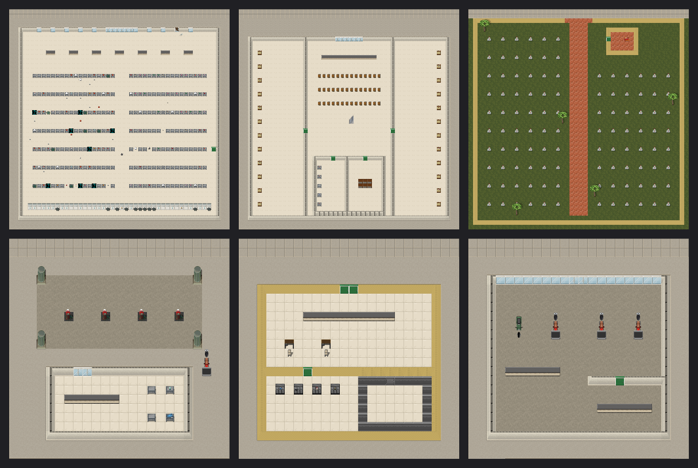

# Saigon 2000s: content bible (setting canon for Part B)

All mod content must be consistent with this document. Period: **the dry season, late 2004**. Place: **Thành phố Hồ Chí Minh (Sài Gòn)**, mainly Quận 1, Quận 3, Quận 5 (Chợ Lớn), Bình Thạnh, and the Thủ Thiêm marsh across the river.
Text rule: English prose, with Vietnamese terms kept in the original and marked with diacritics (e.g. "a bowl of phở"). Every name field is translatable, and the `vi` .po files come later.
Brand rule: no trademarks. Use "Wave-style 110cc underbone", not the real model name. Newspapers, TV channels and products are fictionalized.
Tone rule: no Vietnam War or wartime setting. Veterans may exist as older characters. The tone is respectful and everyday, not exotic.

## 1. Period texture (2004)
- **Transport.** Motorbikes are everywhere: 110cc underbones, Chinese copies, and a few 50cc scooters. There are xe ôm (motorbike taxis) at every corner, xích lô cyclos in District 1, xe ba gác (cargo tricycles, often motorized) for hauling, very few private cars, public buses, and water taxis and cargo ghe on the river and canals.
- **Tech.** Nokia-style phones, internet cafés running LAN games, VCD/DVD stalls, karaoke bars, CRT TVs, rooftop antennas, and 2G phones with prepaid cards.
- **Infrastructure.** Tangled overhead power and telephone cables. Stainless rooftop water tanks (bồn nước inox). Iron accordion shop gates (cửa sắt kéo). Barred windows. Narrow, deep lots. Ward loudspeakers (loa phường). Tidal street flooding (triều cường) in the wet season. The Nhiêu Lộc–Thị Nghè canal is polluted and under renovation.
- **Daily life.** Sidewalk cafés with tiny plastic stools. Street-food carts. Wet markets opening at 4 a.m. Household ancestor altars. Pagodas and Catholic churches. Morning exercise in parks. Afternoon downpours from May to November.
- **Currency.** Đồng (VND). Bills are loot with trade value only (see note in §6).

## 2. Outbreak premise (story)
- **Late 2004.** A regional "sốt lạ" (strange fever) is officially described as a new avian influenza strain. Wards run quarantine drives, and the loa phường broadcast hygiene notices.
- **The collapse happens during the dry season.** The fever's dead rise. Tân Sơn Nhất airport closes. The Saigon River bridges become chokepoints. The city's density turns every hẻm into a trap.
- **Blob/portal lore.** The dda metaplot (the blob, portals) stays compatible but is kept in the background. Local survivors call the risen "ma" (ghosts). Official broadcasts call them "người bệnh" (the sick).
- **The player starts** in the first days of the collapse. Evacuation is said to be heading toward Củ Chi and the delta, but the rumors conflict with each other.
- **Factions (pass 1: flavour only):**
  - Ward militia remnants (dân quân / công an phường)
  - Chợ Lớn merchant clans holding a fortified market
  - River people living on ghe boats (neutral traders)
  - A pagoda sheltering refugees

## 3. Districts for the vertical slice (one generated district)
| Zone | Key forms | Gameplay hooks |
|---|---|---|
| Main street (đường) | Rows of nhà ống shophouses, 3–5 floors. Ground-floor shops open behind iron gates. Parked motorbikes. | Gates and window bars make loud, slow entries. Rooftops connect for movement. Rooftop tanks provide water. |
| Hẻm labyrinth | Alleys 1–3 tiles wide with dead ends, tiny homes, altars, drying laundry, a hẻm café. | Close-quarters danger. Hard to drive through except by motorbike. |
| Chợ (wet market) | Large covered hall with stalls for fish, meat, vegetables, dry goods and gold. | Food-rich but it spoils fast in the heat, so it smells and draws zombies. Ice is the key resource. |
| Canal (kênh/rạch) | Polluted canal with stilt houses and small boats. | Boat routes. Water is unsafe until boiled. Wet-season floods. |
| Landmarks | Pagoda, church, old chung cư apartment block (pre-1975, 5 floors, open corridors), ward office, clinic, internet café, karaoke bar, motorbike repair shop, pharmacy (nhà thuốc), gold shop, school. | |

## 4. Professions (B3)
| ID suffix | Name | Skills | Kit highlights |
|---|---|---|---|
| xe_om | Xe ôm driver | driving 3, survival 1 | Underbone motorbike key, rain poncho, spare helmet, nón bảo hiểm |
| street_vendor | Street-food vendor | cooking 3 | Portable gas stove, pot, bowls, fish sauce, bánh mì stock |
| market_trader | Market trader | speech 3 | Scale, cash bag, bags of rice |
| student | University student | computers 2, first aid 1 | Backpack, textbooks, bicycle |
| cong_an | Ward police officer (công an phường) | melee 2, bashing 2 | Uniform, baton, whistle, radio. No pistol: ward police in 2004 rarely carried one (decision recorded in B3.R) |
| nurse | Hospital nurse | first aid 4 | Scrubs, medical kit, face masks (bird-flu era) |
| construction | Construction worker | fabrication 2, strength-focused | Hard hat, hammer, rebar, bamboo scaffolding pole |
| fisherman | Cần Giờ fisherman | swimming 3, survival 3 | Cast net, fishing rod, dao, conical hat |
| mechanic | Motorbike mechanic | mechanics 4 | Toolbox, tire pump, spark plugs |
| monk | Buddhist monk | first aid 1, speech 2 | Robes, prayer beads, sutra book, vegetarian diet trait if available |
| veteran | Elderly veteran | melee 2, rifle 2, survival 2 | Old field jacket, medal, bad knees trait |

## 5. Food & drink (B5a/B5b)
Target macros roughly follow USDA/VN food tables. Heat spoils food fast, so give realistic `spoils_in` values.

| Item | Notes | Spoils |
|---|---|---|
| phở bò (bowl) | Hot, comfort food, morale boost | 1 day |
| bánh mì thịt | Portable | 1 day |
| cơm tấm | Broken rice with pork | 1 day |
| broken rice / jasmine rice (bag) | Staple, craftable | long |
| nước mắm (bottle) | Condiment and preservative ingredient | very long |
| rau muống | Water spinach, forageable near canals | 3 days |
| instant noodles (gói mì) | Common loot, fictional brand | long |
| bánh chưng | Tết rice cake, long-lasting | 2 weeks |
| cà phê sữa đá / phin coffee filter / ground robusta | Stimulant, craftable | |
| trà đá | Iced tea, needs ice | |
| đá (ice block, from an ice factory) | Cooling resource | melts |
| chè | Sweet dessert soup | |
| dried squid, rice paper, fish, tropical fruit (mango, durian, jackfruit, dragon fruit) | | |

## 6. Gear & tools (B5c)
- **Clothing and gear:** nón lá (conical hat, rain and sun protection), nón bảo hiểm (thin motorbike helmet), áo mưa cánh dơi (bat-wing poncho), dép tổ ong (foam sandals), áo bà ba, sun-protection jacket and gloves, face mask.
- **Tools and containers:** dao rựa (machete), portable butane stove with canisters, thùng xốp (styrofoam cooler), plastic jerrycans, bình gas cylinder, phin filter, clay pot, bamboo pole, cast net.
- **Money:** Đồng notes, and gold chỉ/lượng (valuable to traders).

## 7. Vehicles (B6)
| Vehicle | Basis | Notes |
|---|---|---|
| Underbone motorbike 110cc | Existing motorcycle prototype | Fuel-efficient, small tank (~4 L), rack, 2 seats |
| Automatic scooter 50–125cc | Existing scooter | |
| Xe ba gác (motorized) | 3-wheel cargo frame + small engine | Large flatbed |
| Xích lô | Pedal cyclo, passenger seat in front | |
| Bicycle (xe đạp) | Existing | |
| Ghe (wooden cargo boat) | Boat hull parts, outboard or long-tail engine | |
| Xuồng (small rowboat) | Boat hull, oars | |

## 8. Books & media (B7)
- **Skill books:**
  - Motorbike repair handbook (mechanics)
  - Southern Vietnamese home cooking (cooking)
  - Nursing handbook (first aid)
  - Tailoring pattern book (tailoring)
  - Fishing almanac (survival/fishing)
  - Electronics repair for TV and radio (electronics)
  - Construction handbook (fabrication)
- **Fun/morale:**
  - Serialized wuxia novels (fictional titles)
  - Buddhist sutra booklet
  - Catholic prayer book
  - Fortune-telling almanac
  - Karaoke song books
  - Fictional newspapers: "Tin Nhanh Sài Gòn" daily, "Thể Thao" sports weekly
- **Recipe sources:** the cookbook teaches Vietnamese dish recipes, and the repair handbook teaches motorbike-part recipes.

## 9. Climate targets (B4)
Saigon: latitude 10.82°N, longitude 106.63°E.

| Month group | Mean temperature | Humidity | Rain |
|---|---|---|---|
| Dry (Dec–Apr) | 26–29 °C, April peak with highs of 35 °C | 65–75% | Rare |
| Wet (May–Nov) | 27–28 °C | 80–90% | Almost daily afternoon thunderstorms, 250–330 mm/month |

There is **no winter and never frost**. Annual range is only ~3 °C.
Gameplay goals:
- Heat stress and thirst matter more than cold.
- Rain is an asset for water collection but causes flooding.

## 10. Monsters (B9, light touch in pass 1)
- Reflavored zombie variants: the sick (người bệnh), a xe ôm zombie in a helmet (head armor), a market-worker zombie, a police zombie.
- Tropical fauna and pests: rats, stray dogs, feral chickens (bird-flu carriers), canal snakes, monitor lizards.
- Density: much higher human-zombie density per OMT than in dda cities. This needs a spawn and performance budget from A2/A3.

## 11. More Vietnamese items and places (units V1–V3, P1–P2, 2026-10-05)

| Group | Added | Where it spawns |
|---|---|---|
| Street food (V1) | trứng vịt lộn, bún bò Huế, bún thịt nướng, bánh cuốn, cháo lòng, bò bía, bánh flan, sữa đậu nành, green coconut (nước dừa), khô bò, lạp xưởng, mắm tôm | street carts, chợ, wholesale, shophouse kitchens, Co.op Mart |
| Household, tools, clothes (V2) | Rạng Đông vacuum flask, nồi đất, tamarind-wood chopping block, coconut-rib broom, aluminium kettle, lồng bàn, bơm vá xe kit, bamboo fishing pole, motorbike U-lock (a club), nón cối, đồ bộ, khăn rằn, dép quai hậu | kitchens, living rooms, moto shops, chợ cloth stalls, mall, zombie outfits |
| Media and festivals (V3) | robot-cat comic (fictionalised), drama VCDs, nhạc vàng cassette, lịch bloc with proverb pages, lì xì envelope, vàng mã, star lantern, bánh trung thu | homes, pagodas, temples, karaoke, net cafés, schools, bookstores |
| Shophouse businesses (P1) | barber, tailor (treadle sewing machine), electronics repair, thuốc bắc herbalist (herb-drawer wall, remedy packets), pawn shop, photocopy shop, bánh mì bakery, quán nhậu (clay grill, beer crates) | nhà ống ground floors (15 variants in all) |
| Everyday places (P2) | cây xăng (pumps with real gasoline), Co.op Mart (one per city), district hospital (one per city), ward police station (no guns), cemetery with tiled tombs, bookstore, motorbike dealer (new bikes) | city shop pool; the cemetery in the parks pool |

Top: Co.op Mart, district hospital, cemetery. Bottom: petrol station, ward police station, motorbike
dealer. Every place passes the structure test (doors reachable, indoors roofed, stairs paired), and every
new item has its own sprite.

## 12. Firearms (2026-10 policy)

The user changed the firearm rule in 2026-10 (unit W3): the map had too few guns. **Civilians and random
NPCs still carry none**, and only the guard class may hold one (the công an service pistol). Firearms
now also exist as **loot at police and army sites**, so a player can reach them by going there, past
their dead.

| Firearm (described, never named) | Cartridge (dda ammo) | Where |
|---|---|---|
| công an service pistol (N4) | 9x18mm | district police armory, army racks (rare), the guard class |
| folding-stock assault rifle, 30-round magazine | 7.62x39mm | army guard posts; district armory (rare) |
| semi-automatic carbine with folding bayonet, stripper clips | 7.62x39mm | army guard posts |
| pump-action riot shotgun | 12 gauge | district police armory |
| side-by-side shotgun | 12 gauge | border and militia racks (rare) |
| militia submachine gun, 35-round magazine | 7.62x25mm | district police armory |

- **Sites.** The district police headquarters (trụ sở công an quận: holding cells, the riot unit's
  lockers, a locked armory of gun safes) is one per city; ward police posts (đồn công an phường) are
  more common than before but still hold no guns. Army guard posts (đồn quân sự: a walled compound,
  a sandbagged gate post, barracks, a locked armory, a truck) stand on the city outskirts and in the
  countryside, and on the real map on OpenStreetMap's military sites.
- **Guards.** District police, riot police and soldier zombies in period uniforms (khaki-yellow
  công an, dark blue riot unit, olive army with the nón cối); some lie dormant in the cells and bunks.
  Their drops hold a gun only rarely.
- **Ammunition names.** dda names some cartridges after pistols (Makarov, Tokarev); the mod names
  them by the cartridge alone.
- **Audit.** `tools/saigon/audit_us_content.py` lists the police and army loot groups that may reach a
  firearm (`POLICE_ARMY_GUN_GROUPS`); any other loot that reaches one fails. Slingshots and crossbows
  (flag `PRIMITIVE_RANGED_WEAPON`) are not firearms for this rule.
