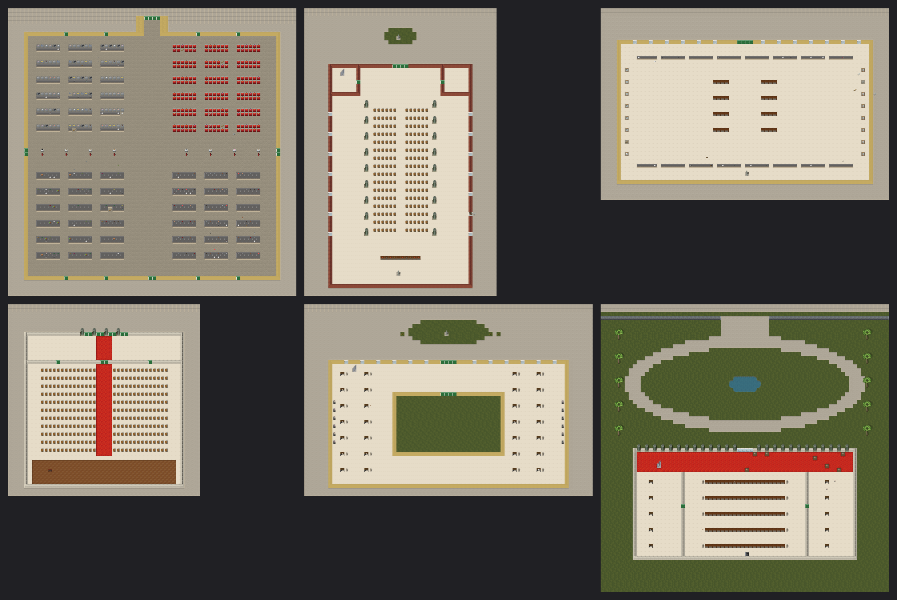
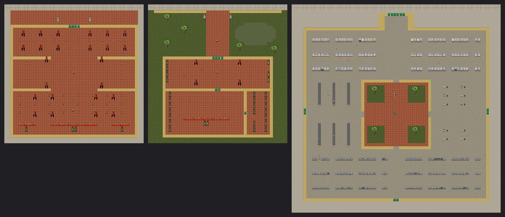
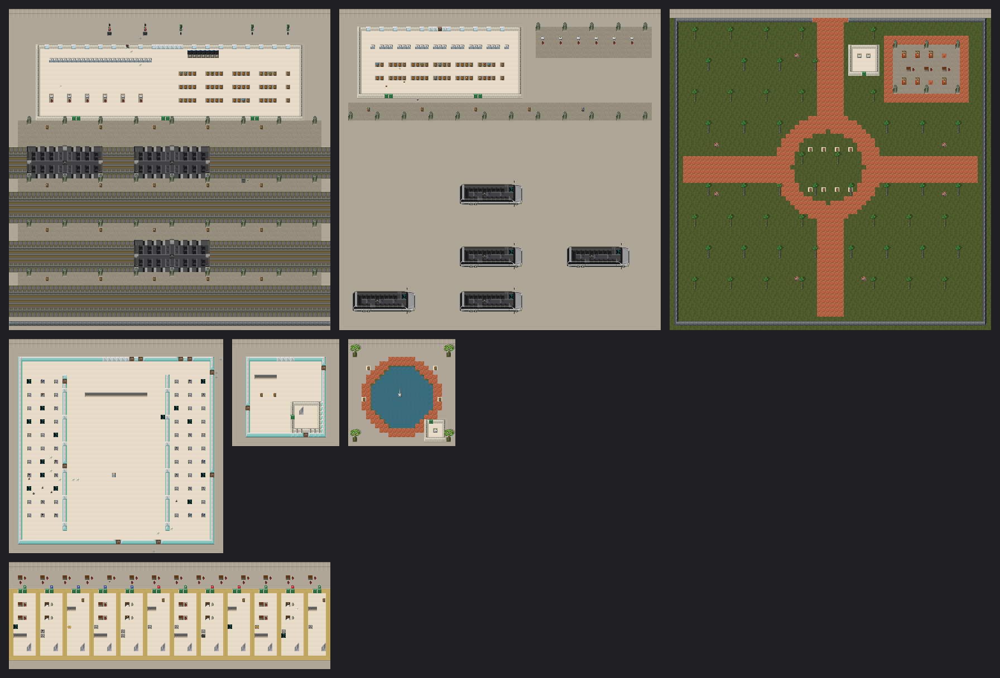
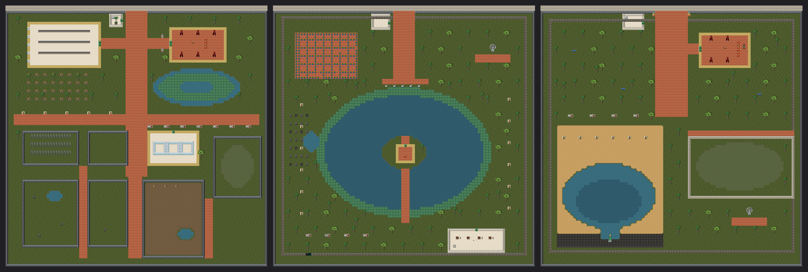

# Saigon landmarks of the 2000s: research and game plan

This doc covers the real places a 2004 survivor would recognise, what each was like at the time, and how each becomes a location on the game map.

Research date: 2026-10-04 (web sources at the end). **Period rule:** only places that existed in 2004 qualify.
- **In period:** Saigon Trade Center (1997), Diamond Plaza (1999), Đầm Sen (1999), Suối Tiên (1995).
- **Out of period:** Bitexco Financial Tower (2010), Landmark 81 (2018), the Thủ Thiêm tunnel and the metro.

## How a landmark becomes a map location
- **Placement:** each landmark is a multi-tile city building flagged `OVERMAP_UNIQUE` and `SAIGON`, so each Saigon overmap has at most one. Landmarks sit in the city's central shops pool at a high weight. They are tried early near the city centre, and once placed they drop out of the pool.
- **Scale:** one map tile (OMT) is 24 m. Real buildings are scaled to a footprint of at most 3×3 OMT so they fit a city block. The proportions and the recognisable parts (towers, gates, lawns, courtyards) are kept.
- **Orientation:** a city building faces the street it is placed on. In the generator's local frame the street is to the north, so the main façade or gate is on the north edge.
- **What every landmark gets:**
  - mapgen built from one large grid (`tools/saigon/gen_saigon_landmarks.py`);
  - roofs for every storey;
  - loot that matches its function;
  - a few awake and dormant zombies within the d3_r3 budget;
  - its own map icon;
  - a structure test (doors reachable from the street, every indoor tile roofed).

## The landmarks

| # | Place (2000s name) | Built | Real footprint | Game footprint | What makes it recognisable | Gameplay role | Phase |
|---|---|---|---|---|---|---|---|
| 1 | **Chợ Bến Thành** (Bến Thành Market) | 1912–1914 | 100 × 80 m, 13,056 m²; 4 main gates, 12 side gates, two 20 m crossing aisles; three-sided **clock tower over the south gate** facing Quách Thị Trang roundabout | 3 × 3 | Clock-tower gate on the street; four hall quadrants divided by a cross of wide aisles; cloth, food, dry goods and gold stalls | Huge loot (food, cloth, gold), and a deathtrap | **L1** |
| 2 | **Nhà thờ Đức Bà** (Notre-Dame Cathedral) | 1863–1880; towers 1895 | 91 × 35.5 m; nave vault 21 m; **two 57.6 m bell towers**; red Toulouse brick; on Công xã Paris square, opposite the post office | 2 × 3 | Red-brick façade with **twin towers** (climbable to z3), Virgin Mary statue on the square in front, long nave with side aisles | Vantage point; refugee crowd inside | **L1** |
| 3 | **Bưu điện Thành phố** (Central Post Office) | 1886–1891, by Alfred Foulhoux (often wrongly credited to Eiffel) | Long yellow-and-white façade on Công xã Paris square, arched vaulted hall, wooden phone booths, painted maps, a portrait of Hồ Chí Minh | 3 × 2 | **Long ochre façade with a central clock**, barrel-vaulted hall, rows of counters and booths | Paper, phone cards, a few valuables | **L1** |
| 4 | **Nhà hát Thành phố** (Municipal Theatre / Opera House) | 1898–1900 | Lam Sơn square, beside the Continental Hotel (1880) | 2 × 2 | Cream façade with a **great arched entrance**, a horseshoe auditorium of seat rows, a stage | Quiet loot; the stage | **L1** |
| 5 | **UBND Thành phố** (City Hall, ex-Hôtel de Ville) | 1898–1908 | Beaux-Arts, at the head of Nguyễn Huệ boulevard; Hồ Chí Minh statue in the small park in front | 3 × 2 | **Yellow façade with a central clock tower**, an inner courtyard, office wings, the statue on the plaza | Official documents; city keys (lore) | **L1** |
| 6 | **Dinh Độc Lập / Hội trường Thống Nhất** (Independence / Reunification Palace) | 1962–1966 | 12 ha grounds; the building is 80 m wide; **oval front lawn of 102 m**; at the end of Lê Duẩn; bunker below | 3 × 3 | Gate and fence on the street, **oval lawn with a fountain**, the long modernist palace with concrete brise-soleil fins, a bunker at z−1 | A fortress; the bunker's war-room loot | **L1** |
| 7 | **Chợ Bình Tây** (Bình Tây Market, Chợ Lớn) | 1928–1930 | Bagua-style hall around a **central courtyard** with a fountain | 3 × 3 | Courtyard ringed by stalls, tiled roofs, Chinese-Vietnamese wholesale goods | Bulk food and goods | **L2** ✓ |
| 8 | **Chùa Bà Thiên Hậu** (Thiên Hậu Temple, Chợ Lớn) | c. 1760 | Courtyard temple, **incense coils hanging from the ceiling** | 2 × 2 | Courtyards, red-and-gold altars, hanging incense spirals | Incense and candles; sanctuary | **L2** ✓ |
| 9 | **Chùa Ngọc Hoàng** (Jade Emperor Pagoda, Đa Kao) | 1909 | Taoist temple, dark smoky halls full of statues, a turtle pond | 2 × 2 | Turtle pond, statue halls | Atmosphere; a few valuables | **L2** ✓ |
| 10 | **Nhà thờ Tân Định** (the pink church) | 1876; pink since 1957 | | — | Already covered by the generic pink `sgn_nha_tho` (B8h) | — | done |
| 11 | **Ga Sài Gòn** (Saigon Railway Station) | 1978–1983 | 1 Nguyễn Thông, District 3; the southern terminus of the North–South line | 3 × 3 | Station hall, platforms, stalled trains | Way out north (lore); train scrap | **L3** ✓ |
| 12 | **Bến xe Miền Đông** (Eastern Bus Station) | Bình Thạnh, built 1985–1990, in its role from 1996 | Huge yard of coaches | 3 × 3 | Bus yard full of coaches, ticket hall | Vehicles, fuel, an evacuation-chaos story | **L3** ✓ |
| 13 | **Công viên Tao Đàn** (Tao Đàn Park) | 1860s | 10 ha of old trees behind the palace; the bird cafés | 3 × 3 | Old-tree park, bird-cage café | Safe-ish green space | **L3** ✓ |
| 14 | **Hồ Con Rùa** (Turtle Lake) | late 1960s | 3,800 m² fountain roundabout | 1 × 1 | Round pool with a concrete monument | A meeting point | **L3** ✓ |
| 15 | **Saigon Trade Center** | 1997 | 145 m, the tallest in Vietnam 1997–2010 | 1 × 1, tall | Glass tower | A vantage point (multi-z) | **L3** ✓ |
| 16 | **Diamond Plaza** | 1999 | Mall beside the cathedral | 2 × 2 | Mall atrium | Mall loot | **L3** ✓ |
| 17 | **Phạm Ngũ Lão – Bùi Viện** | backpacker street, busy from the early 2000s | A street of guesthouses, bars and travel agents | row | Shophouse row variant: guesthouses and bars | Foreign loot (passports, dollars) | **L3** ✓ |
| 18 | **Thảo Cầm Viên** (Saigon Zoo) | 1864–1865 | 20 ha | 4 × 4 | Animal enclosures | Escaped animals | **L4** ✓ |
| 19 | **Đầm Sen / Suối Tiên** (amusement parks) | 1999 / 1995 | | 4 × 4 | Rides | Set pieces | **L4** ✓ |

Out of period, so not built: **Bitexco Financial Tower** (opened 31 Oct 2010), **Landmark 81** (2018) and the **metro**.

## L1 as built

Generated ground floors, rendered with the mod tileset (`render_scene.py` on a `[saigon_landmark_scene]` dump). Top row: Chợ Bến Thành, Nhà thờ Đức Bà, Bưu điện. Bottom row: Nhà hát, UBND Thành phố, Dinh Độc Lập.

Each is `OVERMAP_UNIQUE`, so a city gets at most one of each. A landmark needs a city block deep enough for its footprint, so a 3×3 one can be missing from a given overmap (the first test overmap placed 4 of 6).

## L2 as built

Chùa Bà Thiên Hậu, Chùa Ngọc Hoàng, Chợ Bình Tây (left to right), ground floors:

- **Thiên Hậu:** guardian lions in the forecourt; a gate hall of red lacquered pillars; the open courtyard
  with the great bronze burner; side galleries; the main hall hung with incense coils that still smoulder;
  the goddess's altar flanked by side altars. Green glazed roofs. Loot `sgn_temple`.
- **Ngọc Hoàng:** a walled garden with the turtle pond and trees; a front hall of guardian statues; the
  Jade Emperor's altar with his court along the wall; the dark Hall of the Ten Hells to the east, lined with
  the judges.
- **Bình Tây:** the clock-tower gate on the street; four wings of stalls (rice and grain by the sack,
  produce, food stalls, household goods) around a garden courtyard with the founder's statue and the dragon
  fountain. Terracotta roofs. Loot `sgn_cho_wholesale`.

These three have a lower region weight than L1 (150), so a city still gets District 1 first.

## L3 as built

Top: Ga Sài Gòn, Bến xe Miền Đông, Công viên Tao Đàn. Middle: Diamond Plaza, Saigon Trade Center
(lobby), Hồ Con Rùa. Bottom: Phạm Ngũ Lão – Bùi Viện. Ground floors:

- **Ga Sài Gòn** (3×3): forecourt with parked xe ôm, the ticket hall (windows, flip-slat departure
  boards, benches, food stalls), four covered platforms and four tracks. Stranded passenger cars and
  locomotives from dda's trains sit on the tracks, each kept inside one map tile. Loot: abandoned
  luggage (`sgn_train_station`).
- **Bến xe Miền Đông** (3×3): the ticket hall of the coach companies, kiosks under a canopy, the
  loading bays, and a yard of up to twelve coaches.
- **Công viên Tao Đàn** (3×3): a fenced park of old sao trees, cross walks and a round centre, stone
  chess tables, and the bird café pavilion with its cages and kitchen kiosk.
- **Hồ Con Rùa** (1×1): the round pool with the lotus-and-spire monument, benches on the rim, and a
  drinks kiosk.
- **Saigon Trade Center** (1×1, 10 storeys + roof): a blue-green glass tower with a lobby, eight
  office floors around a stair core, and a sky lounge at the top. It is the tallest vantage point in
  the city.
- **Diamond Plaza** (2×2, 3 floors): boutiques around an atrium with escalators (they work as stairs),
  a department-store floor (shoes, electronics), and the food court and cinema on top. Loot
  `sgn_mall_fashion`: tropical fashion of 2004.
- **Phạm Ngũ Lão – Bùi Viện** (3×1, 3 floors): twelve narrow lots of bars, travel agents and guesthouse
  lobbies, beer tables and red plastic stools on the sidewalk under the signs, and guesthouse rooms
  above. Loot `sgn_tourist`: passports, US dollars, guidebooks, cameras, beer.

L3 region weight is 120, below L1 (200) and L2 (150).

## L4 as built: the zoo and the amusement parks

Thảo Cầm Viên, Đầm Sen, Suối Tiên (left to right), ground floors:

- **Thảo Cầm Viên** (4×4, founded 1864). The gate opens onto an avenue with the history museum
  (display halls) on one side and the Hùng Kings temple (red pillars, altar, guardian lions) on the
  other. Beyond are old trees, an orchid-and-bonsai garden and a lotus lake. South of the cross walk
  are the enclosures: tigers, bears, a deer paddock, macaques in the primate cages, pythons in the
  reptile house's glass tanks, an elephant yard with hay, and the crocodile garden. The animals are
  alive and inside their fences, for now. The test `saigon_zoo_animals` checks that every species spawns.
- **Đầm Sen** (4×4, opened 1999). A big lake with lotus round its edge, an island pagoda reached by a
  causeway, swan pedal boats at the jetty, the Ferris wheel, a rock garden with a waterfall pool, the
  Nam Tú royal garden of bonsai, a restaurant, and the park train circling inside the fence. The
  water-music show (2005) is after the setting, so it is left out.
- **Suối Tiên** (4×4, opened 1995). Kỳ lân guardians at the gate, the Buddha temple, giant painted
  dragons in the gardens, and Biển Tiên Đồng: an artificial beach and lagoon under a cliff, where
  Lạc Long Quân stands over the waterfall. Also the railed Crocodile Kingdom lake full of crocodiles,
  the Ferris wheel and the park train.

New animals (monsters/zoo.json) are the Asian elephant, Siamese crocodile, long-tailed macaque and
reticulated python; tigers, bears and deer are dda's. Region weight is 100, the lowest of the landmarks.
On the three reference overmaps all 19 landmarks were placed.

## District 1 geography (for later, optional)
The real District 1 core is compact: the cathedral faces the post office across Công xã Paris square, Lê Duẩn runs from the cathedral to the palace, and Đồng Khởi runs from the cathedral to the Opera House and the Continental on Lam Sơn square. City Hall heads Nguyễn Huệ, and Bến Thành sits on Quách Thị Trang roundabout at the end of Lê Lợi.

A later unit could place these together as one hand-laid "Quận 1" overmap special, streets included. Pass 1 places them as separate city buildings, which keeps every landmark in the city fabric without fighting the street generator.

## Sources
- Bitexco Financial Tower, opened 2010: https://en.wikipedia.org/wiki/Bitexco_Financial_Tower
- Saigon Trade Center, 1997, tallest until 2010: https://en.wikipedia.org/wiki/Saigon_Trade_Center
- Diamond Plaza, 1999: https://en.wikipedia.org/wiki/Diamond_Plaza
- Bến Thành Market, 1912–1914, 13,056 m², gates, clock tower: https://en.wikipedia.org/wiki/B%E1%BA%BFn_Th%C3%A0nh_Market and https://www.ben-thanh-market.com/about
- Notre-Dame Cathedral, 91 × 35.5 m, 57.6 m towers: https://en.wikipedia.org/wiki/Notre-Dame_Cathedral_Basilica_of_Saigon
- Central Post Office, 1886–1891, Foulhoux: https://en.wikipedia.org/wiki/Saigon_Central_Post_Office
- Opera House, 1898–1900: https://en.wikipedia.org/wiki/Ho_Chi_Minh_City_Opera_House
- Hotel Continental, 1880: https://en.wikipedia.org/wiki/Hotel_Continental_Saigon
- City Hall, 1898–1908: https://en.wikipedia.org/wiki/Ho_Chi_Minh_City_Hall
- Independence Palace, 12 ha, 80 m wide, 102 m oval lawn: https://vietnamdiscovery.com/ho-chi-minh-city/attractions/reunification-palace/
- Bình Tây Market, 1928–1930, central courtyard: https://en.wikipedia.org/wiki/B%C3%ACnh_T%C3%A2y_Market
- Thiên Hậu Temple, c. 1760: https://en.wikipedia.org/wiki/Thien_Hau_Temple_(Cholon)
- Jade Emperor Pagoda, 1909: https://en.wikipedia.org/wiki/Jade_Emperor_Pagoda
- Tân Định Church, 1876, pink since 1957: https://junglebosstours.com/explorer/tourism-blog/tan-dinh-church
- Saigon station, 1978–1983: https://en.wikipedia.org/wiki/Saigon_station
- Miền Đông bus station: https://scootersaigonadventure.com/mien-dong-bus-station-eastern-bus-terminal-ho-chi-minh-city/
- Phạm Ngũ Lão – Bùi Viện: https://en.wikipedia.org/wiki/Ph%E1%BA%A1m_Ng%C5%A9_L%C3%A3o_%E2%80%93_B%C3%B9i_Vi%E1%BB%87n
- Tao Đàn Park: https://vinwonders.com/en/wonderpedia/news/tao-dan-park-tranquil-oasis-amidst-ho-chi-minh-city/
- Turtle Lake: https://en.wikipedia.org/wiki/Turtle_Lake_(Ho_Chi_Minh_City)
- Suối Tiên, 1995: https://en.wikipedia.org/wiki/Su%E1%BB%91i_Ti%C3%AAn_Amusement_Park
- Thảo Cầm Viên, 1864–1865: https://en.wikipedia.org/wiki/Saigon_Zoo_and_Botanical_Gardens
- Đầm Sen Park (50 ha, 20 % lakes, Ferris wheel, monorail, rock garden; water show 2005): https://en.wikipedia.org/wiki/%C4%90%E1%BA%A7m_Sen_Park
- Đầm Sen, opened 1999: https://vietnamdiscovery.com/ho-chi-minh-city/activities/dam-sen-park/ and https://localvietnam.com/ho-chi-minh-city/dam-sen-park-water-park/
