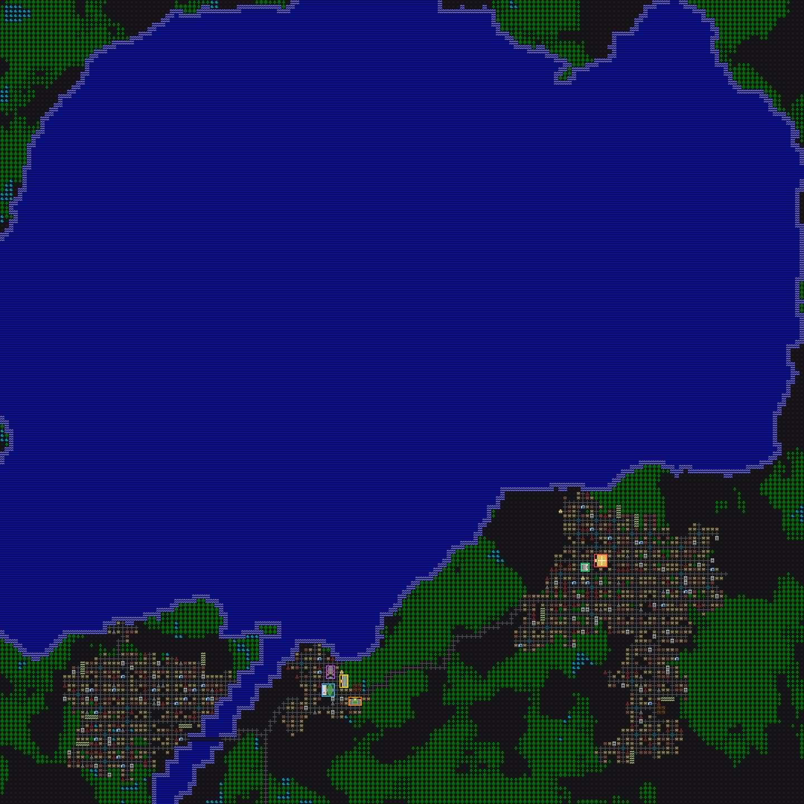
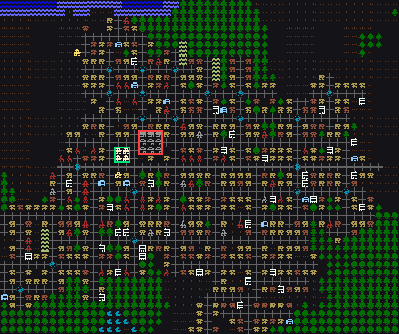
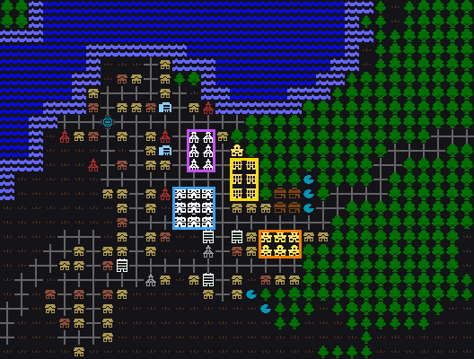
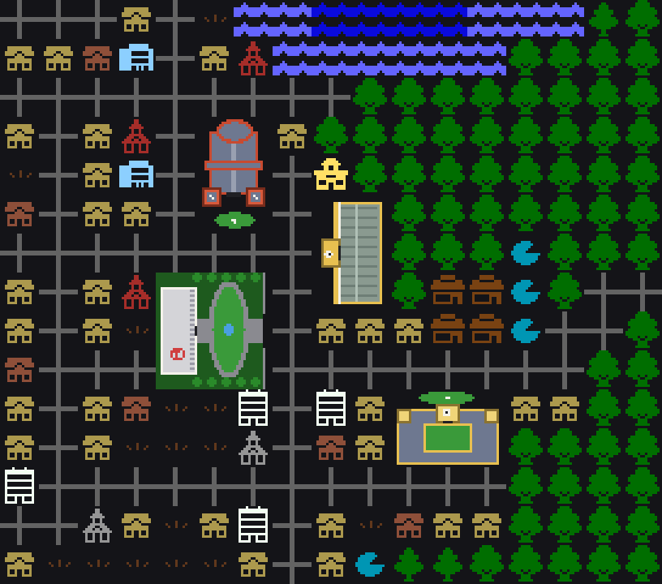
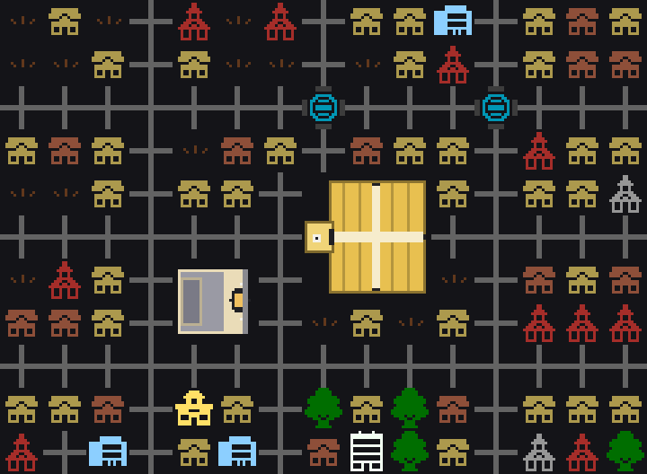
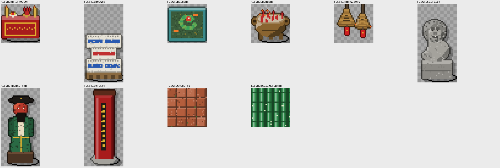

# The Saigon map: what it looks like now, and how to add landmarks

## 1. The current map

One whole generated overmap (180 × 180 overmap tiles; one tile is one 24 × 24 local map),
with the Saigon region, seed 4242. It is rendered with the game's own overmap tilesets
(Larwick Overmap plus the mod's icons). The six District 1 landmarks have coloured outlines.



| Outline | Landmark | OMT x,y (north-west) | Size |
|---|---|---|---|
| red | Chợ Bến Thành | 133,124 | 3×3 |
| green | Nhà hát Thành phố | 130,126 | 2×2 |
| purple | Nhà thờ Đức Bà | 73,149 | 2×3 |
| yellow | Bưu điện Thành phố | 76,151 | 2×3 (rotated) |
| blue | Dinh Độc Lập | 72,153 | 3×3 |
| orange | UBND Thành phố | 78,156 | 3×2 |

Close-ups. The east city has Bến Thành and the opera house:



The small town has the cathedral, the post office, the palace and City Hall:



**What the overmap is made of (this seed)**

| Land use | Share |
|---|---|
| Lake | 65.1 % |
| Forest | 14.8 % |
| Field | 12.0 % |
| Road | 3.6 % |
| Saigon buildings (nhà ống, hẻm, chùa, chung cư, chợ, …) | 3.3 % |
| River | 1.0 % |
| Landmarks / canal | 0.1 % each |

### Problems this map shows

1. **One huge lake covers two thirds of the overmap.** The Saigon region inherits the dda lake
   settings. Saigon is a river-and-canal city with no big lakes, so lakes should be rare and the
   Saigon River should be wide.
2. **The landmarks are scattered.** The landmarks are city buildings, so each one lands wherever a city has a big enough
   block. In this seed that put them in two different towns. In the real city they all stand within about 1 km
   of each other in District 1.
3. **The cities are small and separate.** Saigon should read as one dense metropolis.
4. ~~**Big landmarks show as repeated icons.**~~ Fixed in A1: each landmark is now one plan-view picture
   spread over its tiles, and it turns with the building:





   Đức Bà (towers and the Mary statue, facing south here), the post office (vaulted roof, clock, facing west), the palace
   (oval lawn, fountain, fins, the roof helipad, facing east), City Hall (statue garden, courtyard, clock tower),
   Bến Thành (skylit cross aisles, clock-tower gate, facing west) and the opera house (arched entrance, fly tower).

How to regenerate these pictures:

```bash
SAIGON_OVERMAP_OUT=om.json SAIGON_OVERMAP_SEED=4242 tests/cata_test --mods=dda,saigon_2000s "[saigon_overmap]"
```
```bash
python3 tools/saigon/art/render_overmap.py om.json overmap.png --scale 0.5 --landmarks landmarks.md
```
```bash
python3 tools/saigon/art/render_overmap.py om.json closeup.png --crop 116,108,164,148 --no-outline --zoom 3
```

## 2. How a landmark gets a position today

`tools/saigon/gen_saigon_landmarks.py` writes, for each landmark:

- the `mapgen` for every piece and z-level (`mapgen/landmarks/saigon_landmarks.json`);
- one `overmap_terrain` per piece (`sgn_lm_<name>_<x><y>`, plus `_z<n>` above ground and `_b` for the basement);
- one `city_building` that ties the pieces together (`overmap/saigon_landmarks.json`).

The region (`region/region_settings.json`, `sgn_city` → `shops`) lists each landmark with a weight.
When the overmap generator fills a city block, it draws from that list. These knobs decide where a
landmark appears:

| Knob | Where | Effect |
|---|---|---|
| `weight` in `sgn_city.shops` | region_settings.json | How often the generator tries it (L1 uses 200) |
| `flags`: `OVERMAP_UNIQUE` / `CITY_UNIQUE` / `GLOBALLY_UNIQUE` | the city_building | At most one per overmap / per city / per world |
| `city_sizes: [min, max]` | the city_building | Only in cities of this size (L1: 6 and up) |
| Footprint (w × h) | the builder | Needs a free block that deep; 3×3 sometimes finds none |

## 3. Process: adding a new landmark

| Step | What | Files |
|---|---|---|
| 1 | Research: what it looked like in the 2000s, footprint, recognisable parts, gameplay role. Drop anything built after 2009. | `doc/saigon/LANDMARKS.md` |
| 2 | Write a builder function. Use `Level(w, h)` grids with `rect` / `box` / `at` / `ellipse`, one level per z, and `roof_over()` for roofs. Put stairs at the same x,y on both floors. Add it to the landmark list with id, size, z-range and name. | `tools/saigon/gen_saigon_landmarks.py` |
| 3 | Add any new terrain or furniture, copied from a dda one where possible. | `furniture/terrain.json`, `furniture/furniture.json` |
| 4 | Add a loot group and map its palette symbol. | `itemgroups/loot.json`, palette `sgn_lm` in the generator |
| 5 | Choose where it appears: region weight, uniqueness flag and city size, or a district slot (section 4). | `region/region_settings.json`, generator |
| 6 | Run the generator. | `python3 tools/saigon/gen_saigon_landmarks.py` |
| 7 | Make sprites for each new terrain and furniture (drawn or derived), plus the overmap picture. Then pack and validate. | `art/saigon/drawn/*.py`, `derive_*recipes.json`, `draw_sprites.py`, `build_sprites.py`, `validate_tileset.py` |
| 8 | Add it to the structure test: doors reachable, indoors roofed, stairs paired. | `tests/saigon_landmarks_test.cpp` |
| 9 | Look at it: dump and render the building, and render the overmap. | `[saigon_landmark_scene]` + `render_scene.py`, `[saigon_overmap]` + `render_overmap.py` |
| 10 | Run the QA gate (`check_mod.sh`, the `[saigon]` tests, a real game load), then add a ledger row and commit. | `tools/saigon/*.sh`, `doc/saigon/PROGRESS.md` |

## 4. Proposed: a real District 1 layout (a "district special")

Instead of scattering the landmarks, place them **together**, arranged roughly as in the real city
(compressed, since one overmap tile is only 24 m). This would be one `overmap_special`,
`sgn_district1`. It is `GLOBALLY_UNIQUE` and sits next to the biggest city (`city_distance [0, 3]`),
with its own boulevards that join the city's roads. The landmarks keep their `city_building`
entries at a low weight as a fallback.

```
 north ↑            . = street block (nhà ống / hẻm), = = boulevard / park
 P P P = = = . . . . . .     P  Dinh Độc Lập, facing south-east over Công viên 30/4
 P P P = = = . . . . . .
 P P P = = = D D B B B .     D  Nhà thờ Đức Bà on Công xã Paris square
 . . . . . . D D B B B .     B  Bưu điện, the east side of the same square
 . . . . . . D D . . . .        Đồng Khởi runs south-east from the cathedral ...
 . . . . U U U . N N . .     U  UBND at the head of Nguyễn Huệ
 . . . . U U U . N N . .     N  Nhà hát on Lam Sơn square (Đồng Khởi)
 . M M M = = Lê Lợi = = .     Lê Lợi runs south-west from the opera house ...
 . M M M . . . . . . . .     M  Chợ Bến Thành at the roundabout
 . M M M . . . . . . . .
 ~ ~ ~ ~ ~ Sông Sài Gòn ~ ~   the river closes the south-east edge
```

Adding a landmark to the district later means giving it a slot in this layout: steps 1–4 and 6–10
of section 3, with step 5 replaced by a slot in the district.

## 5. Asset plan (started)

| Unit | Assets | Status |
|---|---|---|
| A1 | Overmap pictures for the six L1 landmarks: one plan-view picture per landmark, sliced over its tiles (16 × 16 per piece), rotating with the building. `art/saigon/drawn/landmark_map.py`, 40 pieces | done |
| A2 | L2 sprites (Chợ Lớn), in `art/saigon/drawn/cholon.py` with game objects in `furniture/cholon.json`. Thiên Hậu: hanging incense coils (they give off incense smoke), the bronze incense burner (also smoking), the temple altar, the stone guardian lion, red lacquered pillars, green glazed roof, terracotta courtyard tiles. Ngọc Hoàng: the carved deity statue (the turtle pond uses the canal's murky water). Bình Tây: rice-sack stacks (a container; smash them and rice spills out), the dragon fountain. Preview:  | done |
| A3 | Overmap pictures for the L2 landmarks | after A2 |
| A4 | District 1 special and the lake fix, from sections 1 and 4 (map design, not art) | proposed |
