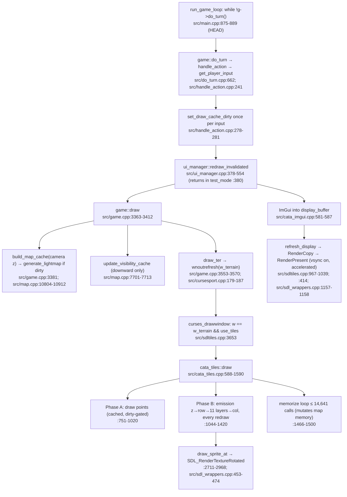
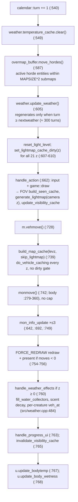
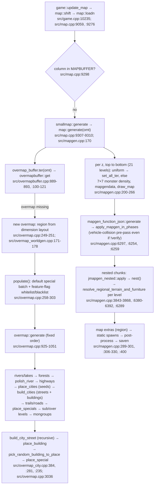
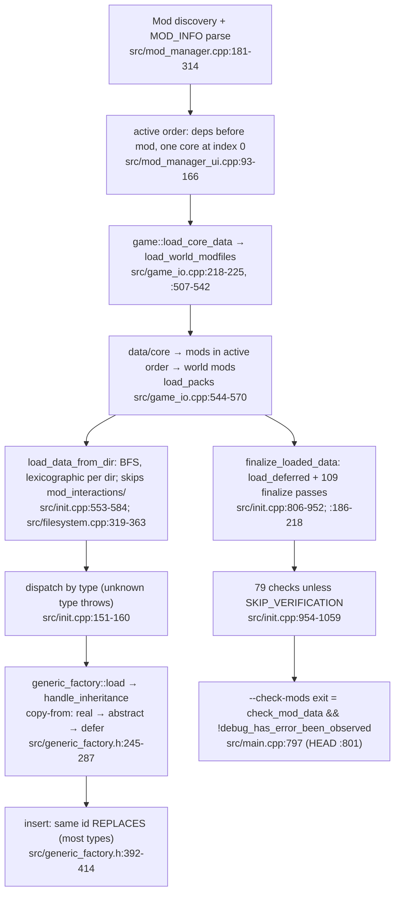
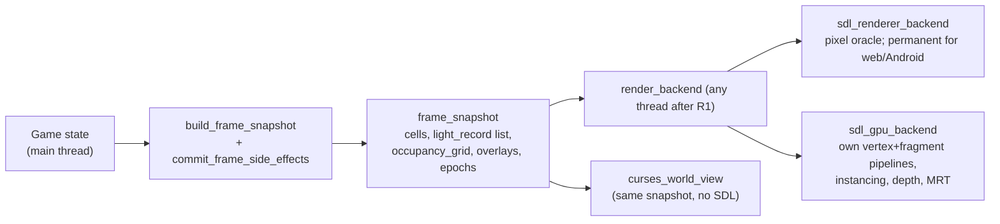
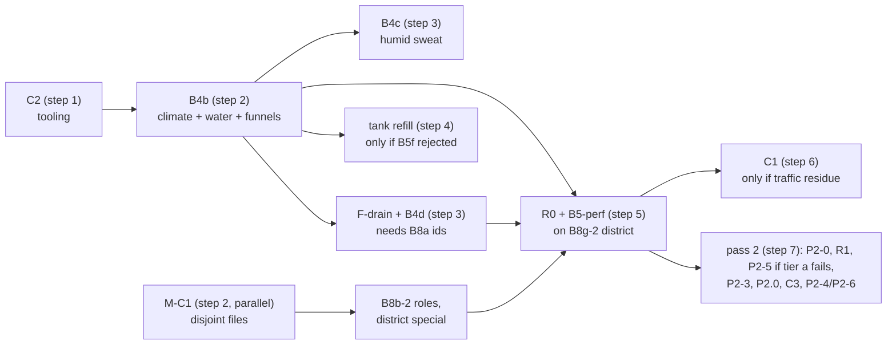

# CDDA Saigon: Master Architecture & Migration TDD

<!-- STATUS: all chapters drafted (A6.1–A6.3). Next: A6.4 citation check. -->

## 0. Document control

| Field | Value |
|---|---|
| Document | `doc/saigon/TDD.md`: Master Architecture & Migration Technical Design Document, CDDA "Sài Gòn 2000s" fork |
| Units | A6.1 (ch. 1–2), A6.2 (ch. 3–4), A6.3 (ch. 5–9, appendices); A6.4 runs the citation checker over this file |
| Upstream base | `CleverRaven/Cataclysm-DDA` @ `fe6a10c2b1425882574b4ad7bfbebc4c6170dbf8` (2026-09-28) |
| Branch / HEAD when written | `saigon/pass1-vertical-slice` @ `44cd8418bf` (ledger I-B6d2; B6d-2 route (c) landed in `18ab858a66` while this document was written). The working tree also holds an **uncommitted, in-progress B4b** (`src/weather_gen.{h,cpp}`, `region/weather.json`, `tests/saigon_weather_test.cpp`); it is not reviewed here, and §3.3.3 is its specification |
| Status | Draft 1.0 for A6.4. Normative for Part B and pass 2 once A6.4 reports zero citation misses |
| Supersedes | The "≤ 33 ms / 30 moves/s" target of `d1_r3` §6.3 (replaced by the tiered budget, ch. 5); every `sg_` id in `d2_r3` (restated as `sgn_`, §3.2) |

### 0.1 Inputs and their verdicts

| Domain | Final report | Critic verdict | Conditions carried into this TDD |
|---|---|---|---|
| D1 Rendering & UI | `analysis/d1_r3.md` | **REJECT → accepted into TDD with conditions** (0 BLOCKER / 2 MAJOR / 9 MINOR, 0.2 % citation failure; `critic_d1_r3.md`) | Two blocking spec conditions: **TDD-RR-D1-01** (fix (a) must be epoch-keyed, never clear a level generated in the current epoch; `[lightmap][multiz]` steps 1–8) and **TDD-RR-D1-02** (per-turn budget must close including the move redraw and R1 memorize). Eight required changes (critic_d1_r3 "Required changes" 1–8). Absorbed in §3.1 and ch. 5 |
| D2 Mapgen & Worldgen | `analysis/d2_r3.md` | **PASS** (0 / 0 / 9 MINOR, 0.0 %; `critic_d2_r3.md`) | D1–D9 + missed topic → register TR-D2-01..16 (ch. 8); D5 tank amount and D1 stair fix already implemented (§3.2) |
| D3 Climate & Vehicles | `analysis/d3_r3.md` | **REJECT → accepted with 11 binding conditions** (0 / 1 MAJOR / 9 MINOR, 0.9 %; `critic_d3_r3.md`) | Binding: `humid_sweat_efficiency` must discriminate and actually enable the option (D1); `DRAINS_WHEN_DRY` is an enum flag, F-drain test moves ≥ 7 submaps (D-m2); Sep–Nov flood water is 1–12 °C before B4b (D-m5); keep `dry_share ≤ 0.02` (D-m6); funnel test numerics (D-m7); flood harness preconditions (D-m8); one option-cache mechanism (D-m9). Absorbed in §3.3 |
| D4 JSON & Modding | `analysis/d4_r3.md` | **PASS** (0 / 0 / 4 MINOR, 0.0 %; `critic_d4_r3.md`) | `--check-mods` is rc 0 when the failing mod is not last (D1, probe P1); C2 `failed` must be function-scoped; user-CPU time is the load-time metric (D2); MIGRATION caveat rescoped (D3). L1 (`xedra_evolved_innawoods` in `conflicts`) is **done** (`modinfo.json`). Register RR-D4-1..11 |
| Cross-domain | `analysis/integration.md` (A5) | 0 BLOCKER / 19 MAJOR / 21 MINOR | The §10 resolution list (27 items) is tracked unit-by-unit in ch. 7–8; §10.27 TDD duties are discharged as listed in §0.3 |
| Canon | `CONTENT_BIBLE.md` | — | Ch. 4 maps every canon item to a mechanism or marks it flavour-only |
| Plan / ledger | `PLAN.md`, `PROGRESS.md` | — | Ch. 7 reproduces done/remaining units with commit SHAs |

### 0.2 Conventions

- **Citations** are `path:line` against the base SHA unless marked `HEAD`. Only `src/game.cpp` and `src/main.cpp` differ (the C6 hunks): `src/game.cpp` base lines ≥ 556 are **+7** at HEAD; `src/main.cpp` base 778–779 are +3 and base ≥ 780 are **+4** (critic_d4_r3 D4). Mod files are cited by path plus JSON id.
- **Evidence labels.** [V] verified by reading code; [M] measured at runtime (command named); [CALC] derived arithmetic; **UNVERIFIED** not yet measured or run; **DECISION** a choice made by this TDD, binding until changed here.
- **Ids.** Every Saigon id uses the `sgn_` prefix. Vehicle prototypes are `sgn_veh_*`, vehicle groups `sgn_vg_*` (RR-D4-4). `d2_r3`'s `sg_*` ids are obsolete (integration I3-6).
- **Units.** Part B ids from `PROGRESS.md` (B4b, B8b-2 …); integration resolution units are prefixed `I-` in the ledger; renderer phases R0–R5 (d1); d4 seams C1–C6; the d2 neighbour seam is **M-C1** (it clashes with d4's C1).

### 0.3 How integration §10.27 is discharged

| §10.27 duty | Where |
|---|---|
| Restate d2 ids as `sgn_` (I3-6) | §3.2.1 id table; every mapgen id in this document |
| Copy the d1 emitter rule into the mapgen chapter (I1-1c) | §3.2.9 (rule ML-1..ML-6, verbatim d1 §7 rule 2 plus the integration amendments) |
| Replace "≤ 33 ms / 30 moves/s" with the tiers (I5-1) | Ch. 5.1–5.2 |
| Adopt the spike rule (I5-3) | §5.4 |
| Record the global weather-type leak (I4-4) and the `no_hope` rationale (I4-3) | §3.4.4 |
| Put §9.2 into merge maintenance | §1.4 and ch. 6 |
| Register every MAJOR with its owner | Ch. 8, table 8.5 |

### 0.4 How to read this document

| Reader | Read |
|---|---|
| Content author (JSON) | §1.2, §3.2, §3.4, ch. 4, §5.3 entity budgets |
| C++ engineer (pass 1 seams) | §1.4, ch. 2, §3.3, ch. 6, ch. 9 |
| Renderer engineer | §2.1, §3.1, ch. 5, R-phases in ch. 7 |
| Producer / reviewer | ch. 1, ch. 7, ch. 8 |

**Change control.** Any change to a budget (ch. 5), a seam order (ch. 6) or an authoring rule (§3.1.4, §3.2.9, §3.4.3) is made in this file in the same commit as the code or JSON that needs it, and the ledger row cites the TDD section.

---

## 1. Executive summary and architecture decision

### 1.1 What is being built

A total conversion of CDDA to Hồ Chí Minh City in the dry season of 2004 (`CONTENT_BIBLE.md` header): nhà ống shophouse streets, hẻm alley labyrinths, wet markets, pagodas, old chung cư blocks and canals; motorbikes instead of cars; monsoon rain and humid heat instead of New England seasons. Pass 1 is a playable vertical slice. Pass 2 adds the engine changes the setting needs (organic streets and canals, two-wheeler physics, real floods). A long-term renderer track (R0–R5) moves the game to batched 2.5D isometric rendering with per-pixel and dynamic lighting.

### 1.2 Architecture decision AD-1: thin C++ fork + in-repo total-conversion mod on top of `dda`

**DECISION.** The product is (a) a fork of CDDA whose C++ delta is a short, ordered list of flag-gated seams, each with a test, plus (b) an in-repo mod `data/mods/saigon_2000s` (`category: total_conversion`, `dependencies: [ "dda" ]`, `modinfo.json`) that carries all content.

Rationale:

| # | Fact | Evidence |
|---|---|---|
| 1 | C++ hard-codes ≥ 2,535 unique `static const` id constants, 66 multi-line ones and ~600 inline id literals; replacing `dda` as the core would break them | d4_r3 §0.1, §3.1 |
| 2 | Only one core mod can be active | `src/mod_manager_ui.cpp:131-139` (d4_r3 §0.1) |
| 3 | Same-id replacement, `copy-from` patching, whitelists, MIGRATION and group dilution cover every US-content removal the slice needs without C++ | d4_r3 §1.3, §2.1–2.3 |
| 4 | The mod directory never conflicts textually with upstream; the maintenance cost is **semantic drift** in referenced dda ids, which surfaces as load-time debugmsgs | d4_r3 §4.2 (`src/item_factory.cpp:1692`, `:1764`, `src/mongroup.cpp:425-428`, `src/init.cpp:205-211`, `src/overmap_special.cpp:94-101`) |
| 5 | In-repo is required for tooling: `lang/update_pot.sh` already extracts `data/mods`; in-repo mod `.mo` files are not loaded, so strings go to the main catalogue; CI isolates total conversions | `lang/update_pot.sh:42-45`; `src/translation_manager_impl.cpp:55-63`; `build-scripts/get_all_mods.py:21-23,73-74` (d4_r3 §4.2) |
| 6 | The things JSON cannot express are few and local: Saigon temperatures and water temperature (`src/weather_gen.cpp:38,42,301-330`), humidity-limited sweat (`src/character_body.cpp:191`), drained flood tiles on reload (`src/map.cpp:9822-9884`), rotation-aware neighbour tests (`src/mapgen.cpp:3569-3621`), and a clean `--check-mods` failure (`src/game_io.cpp:200-210`) | d3_r3 §2.3; d2_r3 §5.1; d4_r3 §4.3 |

Alternatives considered:

| Option | Verdict | Why |
|---|---|---|
| A. Replace `dda` as the core content set | Rejected | Fact 1–2; would re-implement thousands of hard-coded ids |
| B. Out-of-tree mod only, no fork | Rejected | Cannot reach Saigon climate (min ≥ 18 °C) or a usable curses `--check-mods` (the pre-C6 build hung 687 s, d4_r3 §4.3) |
| **C. Thin fork + in-repo TC mod (chosen)** | Accepted | Upstream merges stay mechanical; every C++ hunk is small, gated and tested |

### 1.3 Fork delta: today and planned

| Seam | State | Size | Gate |
|---|---|---|---|
| **C6** curses `--check-mods` (test-mode `init_ui`, TILES-only options re-init) | **Landed** `2efb03fe98`, `cc765965c0`, `2f59828f4b` | 17 lines in `src/game.cpp` `game_ui::init_ui` (HEAD `:549-559`) and `src/main.cpp` `initialize_interface` (HEAD `:777-784`) | `tools/saigon/check_mod.sh dda` → `OK` after every merge |
| C2, B4b, B4c, F-drain, M-C1, R0 (+ optional tank refill, C1) | Pass 1; B4b in progress (uncommitted), the rest not started | ≈ 12–150 LOC each | Ch. 6 |
| P2-0…P2-6, P2.0–P2.8, R1–R5, C3 | Pass 2 | see ch. 6–7 | Ch. 7 |

`git diff fe6a10c2b1 -- src/` at HEAD contains exactly the two C6 hunks (integration "Checked and correct").

### 1.4 Upstream-merge strategy

**DECISION.** Merge `upstream/master` weekly; at least every 2 weeks while R1–R2 are in flight (d1_r3 §8 rule 3). Every merge runs the **post-merge gate**:

1. `tools/saigon/check_mod.sh dda` then `tools/saigon/check_mod.sh saigon_2000s` (one mod per invocation, RR-D4-1).
2. `tests/cata_test --mods=dda,saigon_2000s "[saigon]"` and `"[force_load_game]"`.
3. Re-run every generator in `tools/saigon/` into a scratch directory and diff against the committed JSON (integration method, "all 6 outputs identical"). `gen_road_traffic.py` reads `data/json/mapgen/nested/road_vehicles_nested.json` and **must** be re-run whenever upstream changes that file.
4. Record `check_mod.sh` user-CPU time against the 58 s dda baseline; flag > 5 % growth (RR-D4-8).

Hunk policy:

| Class | Policy | Examples |
|---|---|---|
| Correctness fixes and generic APIs useful to vanilla | **Upstream-first PR**; carry as a fork hunk until accepted | C2, C6, M-C1, B4b (bit-identical when keys absent), R0 instrumentation, R1 side-effect move + stale-colour fix, upward visibility, `light_record` hook |
| Setting-specific but small | Fork hunk, behind JSON key or option | B4c (`HUMID_SWEAT_MODEL`), F-drain (`DRAINS_WHEN_DRY`) |
| Large renderer work | Fork-owned files under `src/render/*`, `data/shaders/saigon_*` | R2b, R4, R5 |
| R1 if rejected upstream for 2 merge cycles | Fork-owned copy of the draw path, re-ported by scripted diff | `src/render/legacy_draw.cpp` (d1_r3 §8) |

The multi-domain hot files are `src/map.cpp` (6-month churn 32 commits) and `src/options.cpp`; add options one per commit (integration §9.2). Never fork `cata_shader`'s recovery machinery; wrap it (d1_r3 §8 rule 4).

### 1.5 Headline numbers and decisions

| Item | Value | Source |
|---|---|---|
| Per-turn target, street tier (normal play) | **p50 ≤ 40 ms (≥ 25 moves/s) with ≤ 100 awake monsters** | integration §8.1, I5-1; ch. 5 |
| Per-turn target, horde tier | ≈ 59 ms (≈ 17 moves/s) with ≤ 300 awake | integration §8.1 |
| Spike rule | ≤ 250 ms per event, never two spike events in one turn | integration I5-3; §5.4 |
| Light emitters | ≈ 40 per bubble at a 5 ms lightmap; mapgen ≤ 1 lit fixture per OMT mean (≤ 0.8 for the 36-OMT touch bound, ≤ 0.5 under the tier-a 4 ms target) | d1_r3 §6.3; critic_d1 m7; integration I1-1 |
| Vehicles per bubble | ≤ 150 (≤ 90 frontage + ≤ 60 road) | d2_r3 §6.3; integration I2-2 |
| Monsters per bubble | ≤ 100 awake (tier a), ≤ 300 (tier b), ≤ 1,200 dormant | d3_r3 §6.2; integration §8.2 |
| Measured slice content density | nhà ống 1.6 awake / 5.8 dormant per OMT; hẻm 0.9 / 3.4; chợ 3.8 / 7.4 [M, `saigon_monster_budget_per_omt`, 10 seeds] | commit `425d4b23c0` |
| Measured climate (B4a, JSON only) | mean 27.4 °C; extremes 5.4–46.4 °C; wet-season rain hours 22 % vs dry 1.4 % [M, `saigon_monsoon_climate`, 3 seeds] | `PROGRESS.md` B4a; d3_r3 §0.2 |

Top risks (ch. 8): the per-turn budget is unmeasured on real content (TDD-RR-D1-02, I5-2); the climate sawtooth until B4b (K1); multi-floor stale light colour before R1 (TDD-RR-D1-01); upstream acceptance of R1 (TDD-RR-D1-08).

---

## 2. Baseline architecture (upstream dda at `fe6a10c2b1`)

The engine is single-threaded: the only `std::thread` in `src/` is in `src/sounds.cpp:1433` (d1_r3 §6.4), and there is no threading in `src/overmap*.cpp`, `src/mapgen*.cpp` or `src/map.cpp` (d2_r3 §1.3). Every diagram below runs on the main thread.

### 2.1 Frame / render path

There is no fixed-rate render loop. A frame is produced when a `ui_adaptor` is invalidated and `ui_manager::redraw*()` runs (d1_r3 §1.1).



| Property | Today | Evidence |
|---|---|---|
| Renderer | SDL3 2D `SDL_Renderer` ("gpu" driver preferred), one `SDL_RenderTextureRotated` per sprite into a terminal-sized `display_buffer`, integer-upscaled on present | d1_r3 §0.1; `src/sdltiles.cpp:301-345`, `:659-686` |
| Shaders | Fragment-only `SDL_GPURenderState`s; 8 `.frag`, 0 `.vert`; no custom vertex format, depth, instancing or MRT | `src/cata_shader.cpp:73-155`, `:203`; `data/shaders/` |
| Layering | Implicit painter's order z → row → 11 layers → column; no sort, no depth | `src/cata_tiles.cpp:1026-1033`, `:1044-1123` |
| Present pacing | Map path has no software throttle; accelerated renderers are created with present-vsync on; no vsync option; 44 `refresh_display();` call sites | `src/sdltiles.cpp:3783-3784`, `:6470-6471`, `:414`; `src/sdl_wrappers.cpp:1157-1158`; d1_r3 §1.1 |
| Extra redraws | `FORCE_REDRAW` defaults true: every non-acting turn pays a full redraw and a vsync-paced present | `src/options.cpp:2394-2397`; `src/do_turn.cpp:754-756` (critic_d1 Missed 1) |
| z-levels drawn | Only z ≤ camera z. Upper storeys are visible only by climbing or look mode `<` | `src/cata_tiles.cpp:1053`; `src/game.cpp:6235-6246` |
| Draw mutates game state | map memory, `overmap_buffer.set_seen`, `prev_*`, `effect_haslight` | `src/cata_tiles.cpp:1466-1500`; `src/map.cpp:7750`; `src/lightmap.cpp:357-358` |
| Light reaching the GPU | `lit_level` (≈ 3 visual states) + per-tile tint capped at 80/255; directional `four_quadrants` and the light list never reach it | `src/cata_tiles.cpp:182-196`, `:1090-1101`; `src/tile_tint.cpp:22-23` |

### 2.2 Turn tick

`game::do_turn` (`src/do_turn.cpp:524`) in source order. "Every turn" rows are paid on every simulated turn, including auto-move and non-acting turns.



| Stage | Cost driver | Evidence |
|---|---|---|
| Lightmap | Dirtied for every z every turn; regenerated lazily on the next non-skip `build_map_cache`, i.e. the first redraw: full emitter scan of 17,424 cells, `build_sunlight_cache` from `calc_max_populated_zlev() + 1` down, `castLight` per emitter | `src/do_turn.cpp:607-610`; `src/lightmap.cpp:371`, `:503-810` |
| FOV | `build_seen_cache` → `cast_zlight` on player move or dirty; synthetic 6.9–19.2 ms per call [M, contaminated, i5-7360U] | `src/lightmap.cpp:1264-1307`; d1_r3 §6.1 |
| Visibility | `update_visibility_cache` invalidated every turn; up to 11–12 × 17,424 `apparent_light_at` | `src/do_turn.cpp:765`; `src/map.cpp:7701-7713` |
| Monsters | `monmove` walks `g->all_monsters()` with no cap; `plan()` + `move()` per monster | `src/do_turn.cpp:279-360`; `src/monmove.cpp:558`, `:976` |
| Vehicles | `vehmove` visits every vehicle; `do_vehicle_caching` walks every part of every vehicle on every z, ungated | `src/map.cpp:922-953`, `:10784-10800`, `:10819-10821` |
| Weather | Cheap: one comparison per turn; regeneration every ≈ 300 turns; scent decay over 17,424 ints while raining | `src/weather.cpp:1035`, `:1056`; `src/scent_map.cpp:59-66` |
| Items / dormant | `map::process_items`; dormant corpses only re-check their trap | `src/item.cpp:4452-4468` |

During long activities and sleep, `handle_progress_ui` redraws only every `wait_refresh_rate` (30 min sleeping, 5 min most activities), so the lightmap that NPC vision reads can be up to 30 min old (`src/do_turn.cpp:472-516`; `src/lightmap.cpp:883-890`; TDD-RR-D1-07).

### 2.3 Worldgen pipeline

Overmaps and submaps are generated lazily, synchronously, on the main thread, the first time any code asks for them (d2_r3 §1.3).



| `overmap::generate` step | Line | Region key (JSON switch) |
|---|---|---|
| Pregenerated `.omap` import | `src/overmap.cpp:929-952` | external option `OVERMAP_PREGENERATED_PATH` |
| Rivers / lakes / oceans | `:966-972` | `rivers`, `lakes`, `ocean` |
| Highways | `:988`, `:994` | `highways` (Saigon: `null`) |
| `place_cities` (seeds) | `:991` | `cities` (Saigon: `sgn_city`) |
| `build_cities` | `:997` | `cities` |
| Trails, railroads, roads | `:1000-1015` | `forest_trails` (Saigon: `null`), `place_railroads` (Saigon: `false`) |
| `place_specials` | `:1018` | `place_specials`; filtered by `feature_flag_settings` (Saigon: whitelist `SAIGON`) |
| Sub / over levels | `:1032-1045` | hard-coded |
| `place_mongroups`, `place_radios` | `:1048-1049` | — |

Hard-coded in C++ and not reachable from JSON: the street topology (4 arms, a side street every `block_width + 1` OMT, 75 % build chance per frontage, front faces the street; `src/overmap_city.cpp:36`, `:228-230`, `:284-285`, `:407`, `:413`, `:439-444`), the river veto on streets (`:318`), and river width (≥ ~3 OMT, `src/overmap_water.cpp:55-57`, `:555`). Persistence: generated overmaps and submaps are loaded, never regenerated, so worldgen changes affect only new areas (`src/overmap.cpp:3695-3745`; d2_r3 §1.4).

### 2.4 JSON load pipeline



| Point | Behaviour | Evidence |
|---|---|---|
| Collision semantics by type | replace (generic_factory types); extend unless `"override": true` (`monstergroup`); **append** (`vehicle_group`, `vehicle_placement`, `talk_topic` responses); **additive weighted candidates** (`mapgen`, nested mapgen, default weight 1000); first wins (`npc`) | d4_r3 §1.3; `src/mongroup.cpp:468-472`; `src/vehicle_group.cpp:80-87`; `src/mapgen.cpp:796-845`; `src/npc.cpp:346,540` |
| Shared namespace | Every `vehicle` prototype auto-creates a same-named `vehicle_group` at weight 100 | `src/veh_type.cpp:1342` |
| `conflicts` | Enforced only at interactive world creation, not by `--check-mods` or `cata_test` | `src/worldfactory.cpp:195-203`; d4_r3 §1.1 |
| Hard load error | Exception escapes before finalize; rc 134 at teardown if the failing mod is checked last, **rc 0** otherwise | `src/game_io.cpp:187-210`; critic_d4_r3 D1, probe P1 |
| Fork gate | `tools/saigon/check_mod.sh` fails on rc ≠ 0, on `Error loading data` (killing the run before the ~40 min teardown cascade), or on any `ERROR`/`WARNING` in `debug.log` | `tools/saigon/check_mod.sh` |
| Mod pack load time | 18 ms for `saigon_2000s` vs 20.9 s for `dda` [M, `[force_load_game]`] | `PROGRESS.md` S0.3b |

---

## 3. Domain chapters

Each chapter gives the current state, limits with numbers, the target design, the seams, and the pass-1 / pass-2 split.

### 3.1 Rendering

Source: `d1_r3.md` (accepted with conditions, `critic_d1_r3.md`). **Pass 1 ships no renderer C++** (d1_r3 §7 item 1); everything in this chapter is either a JSON authoring rule for pass 1 or a roadmap phase.

#### 3.1.1 Current state and limits

| Area | Limit (numbers) | Evidence | Consequence for Saigon |
|---|---|---|---|
| Draw calls | ≈ 9,000 `SDL_RenderTextureRotated` per frame on a dense street (estimate: 3 sprites/cell × 2,000 cells × 1.5 z); 1–2 calls per layer per tile; no instancing | d1_r3 §6.2; `src/cata_tiles.cpp:2970-2981` | Parked bikes, carts and crowds multiply blits; µs/blit is unmeasured (R0) |
| Sprite lookup | String-keyed per layer per tile, string concatenation for `_transparent`/`_int`/variants | `src/cata_tiles.cpp:2387`, `:2428`, `:2438`, `:2008-2020` | CPU per frame scales with cells × layers |
| Memorize loop | ≤ (2·60+1)² = 14,641 `draw_terrain(memorize_only)` per **redraw**, including idle animation redraws | `src/cata_tiles.cpp:1466-1500`, `:652-653` | Scales with view range, not screen size |
| FOV | `cast_zlight` 6.9–19.2 ms per call, synthetic (no floors, all 21 z, `BOTH`), under load [M] | d1_r3 §6.1; `tests/shadowcasting_test.cpp:363-440` | Production cost on 3–5 storey stacks unknown until `[seen_cache][saigon]` |
| Visibility | Up to 11–12 levels × 17,424 `apparent_light_at`, at least once per turn; recursion is downward only | `src/map.cpp:7701-7713`; `src/do_turn.cpp:765` | Upper storeys need new upward visibility for R3 |
| Vertical view | Nothing above the camera z is drawn; look mode replaces the lower view | `src/cata_tiles.cpp:1053`; `src/game.cpp:6235-6246` | A street-level player sees façades one storey tall |
| Iso mode | Fixed 2:1 dimetric; 18 renderer functions + 14 gameplay sites branch on projection; no shipped iso tileset, no test; `tile_iso` does not exist (the symbol is `tile_isometric`) | d1_r3 §4.1–4.5; `src/cata_tiles.cpp:1775-1811` | Not a base to build on; R3 replaces the bool with a `projection` object |
| Present | Vsync on accelerated renderers; ≤ 16.7 ms main-thread wait per present at 60 Hz (UNVERIFIED per driver); `FORCE_REDRAW` adds a redraw + present on every non-acting turn | `src/sdltiles.cpp:414`; `src/sdl_wrappers.cpp:1157-1158`; `src/do_turn.cpp:754-756` | Caps moves/s unless presents are coalesced on auto-repeat |
| Tiles test binary | None in the clone; every TILES test is `#if defined(TILES)` | d1_r3 §5.6 (TDD-RR-D1-03) | R0 entry gate needs an SDL3 build (PROGRESS S0.3c) |

#### 3.1.2 Multi-floor lighting defects (reading-based, runtime UNVERIFIED)

`generate_lightmap( zlev )` has one caller (`src/map.cpp:10911`), and in normal play `zlev` is the camera z. For any other level L (d1_r3 §2.2):

| # | Defect | Mechanism | Evidence |
|---|---|---|---|
| L1 | Ter/furn/item/vehicle lights on L are absent | The emitter scan covers only `zlev` | `src/lightmap.cpp:591-758`; comment `src/character.cpp:2680-2684` |
| L2 | Stale colour tint on L | `light_color_cache`/`has_colored_lights` are cleared only for the generated z; the prepass tints every drawn z | `src/lightmap.cpp:518-519`; `src/cata_tiles.cpp:1058-1061`, `:1090-1101` |
| L3 | **Unbounded colour growth** under any NPC on L | Character lights on L read L's stale `light_source_buffer` and add its colour every generation | `src/lightmap.cpp:530-531`, `:584-587`, `:1466-1474` |
| L4 | NPC z-change transient | `Character::on_move` fully generates L (colour included); the next draw overwrites L's `lm` with sunlight only | `src/character.cpp:2795-2799`; `src/lightmap.cpp:388-393` |
| L5 | Bubble shift leaves colour at pre-shift coordinates | `invalidate_map_cache` only sets dirty flags; nothing shifts `light_color_cache` | `src/game.cpp:10314-10317`; `src/map.cpp:513-522` |

Every storey above or below the player in a 3–5 storey nhà ống street is a non-camera z, so these are Saigon-visible defects, not edge cases (integration I1-2).

**Fix specification (binding, TDD-RR-D1-01 and TDD-RR-D1-05).**

- **Fix (b), epoch.** `map::lightmap_epoch` (`uint64_t`) is bumped **only** in `game::do_turn` right after the dirty loop (`src/do_turn.cpp:607-610`), not in `invalidate_map_cache` (critic_d1 m6: a global bump there makes every level stale). `generate_lightmap( z )` stamps `get_cache( z ).lightmap_epoch`. `invalidate_map_cache( z )` marks the levels it dirties (z and every level below, via `set_lightmap_cache_dirty_below`, `src/map.cpp:390-395`, `:456-463`) with a per-level stale stamp.
- **Fix (a), epoch-keyed clear.** At the top of `generate_lightmap( zlev )`, after the dirty gate and before `build_sunlight_cache`/`apply_character_light`, clear `light_color_cache`, `has_colored_lights` and `light_source_buffer` for every z ≠ `zlev` **whose `lightmap_epoch` ≠ the current epoch**, i.e. that was dirtied without being regenerated. A level generated in the current epoch (look mode's avatar floor, an NPC's floor mid-turn) is never cleared. The r3 wording "only the previous camera z is flagged … white light only, which is correct" is withdrawn (critic_d1 D1).
- **Map-side predicate.** `bool map::level_colour_is_current( int z ) const`, used by the tint prepass (skip tint when false) and by the curses-buildable test (critic_d1 m5).
- **Fix (c), R4d.** Real multi-z artificial light for z ∈ [camera − k, camera] from the `light_record` list, on the GPU.
- **Fallback fork surface** if upstream rejects: ≈ 30 lines in `lightmap.cpp` + 6 in `map.cpp` + 2 in `level_cache.h` ≈ 0.44k conflict surface (critic_d1 m4).

**Test `[lightmap][multiz]`** (R0 writes it as a characterization test; R1 flips it to the fixed expectations). Synthetic z1 atrium over z0, red `light_emitted` + `light_color` furniture at T on z0. Every simulated turn calls `set_lightmap_cache_dirty( z )` for all z, mirroring `src/do_turn.cpp:607-610` (m5).

| Step | Scenario | Expected after R1 |
|---|---|---|
| 1–2 | Avatar z0 → z1; NPC with a white flashlight on T for 10 turns | — |
| 3 | Colour on z0 at T and 3×3 | zero after turn 1 (fix a); `level_colour_is_current(0) == false` (fix b). Today: strictly increasing (characterization) |
| 4 | z0 `lm` at the lamp | sunlight only (documented); lit after fix (c) |
| 5 | NPC walks z0 → z1 → z0 | z0 colour cleared or flagged after the next camera-z generation |
| 6 | Bubble shift by one submap | no z0 colour at the pre-shift coordinates |
| 7 | **Look-up**: `invalidate_map_cache( 1 )`, `build_map_cache( 0 )`, `build_map_cache( 1 )` | z0 colour at T non-zero and equal to a fresh z0-only generation |
| 8 | **Mid-turn**: generate camera z, then an NPC z-change on another level | camera-z colour unchanged |

The real-content benchmarks (`[lightmap][saigon]`, `[seen_cache][saigon]`) run on generated `sgn_nh_*` stacks; the synthetic atrium is used only for `[lightmap][multiz]`, because the implemented shophouse has no atrium (integration I1-3).

#### 3.1.3 Vsync and present coalescing

| Present source | Today | Target |
|---|---|---|
| Map frame (`get_input_event` → `refresh_display`) | Unthrottled; vsync-paced on accelerated renderers | Coalesced while a move auto-repeats or input is pending (d1_r3 §1.1 option 2) |
| `FORCE_REDRAW` on non-acting turns | Redraw + present every such turn | Suppress the **present**, keep the **redraw** (it also regenerates the lightmap) (critic_d1 Missed 1) |
| Animations (`src/animation.cpp:70`), progress UI (`src/do_turn.cpp:514`) | Blocking loops with presents | Unchanged until R1/R2 |

R0 instruments: presents/s per call site, a present-duration timer around `RenderPresent` (`src/sdltiles.cpp:1038`), and a `debug.log` line with the renderer name and effective vsync. `SDL_GetRenderVSync`/`SDL_SetRenderVSync` and the `SDL_RENDER_VSYNC` hint must be checked against SDL3 headers in R0 step 1 (TDD-RR-D1-11). **DECISION (re-keys RR4 to the tiered budget):** implement coalescing behind an option before R2 if the per-turn p50 on the Saigon district exceeds the street-tier target (40 ms, ch. 5) while present time is > 0.

#### 3.1.4 Pass-1 light authoring rules (JSON only)

The emitter budget (d1_r3 §6.3, §7 rule 2, corrected by critic_d1 m7 and integration I1-1/I1-2):

- `generate_lightmap` ≈ F + N·c, so **N_max = (5 ms − F) / c**. With the working assumptions F ≈ 2 ms and c ≈ 75 µs per open-street emitter (both UNVERIFIED), N_max ≈ **40 emitters per bubble**.
- The bubble is 132² / 24² ≈ **30 OMTs**, but a bubble at arbitrary alignment touches up to 6 × 6 = **36 OMTs**.
- About 10 emitters are reserved for motorbike headlights (cone lights, `src/lightmap.cpp:707-712`), NPC flashlights and fires.

Rules (also restated for mapgen as ML-1..ML-6 in §3.2.9):

| ID | Rule |
|---|---|
| RL-1 | Mapgen fixtures: **≤ 1 lit fixture per OMT on average, ≤ 0.8 per OMT** so the 36-OMT touch stays within 40; **≤ 0.5 per OMT if the tier-a 4 ms lightmap target holds** (N ≤ 26). A single OMT may peak at 4 if neighbours compensate. Use an `omt`-scoped parameter to choose the one fixture |
| RL-2 | `f_sgn_ban_tho` (ancestor altar) **never emits light**. 6 per row OMT and up to 16 per hẻm OMT would put 180–480 emitters in a bubble (4.5–12× budget). Its "electric candles" become an emissive sprite in R4 |
| RL-3 | `light_color` only on **z0 street-facing** fixtures until R1 lands fix (a)+(b) with `[lightmap][multiz]` steps 7–8. Fixtures on z ≥ 1 emit white light only |
| RL-4 | Prefer non-emitting glow sprites for decorative neon; keep `light_emitted` for lights that matter to play (shop interiors, street lamps) |
| RL-5 | Content must not rely on lamps on floors other than the camera z to make a scene readable (defect L1) |
| RL-6 | Every new ter/furn/item/vpart has a `looks_like` chain to a vanilla id (`src/cata_tiles.cpp:2034-2046`); no content assumes `"iso": true`; new pass-1 tests stay curses-buildable |

**Current state:** `grep -r light_emitted data/mods/saigon_2000s` = 0, so RL-1 is trivially met and interiors are dark at night. Lighting content lands with B8a (`sgn_common` palette) and is gated by the per-OMT-column emitter lint (§3.4.6). `looks_like` was added to the 16 standalone items in `344ade721f` (integration I7-7).

#### 3.1.5 Target design (pass 2+)



| Seam | What | Evidence of the cut |
|---|---|---|
| A. Snapshot | Promote draw-point generation and the 9 layer functions to pure builders; move map memory, `set_seen`, `prev_*`, `effect_haslight` into `commit_frame_side_effects`; memoize sprite resolution by (id, category, variant, season); key rebuilds on `render_epochs { world, view, overrides, options }` | `src/cata_tiles.cpp:751-1020`, `:3099-4243`; d1_r3 §5.1 |
| B. `render_backend` | `begin_frame`, `upload_atlas` (colour + normal + height + emissive), `draw_sprite_batch`, `set_lights`, `render_shadow_maps`, `draw_overlays`, `end_frame`, `caps()`; must honour `renderer_resource_coordinator`/`display_buffer_draw_scope`/`present_gate` | `src/sdltiles.cpp:1218-1295`, `:967-978`; `tests/renderer_recovery_test.cpp` |
| C. Batching | R2a: stable-sorted `sprite_instance` stream coalesced into **textured** `SDL_RenderGeometryRaw` runs (new wrapper overload; the in-tree precedent is untextured); white vertices on the atlas-fallback path | `src/pixel_minimap_geometry.h:13-18`; `src/sdl_wrappers.cpp:487-500`; `src/cata_tiles.cpp:2877-2878`, `:4089-4091` |
| D. G-buffer / shadows | Normal, height, emissive atlas layers; light accumulation from `light_record`s; sun shadow by height-field ray-march over `floor_cache`/`transparency_cache` + per-terrain `occluder_height` | `src/level_cache.h:42-56`; d1_r3 §5.4 |
| E. Tileset format | Optional `normal_file`/`height_file`/`emissive_file` per `tiles-new` entry; `"projection"`, `"base_tile"`, `"camera_yaws"`; per-tile `"occluder_height"` | `src/tileset_loader.cpp:524-533`, `:898`; `src/cata_tiles.h:280-289` |
| F. Windowing | Native-resolution world target; projection-owned picking; curses as a separate `world_view` | `src/sdltiles.cpp:247-279`; `src/cata_tiles.cpp:1833-1893` |

**Gameplay invariance rule (R4/R5).** GPU lighting is cosmetic. `lit_level`, `seen_cache` and `lm` stay the CPU source of truth; hidden tiles render black in every lighting mode; `tests/vision_test.cpp` and `[shadowcasting]` stay bit-identical (d1_r3 §3.3).

**Lightmap freshness rule.** `generate_lightmap` must be on the per-turn path, independent of whether a frame is presented; frame/turn decoupling may not move it further from turn processing (TDD-RR-D1-07).

#### 3.1.6 Roadmap R0–R5

Conflict surface = upstream lines touched × 6-month commits to that file (d1_r3 §8, recomputed by critic_d1 WN-7).

| Phase | Deliverable | Exit gate | Conflict surface | Strategy |
|---|---|---|---|---|
| **R0** Measurement harness | Tiles test binary; `render_stats` counters and timers (one-line macros); `[seen_cache][saigon]`, `[lightmap][saigon]` (0/16/32/64 emitters, F measured **at dusk under coloured weather**, max populated z = 5), `update_visibility_cache`, `build_map_cache` benchmarks on a 6×6-OMT Saigon district; `[lightmap][multiz]` characterization; golden lanes L1 (software), L2 (GPU driver), L3 (counters) with a `render_clock` seam, fixed RNG, `ANIMATIONS=false` and fixed `calendar::turn` | Numbers within ±10 % over 3 idle runs; L1/L2 goldens bit-stable over 3 runs; §6.1 baseline re-measured idle; **per-turn p50 ≤ 40 ms with ≤ 100 awake on the B8g-2 district** (TDD-RR-D1-02, with B5-perf); N_max re-derived and §3.1.4/§3.2.9 updated in one commit (TDD-RR-D1-04) | ≈ 2.0k | Upstream-first; fallback macros compiling to nothing |
| **R1** Frame snapshot | Side-effect move + epoch-keyed fix (a)+(b); memo table; snapshot; idle frames re-present the cached snapshot; no per-frame allocations | L1/L2 0-diff, L3 counters identical; snapshot hash, epoch and animated-tile tests; `[lightmap][multiz]` 1–8 green; `map_memory_test`, `vision_test` green; idle-frame CPU ≤ 0.5 ms | ≈ 72k (dominant) | Upstream-first, staged (side effects + D2 fix → memo → snapshot); fork copy after 2 unaccepted merge cycles |
| **R2a** Batched (SDL_Renderer) | `sprite_instance` stream → textured geometry runs per (atlas page, variant) | L1 and L2 within ≤ 2 LSB/channel; geometry calls ≥ 20× fewer than legacy blits (target); recovery tests pass; frame ≤ 16.7 ms CPU on the Saigon map | ≈ 19k | Rides on R1's outcome |
| **R2b** SDL_GPU backend | Owned pipelines, instance buffer, depth from (z, row, height_3d); interop spike first | Spike report; recovery tests; `caps()` selection test | ≈ 1.9k | Fork-owned |
| **R3** Iso / 2.5D | `projection` object owns the 7 lattice functions and answers the other 11; upper z with cut-away (needs upward visibility); directional sprites; z-aware weather; optional 90° yaw | Round-trip `screen_to_player(player_to_screen(p)) == p` over the view in both projections; iso goldens of the Saigon block (ground, z1, roof walk); input mapping per yaw | ≈ 20.5k (+1.5k with yaw) | Renderer part follows R1; `update_visibility_cache_above` upstream-first |
| **R4** Lighting / normal maps | R4a light texture via an extra sampler on `SDL_GPURenderState` (no uniforms); R4b normal/height/emissive atlases; R4c drop baked variants; R4d multi-z light (fix c) | `lit_level`/`seen_cache` bit-identical; "hidden = black" test; night-neon goldens; GPU ≤ 6 ms at 1080p on an integrated GPU (UNVERIFIED target) | ≈ 5.2k | Fork-owned except the `light_record` hook |
| **R5** Dynamic shadows | Sun/moon height-field ray-march; point lights from CPU `castLight` masks first | Goldens at 4 sun angles; a shadow never lights a tile `lm` says is dark by > 1 `lit_level` step | ≈ 0.1k | Fork-owned; droppable |

Budgets for the upper-storey multiplier (R3, U = 2 storeys above camera): `update_visibility_cache` ×3 ≤ 9 ms must be reduced to façade-facing columns; `generate_lightmap` ×3 ≤ 15 ms is acceptable only with fix (c) on the GPU or sunlight + emissive only; snapshot cells ×≈1.6 (d1_r3 §6.3).

#### 3.1.7 Pass 1 vs pass 2

| Pass 1 (now) | Pass 2+ |
|---|---|
| No renderer C++. Rules RL-1..RL-6. Emitter lint (B8a). S0.3c SDL3 tiles build for V1 screenshots (needs user approval to download SDL3 frameworks) | R0 → R1 → R2a → (R2b spike) → R4a → R3 → R4b–d → R5. R0 is also the measurement gate for pass 1's per-turn budget (ch. 5) |

### 3.2 Mapgen and worldgen

Source: `d2_r3.md` (PASS, `critic_d2_r3.md`), integration §1–§3, §7, and the implemented generators in `tools/saigon/`.

#### 3.2.1 Id table (integration I3-6)

`d2_r3` uses `sg_`; the mod and d4's namespace rule use `sgn_`. A PREFIX match on `sg_nh` would silently match nothing. **Every id below is normative; the `sg_` forms are void.**

| d2_r3 id | Normative id | Status |
|---|---|---|
| `sg_nh_{solo,endw,mid,ende,pairf,pairb}_z0..z5` | `sgn_nh_{…}_z0..z5` | `sgn_nh_solo_*` landed (`overmap/nha_ong.json`); other roles B8b-2 |
| `sg_nhaong_row_1/2/3`, `sg_nhaong_pair_1x2`, `sg_nhaong_deep` | `sgn_nhaong_row_1/2/3`, `sgn_nhaong_pair_1x2`, `sgn_nhaong_deep` | `sgn_nhaong_row_1` landed; rest B8b-2 |
| `sg_hem_block`, `sg_hem_cap_*`, `sg_hem_arm_block_*` | `sgn_hem_block` (+ `_roof`), `sgn_hem_cap_*`, `sgn_hem_arm_block_*` | `sgn_hem_block_1` landed (`overmap/hem.json`) |
| `sg_cho` | `sgn_cho_{nw,ne,sw,se}` (+ `sgn_cho_roof_*`), city building `sgn_cho_1` | landed |
| `sg_kenh_ew`, `sg_kenh_causeway_ns`, `sg_kenh_stilt_*` | `sgn_kenh_ew`, `sgn_kenh_causeway_ns`, `sgn_kenh_stilt_*` | B8f |
| `sg_street_*` | `sgn_street_*` | with the district special |
| `sg_frontage_row`, `sg_prop_xe_may_1x1`, `f_sg_xe_may_parked` | `sgn_frontage_row`, `sgn_prop_xe_may_1x1`, `f_sgn_xe_may_parked` | B8b-2 |
| `sg_parked_twowheelers` | `sgn_vg_parked_twowheelers` | landed (`vehicles/vehicle_groups.json`) |
| `sg_district_q1_start` (flag `SG_URBAN`) | `sgn_district_q1_start` (flag `SAIGON`) | B8g-2 follow-up |
| — (d3) | `t_sgn_hem_low`, `t_sgn_sidewalk_low`, `t_sgn_hem_flooded`, `t_sgn_sidewalk_flooded`, `t_sgn_cua_sat_keo` | B8a |
| — | `sgn_chua_1`, `sgn_chungcu_1` (`overmap/chua_chungcu.json`) | landed (B8e) |

#### 3.2.2 Current state

| Element | Implementation | Generator / test | Commit |
|---|---|---|---|
| Region routing | `dimension default` → `sgn_layout` (UNIFORM `sgn_saigon`); `sgn_saigon` copy-from `default` with `weather: sgn_weather`, `cities: sgn_city`, `highways: null`, `forest_trails: null`, `map_extras: no_map_extras`, `place_railroads: false`, `feature_flag_settings.whitelist: [ "SAIGON" ]` | `region/dimension.json`, `region/region_settings.json` | `b811a25b42`, `7ee5662561` |
| City pools | `sgn_city`: `city_size` 12, `city_spacing` 3; houses `sgn_nhaong_row_1` 100 / `sgn_hem_block_1` 40 / `sgn_chungcu_1` 12; shops `sgn_cho_1` 8 / `sgn_nhaong_row_1` 100 / `sgn_hem_block_1` 20; parks `sgn_chua_1` 100; `name_snippet` `<sgn_city_name>` | `saigon_cities_use_shophouses` (seed 4242: ≥ 300 Saigon cells, 0 dda buildings) | `8fee119f86`, `12ef4728e5`, `461916d7aa`, `7ee5662561` |
| Nhà ống row | `sgn_nh_solo` z0..z5, 6 × 4-tile lots, heights h3:h4:h5 = 3:4:1 per lot (`omt_stack`), alternating stair columns, z3 roof walk rows 16–19 between `t_brick_wall` caps, one filled `f_standing_tank` per lot (`amount` [120, 720]), fixtures off lot column 3 | `gen_nha_ong.py`; `saigon_nha_ong_row_structure` (10 seeds) | `3fa02ce99d`, `344ade721f` |
| Hẻm block | 2-tile cross spine, rotation-invariant ports open only toward `sgn_hem*` or `road`, four 11×11 quadrants (homes, café, miếu), z1 roof stack chosen per column | `gen_hem.py`; `saigon_hem_connectivity` (4 rotations × 3 configs × 10 seeds) | `f7343a2dcb`, `591b86e29b` |
| Chợ | 2×2-OMT covered hall, four entrances, zoned stalls, ice store of empty `sgn_thung_xop`, office with altar, metal roof level | `gen_cho.py`; `saigon_cho_market_structure` | `12ef4728e5`, `591b86e29b`, `344ade721f` |
| Chùa, chung cư | Walled pagoda (tam quan gate, hall, statue, quarters, tile roof); 5-storey pre-1975 walk-up with open corridors, stair core, filled roof tanks | `gen_b8e.py`; `saigon_chungcu_and_chua_structure` | `461916d7aa` |
| Roofs | Every INDOORS z0 tile of all five building types has a ceiling | `saigon_buildings_have_roofs` (5 seeds each) | `591b86e29b` |
| Monsters | Explicit-chance `place_monster` in lot ground/floor chunks, hẻm spines, chợ quarters | `saigon_monster_budget_per_omt` | `425d4b23c0` |
| Not yet | Role oters, frontage parking, `sgn_common` palette and flood ids, gate terrain, lighting, canals, district special, M-C1 | — | B8a, B8b-2, B8f, B8g-2 |

**Generated content rule (DECISION).** Every file under `mapgen/` and `overmap/` that a generator writes is output, not source. Edit `tools/saigon/gen_*.py`, re-run it, and commit both. The post-merge gate (§1.4) diffs a fresh run against the committed JSON.

#### 3.2.3 Limits that shape the design

| Limit | Number | Evidence |
|---|---|---|
| Street topology is C++ | 4 arms; a side street every `block_width + 1` OMT; 75 % build per frontage; front faces the street | `src/overmap_city.cpp:36`, `:228-230`, `:284-285`, `:407-444` |
| Rivers cannot be canals | Narrowest branch radius 1 ≈ 3 OMT ≈ 72 m vs a 10–30 m kênh; streets refuse water and cities are built after rivers | `src/overmap_water.cpp:55-57`, `:212-213`, `:555`; `src/overmap_city.cpp:318`; `src/overmap.cpp:966-997` |
| Neighbour tests are rotation-blind | PREFIX compares id strings; `mapgendata` rotates only the neighbour position | `src/overmap_terrain.cpp:310-331`; `src/mapgendata.cpp:80-84`; `src/mapgen.cpp:3604-3621` |
| `relative_rotation` does not exist | Loader rejects the key ("Invalid or misplaced field name") | critic_d2_r3 probe; `src/flexbuffer_json.cpp:332` |
| Nested chunks cannot rotate | Per-position variants required | `src/mapgen.cpp:6383-6384` |
| Mod mapgen is additive | Same-id mapgen joins vanilla's weighted list | `src/mapgen.cpp:647-649`, `:836-839` |
| Vehicle overlap at mapgen | Overlap with impassable terrain **destroys the terrain and smashes the vehicle**; vehicle-vehicle overlap merges into a wreck | `src/mapgen.cpp:7065-7085`, `:6964-7060` |
| Per-column overhead | 21 levels × 4 submaps; 49 `overmap_buffer.ter` per level = 1,029 per column | `src/mapgen.cpp:187-211`, `:226`, `:249-253` |
| Per-nest cost | Each `nest()` re-scans the level for regional terrain (≈ 576 × 2 flag tests) plus the recursive vehicle-collision pre-pass, which draws RNG | `src/mapgen.cpp:6259`, `:6289`, `:6436-6452`, `:3941-3961` |
| Hidden spike | Mapgen near an overmap edge generates the neighbouring overmap through `overmapbuffer::get` | `src/mapgen.cpp:249-253`; `src/overmapbuffer.cpp:100-121`, `:889-893` |
| Sunlight start | `calc_max_populated_zlev() + 1`; P(≥ 1 h4/h5 lot per OMT) ≈ 99.7 %, P(≥ 1 h5) ≈ 55 % [CALC], so most bubbles start at z6 and take the slow quadrant path for z5..z0 | `src/lightmap.cpp:371`; integration I1-5 |

#### 3.2.4 Nhà ống: lot template and rooftop rule R-ROOF

Geometry per OMT (local frame, street to the north; d2_r3 §4.a.1):

| Rows | z0 | z ≥ 1 |
|---|---|---|
| 0 | vỉa hè curb row: parked two-wheelers parallel to the curb (owned by `sgn_frontage_row`) | open air |
| 1 | pedestrian row, nothing spawned | open air |
| 2 | shop front (shutter / gate) over lot columns lx = 1..3 | front wall with windows |
| 3–15 | house body | floors |
| 16–19 | rear rooms (z0–z2) | **z3 roof walk** (`t_concrete_roof`, railings on rows 16/19 at lx = 0) |
| 20–23 | rear service strip, open at x = 0 and x = 23 | open air |

Implemented deviations from d2_r3, all accepted:

| d2_r3 text | Implementation | Why |
|---|---|---|
| Single stair column (2, 13) up and down on every storey | Alternating columns (2, 13)/(2, 11); every up-stair has a down-stair directly above, simulated for all 3⁶ = 729 height combinations | critic_d2 D1 (a single tile cannot carry both; `game::find_stairs` falls back to the nearest stair in the OMT, `src/game.cpp:9956-9996`) |
| Caps `t_concrete_wall` | `t_brick_wall` at x = 0 and x = 23, rows 16–19, asserted by the test | Same function; any wall terrain satisfies R-ROOF |
| Tank at lx = 3, `amount` [40, 200] | Tank at lx = 2, `amount` [120, 720] (10–60 % of the 300 L `keg_capacity`, 250 ml per charge) | critic_d2 D3, D5 |
| Fixtures on lx = 3 | Moved off lx = 3; test "no item on a `t_brick_wall` tile" | integration I7-2 |

R-ROOF (normative, d2_r3 §4.a.2):

1. Every lot has ≥ 3 storeys, so rows 16–19 of every cell are walkable at z3.
2. Continuity is decided by **role type, never by a neighbour test.** End caps are unconditional per role: `solo`, `pairf`, `pairb` at x = 0 and x = 23; `endw` at x = 0; `ende` at x = 23; `mid` none. Caps are nested chunks declared **after** the six lot placements, because pieces apply in phase order then declaration order (`src/mapgen.h:89-99`; `src/mapgen.cpp:4968`, `:6403-6432`; critic_d2 D2).
3. Planks (`t_bridge`, x = 11–12, rows 19–23) exist only inside `sgn_nhaong_pair_1x2`, whose second cell is the 180° counterpart.
4. Height steps h4/h5 are setback rooms on `t_thconc_floor`; no lot top is more than 2 storeys above the walk. Each setback storey writes its **own** east wall at lx = 3 (interior lx = 1..2) so mixed heights never put a railing or nothing on a room wall (critic_d2 D4).
5. Across separate buildings, walks do **not** connect in JSON-only mode (documented downgrade, TR-D2-01). M-C1 (§3.2.10) restores it.

Walk-surface definition for every rooftop test (critic_d2 D6a): walk = {`t_concrete_roof`, `t_bridge`, stair tiles}; `t_railing` and walls are edges. The implemented test walks bare roof only and asserts both caps.

`saigon_rooftop_walkability` (B8b-2, cases from d2_r3 §4.a.2 with `sgn_` ids): (1) same-building run, (1, 17) reaches (70, 17) across `endw/mid/ende`; (2) back-to-back pair connects through the plank; (3) perpendicular corner: no walk tile borders `t_open_air` without a wall or railing, and the two walks are disconnected without M-C1 and connected with it for a same-rotation pair; (4) 3D BFS through `GOES_UP`/`GOES_DOWN` reaches every top deck and every vertical move lands in the **same lot** (lot = x / 4); (5) one tank per lot holding water, plus a bash step next to a plank (TR-D2-11).

#### 3.2.5 Hẻm, chợ, chùa, chung cư

- **Hẻm (`sgn_hem_block`).** Spine at x = 11–12 and y = 11–12; ports (11–12, 0), (23, 11–12), (11–12, 23), (0, 11–12) open only toward another hẻm or a road; quadrant variants are authored per position and must open onto both bordering arms (tested). Remaining work: add `{ "om_terrain": "sgn_kenh", "om_terrain_match_type": "PREFIX" }` to the port list when canals land (I3-5, B8f); `hem_underbone_turns_at_spine` (I2-4, B6d): drive a 3-tile `sgn_veh_underbone` south then east through the 2 × 2 crossing; if it collides, widen the crossing to 3 × 3 in `gen_hem.py`. The `closed_arm` dead-end parameter and multi-OMT mutable labyrinths are deferred (`PROGRESS.md` B8c); a mutable special as a `city_building` is untested (TR-D2-15).
- **Chợ (`sgn_cho_1`).** **DECISION (I7-4, recorded):** about 9 non-unique markets per overmap (shops weight 8), not `CITY_UNIQUE` as in d2_r3 §4.c, because Saigon has a market per ward; every shops fallback is a 1-OMT building, so city filling never stalls. The default start is the nhà ống (first allowed start location), so a missing chợ cannot block a new game. Doors no longer open onto counters (`344ade721f`). Open: the ice store holds empty coolers until B5b-2; stall garments still use the overridden `default_zombie_clothes` (damaged 1–4) until `sgn_cho_garments` exists (I4-4, deferred in `PROGRESS.md`); no chợ smell source yet (I6-5).
- **Chùa / chung cư.** Parks pool is 100 % pagodas, so `sgn_city` no longer inherits other mods' `parks` additions (I4-3). The chung cư carries 2 filled roof tanks and alternating stair columns.

#### 3.2.6 Canals (B8f, gated)

Design (d2_r3 §4.d, ids restated): `sgn_kenh_ew` is a 6–8-tile `t_water_murky` channel (`SHALLOW_WATER`, `SWIMMABLE`, not `DEEP_WATER`) at z0 with 2-tile embankment walks; `sgn_kenh_causeway_ns` is a z0 street deck with a culvert; `sgn_kenh_stilt_*` stilt houses with boardwalks on all four edges; at most 1 static boat per cell parked wholly on water (`add_vehicle_to_map` rejects non-floating vehicles only on `DEEP_WATER`, `src/mapgen.cpp:6953`). Canals exist only inside authored specials in pass 1.

**Gate (integration I3-4, DECISION):** no `t_water_murky` content ships in a placed overmap terrain until B4b's `water_temperature_curve` passes. Before B4b, water is New England water: 1.0–3.2 °C on 15 Nov and ≈ 4 °C at the 21 Dec start, which chills a wading or swimming character (`src/weather_gen.cpp:301-330`; `src/character_body.cpp:487-488,551-556`). Current state: `grep t_water_murky data/mods/saigon_2000s` = 0. Also required before boats are placed: `boat_navigates_shallow_canal` and turning basins for the ghe (K9).

#### 3.2.7 District special `sgn_district_q1_start` (6 × 7 OMT)

Fixed special, `rotate: true`, `locations: [ "land" ]`, `occurrences: [1, 1]`, `GLOBALLY_UNIQUE` + `SAIGON`, `city_distance: [1, 6]`, high `priority`; connections to `local_road` at [−1, 0], [6, 0], [3, 7] (d2_r3 §7.2). Layout rows: y = 0 internal street; y = 1 north-facing rows (R1: 72-tile walk, R2: 48); y = 2–3 hẻm cells and side-facing rows (R3, R4); y = 4 canal with causeway at x = 3; y = 5–6 stilts, hẻm, rows (R5) and the 2 × 2 chợ. 42 cells, ≈ 119 OMT entries, ≈ 476 non-uniform submaps, ≤ 71 vehicles (UNVERIFIED). Roof groups R1–R5 are each continuous and never joined to each other (TR-D2-09). Its start location points at an `sgn_nh_*_z0` cell.

Placing it is what makes the `SAIGON` whitelist meaningful: the whitelist acts on specials, not on city buildings (I4-1). It depends on B8b-2 (roles), B8f (canal) and B4b (water temperature). Test `saigon_district_reachability`: force-place (`src/overmap.cpp:1431-1439`), 4 rotations × 10 seeds; BFS at z0 must run over `MAPBUFFER.lookup_submap` rather than the 132-tile bubble, because the special is 144 × 168 tiles (critic_d2 D6c); doors are traversed only when the terrain has the `DOOR` flag (D6b).

#### 3.2.8 Frontage parking `sgn_frontage_row` (B8b-2 with B6d)

`sgn_frontage_row` is a 24 × 24 nested chunk and the only writer of rows 0–1:

| Element | Tiles | Rule |
|---|---|---|
| Real vehicles | mounts (1, 0), (5, 0), (9, 0), (13, 0), (17, 0), (21, 0); `rotation: 0`; `status: 0`; `chance: 50` | group `sgn_vg_parked_twowheelers` = underbone 70 / xe tay ga 20 / xe đạp 10 (implemented; integration I2-1 proposed 70/15/15 and accepted the 70/20/10 B6d form in I2-7) |
| Gap props | (3, 0) … (23, 0) | `sgn_prop_xe_may_1x1` (furniture, no per-turn cost) weighted against `null` |
| Pedestrian row | row 1 | nothing placed |

Budget: ≤ 6 real vehicles per row OMT, mean 3. **Footprint rule:** every prototype reachable from a frontage group has parts with x ∈ [−1, 1] and y = 0 (static test over `VehicleGroup::all_possible_results()`, `src/vehicle_group.h:45`). The 4 × 3 `sgn_veh_ba_gac_may` never appears in a frontage group; it appears only in road chunks or in the rear strip with mount y ∈ {21, 22}, rotation 0 or 180, never touching row 19 (I2-3). Test `saigon_frontage_parking_safe` (d2_r3 §4.f): pin `OVERRIDE_VEHICLE_INIT_STATE=false`; 200 seeds; row-2 shutter intact, ≤ 6 vehicles, every part undamaged and on row 0, no furniture under a vehicle; negative control with a (1, 1) mount at rotation 90.

#### 3.2.9 Shared palette `sgn_common` and mapgen rules (B8a)

Today each building has its own palette (`sgn_nhaong`, `sgn_hem`, `sgn_cho`, `sgn_chua`, `sgn_chungcu`), which is how the flood ids diverged (I7-8). **B8a** creates `sgn_common`, used by every generator, containing:

| Entry | Definition | Consumers |
|---|---|---|
| `t_sgn_hem_low` | copy-from `t_concrete`, `looks_like` `t_concrete`, flag `DRAINS_WHEN_DRY` once F-drain lands | hẻm spine/sub-alleys/courtyard (`gen_hem.py` `a`, `,`, `T`, `C`), shophouse rear strip (`gen_nha_ong.py` `P`) |
| `t_sgn_sidewalk_low` | copy-from `t_sidewalk` | shophouse frontage (`S`), Saigon road chunks (B6d-2) |
| `t_sgn_hem_flooded`, `t_sgn_sidewalk_flooded` | copy-from `t_water_murky`, `transforms_into` their own dry twin; **delete `phase_targets`** so a cold mod cannot strand them as ice (critic_d3 missed 3) | B4d flood EOCs |
| `t_sgn_cua_sat_keo` | iron accordion gate: copy-from a metal door with a lock, a long open time (two-step open or `examine_action`) and noise on bash | shop fronts (row 2); canon "loud, slow entries" (I6-5) |
| `f_sgn_ban_tho` | the altar; **never** `light_emitted` | all home and shop chunks |
| Lighting fixtures | one `omt`-scoped fixture parameter | §3.1.4 |

A single `transforms_into` cannot restore two different originals, and dda uses `t_concrete` indoors, so the flood toggle must target these dedicated ids, never `t_concrete`/`t_sidewalk` (integration I3-1).

**Mapgen rules ML-1..ML-6 (normative for every Saigon mapgen; ML-1..ML-4 are d1_r3 §7 rule 2 as amended by integration I1-1/I1-2, copied here per I1-1c):**

| ID | Rule |
|---|---|
| ML-1 | "Author to the per-turn emitter budget: ≈ 40 emitters in the ≈ 30-OMT bubble, of which mapgen fixtures get ≤ 1 lit fixture per OMT on average over any 5×5-OMT window (peak 4 in a single OMT). The rest is left for motorbike headlights, NPC flashlights and fires." Amended: mean ≤ 0.8 per OMT (36-OMT touch bound), ≤ 0.5 under the tier-a 4 ms lightmap target |
| ML-2 | "Prefer non-emitting glow sprites for decorative neon, and keep `light_emitted` for lights that matter to gameplay." The altar never emits |
| ML-3 | "Pass-1 content must not rely on upper- or lower-floor lamps to make a scene readable." |
| ML-4 | `light_color` only on z0 street-facing fixtures until R1 (TDD-RR-D1-01) |
| ML-5 | Monsters: every placement is explicit (`place_monster` with `chance`/`repeat`, or `place_monsters` with explicit `density`); never the implicit 7×7 `monster_density()`, because the z1..z5 oters copy `generic_city_building_roof` with `mondensity: 2` and would apply it once per storey (`src/mapgen.cpp:248-254`, `:2525-2545`; `data/json/overmap/overmap_terrain/overmap_terrain.json:44`; I5-4). Tiers per OMT: rows and hẻm ≤ 4 awake / ≤ 20 dormant; chợ ≤ 20 / ≤ 60 |
| ML-6 | Vehicles only through `sgn_frontage_row`, the rear strip rule, or Saigon road chunks; never `FUNNEL` or solar parts on parked vehicles (each costs a weather-condition walk per minute, `src/vehicle.cpp:8611-8624`); nesting depth ≤ 2; never nest per tile; ≤ 18 nests per level (implemented: nhà ống 13–14, hẻm 8) |

Enforcement: a `tools/saigon/` lint (B8a) counting `light_emitted` placements per OMT column and coloured emitters on z ≥ 1; `saigon_monster_budget_per_omt` for ML-5; the footprint test for ML-6.

#### 3.2.10 Seams

| Seam | Spec | Pass |
|---|---|---|
| **M-C1** rotation-aware neighbour predicate | Optional per-entry `"relative_rotation": 0..3` in `neighbor_oter_check` (`src/mapgen.cpp:3569-3621`). The test adds `( neighbor->get_rotation() − self->get_rotation() + 4 ) % 4 == rel`. Semantics (critic_d2 D9): evaluated only when the neighbour `is_rotatable()` and is not linear (else false); self-rotation taken raw even under `IGNORE_ROTATION_FOR_ADJACENCY`; horizontal directions only. ≈ 20–35 LOC + `doc/JSON/MAPGEN.md` + unit test. Reads state only: no save or determinism impact. Usage: end caps become `else_chunks` of `{ "om_terrain": "sgn_nh", "om_terrain_match_type": "PREFIX", "relative_rotation": 0 }`; hẻm ports toward rows use `relative_rotation: d` (d = 0 N, 1 E, 2 S, 3 W) | 1 |
| I1 nest counter | Test-only counter in `mapgen_function_json_nested::nest` (`src/mapgen.cpp:6380`); otherwise B2 uses a static JSON nest count | 1, optional |
| P2.0 vanilla worldgen fixes | `city_spacing` clobbers `city_size` (`src/regional_settings.cpp:806-810`); duplicate predefined cities (`src/overmap_city.cpp:204`); pick-loop hang when no pool entry fits (`:268-277`); partial `connections` override nulls the rest (`src/regional_settings.cpp:464-472`); pregen migration/run overflow (`src/savegame.cpp:924-927`) | 2 |
| P2.1–P2.8 | `layout` dispatch in `build_cities` with a cross-build golden hash of the grid layout; density rings + `city_ring` mapgen condition; `place_canals()` before cities + z1 canal bridges; bridge-aware `lay_out_street`; `build_city_organic`; block subdivision with `joins`; C++ `sgn_hem_block` mapgen seeded by `hash(world seed, omt)` for topology only; multi-z `.omap` import | 2 (ch. 7) |

Pass-1 authoring workarounds for the vanilla bugs: keep `city_spacing` ≤ 8; always keep a non-unique 1-OMT fallback in every pool covering all `city_sizes` (done); always specify all six `connections` if any is overridden (the mod overrides none); never put an `eoc` on a city building (`src/overmap.cpp:2981-2986`).

#### 3.2.11 Pass 1 vs pass 2

| Pass 1 (JSON, with M-C1) | Pass 2 (C++) |
|---|---|
| Grid streets from the vanilla grower, Saigon building pools, role-typed rows, hẻm blocks, chợ, chùa, chung cư, frontage parking, one district special with canals, flood-aware ground ids, cross-building roofs via M-C1 | Organic arterials and dead-ends (P2.5), canals and bridges in the procedural city (P2.3–P2.4), alley-first block subdivision (P2.6), deterministic C++ hẻm labyrinths (P2.7), optional OSM-derived pregen maps (P2.8) |

### 3.3 Climate, environment and vehicles

Source: `d3_r3.md` (accepted with 11 binding conditions, `critic_d3_r3.md`), integration §3, and the committed B4a/B6 JSON.

#### 3.3.1 Current state: B4a (done) and measured numbers

| Item | Value | Evidence |
|---|---|---|
| Region routing | `sgn_saigon` with `weather: sgn_weather` (`region/weather.json`); scenario starts in CDDA "winter" = December dry season | `b811a25b42`; `PROGRESS.md` B2a |
| Monsoon gate | jmath `sgn_doy`, `sgn_wet` = `(sgn_doy() >= 41) * (sgn_doy() < 253)` (May–Nov in CDDA's calendar), `sgn_afternoon`; four same-id `weather_type` overrides (`light_drizzle`, `drizzle`, `rain`, `thunder`); `thunder` lasts 40 min–2 h | `region/weather.json:35`, `:43-117`, `:103-104`; F3 committed in `e1125663f1` (critic_d3 D-m1) |
| Measured climate [M] | mean 27.4 °C; **min 5.4–6.4 °C, max 45.4–46.4 °C** over 3 seeds; wet-season rain in 22 % of hours vs 1.4 % dry; ≥ 50 % of wet rain in the afternoon | `tests/saigon_weather_test.cpp` `saigon_monsoon_climate`; d3_r3 §0.2–0.3 |
| Daily-mean sawtooth [CALC] | 19.0 °C on 21 Mar → 35.8 °C on 19 Jun → drop to 25.0 → 36.0 °C on 19 Sep | d3_r3 §0.2 |
| Known B4a defects | Dry-season and off-afternoon rain always escalate to heavy `rain`; dry-season humidity ≈ 59 % with ±60 % noise | d3_r3 §2.4(c) |
| Test today | `mean 24–31`, `min > 5`, `wet_share ≥ 0.05`, `dry_share ≤ 0.02`, `wet ≥ 4·dry`, `afternoon ≥ 0.5` | `tests/saigon_weather_test.cpp:106-114` |
| Latitude | `LATITUDE` 10.82, `LONGITUDE` 106.63 as `EXTERNAL_OPTION`s | `modinfo.json` |

**Global leak (I4-4, recorded).** The four same-id `weather_type` overrides replace dda's types in **every** dimension, so other dimensions (dda highland/netherum, MindOverMatter, BombasticPerks) only rain on Saigon's wet-season afternoons. This is expected for a total conversion and is why the TC `conflicts` list exists (§3.4.4).

#### 3.3.2 Limits

| Limit | Number | Evidence |
|---|---|---|
| Hard-coded seasonality and noise | ±12 K seasonal (`seasonality_magnitude_K`), ±6 K noise, ±5 K daily; peak on 5–6 Aug | `src/weather_gen.cpp:31-44`, `:116-119`, `:145-152` |
| Humidity noise | ±20 % midsummer, **±60 % midwinter** | `src/weather_gen.cpp:195-199` |
| Rain intensity cap | 0.5 / 1.5 / 3 mm/h; 300 mm/month would need 100 h of heavy rain | `src/weather.cpp:444-452` |
| Funnels | Live rate truncated to `int` → 0 / 1 / 3 mm/h (very light rain collects nothing); back-fill over-credits ∞ / 4× / 2.67× | `src/weather.cpp:170-179`, `:246`, `:334`, `:368` |
| Water temperature | New England curve `54.5 + 20.7·sin(2π(day − 45.5)/364)` °F, daily term 0…+4 °F: 1.0–3.2 °C on 15 Nov, 3.1–5.3 °C on 21 Dec, 4.4–6.6 °C on 1 Jan, 10.4–12.6 °C on 5 Feb; also 9.4–11.6 °C on 1 Sep and 4.4–6.6 °C on 1 Oct | `src/weather_gen.cpp:301-330`; critic_d3 D-m5 |
| Sweat cooling | Flat 0.008 °C per turn regardless of humidity; humidity enters only via apparent temperature | `src/character_body.cpp:191`; `src/weather.cpp:687-689` |
| Two-wheel physics | No lean or tip-over; balance = rounded COM inside the wheel hull; rain does not reduce traction | `src/vehicle.cpp:5213-5241`; `src/vehicle_move.cpp:2307-2370` |
| Off-bubble consumers | Item rot, mapgen, forecast, planting and funnel back-fill call the **generator**, so an EOC clamp on `weather('temperature')` cannot fix climate | `src/item_degrade.cpp:1372`; `src/weather.cpp:192-231`, `:583-585` |

#### 3.3.3 B4b: monthly climate, water temperature, rain intensity, funnels (C++, next)

Goal: optional JSON keys; with none set, dda behaviour is bit-identical. ≈ 120 LOC in `src/weather_gen.{h,cpp}`, `src/weather_type.{h,cpp}`, `src/weather.cpp` (d3_r3 §2.5–2.6).

| Item | Change |
|---|---|
| 1. Fields | `std::optional<std::array<double,12>> monthly_temperature, monthly_humidity, monthly_pressure, monthly_water_temperature`; `noise_magnitude` 6.0, `daily_magnitude` 5.0, `humidity_noise` 20.0, `pressure_noise` 15.0 (`src/weather_gen.h:28-85`) |
| 2. Load | `optional(...)` reads; throw unless 12 entries (`src/weather_gen.cpp:389-409`) |
| 3. Month interpolation | CDDA's own month table `month_and_day` (`src/calendar.cpp:876-910`), linear between month midpoints; fallback to `year_fraction × 12` when `SEASON_LENGTH` is not the default (`month::UNKNOWN`, `:877-879`) |
| 4. T/H/P | With a curve: `T = curve_T + dayv·daily_magnitude + n·noise_magnitude` (no seasonality term, no seasonal modifiers, no noise widening); `H = clamp(curve_H + n·humidity_noise)`; `P` keeps the dda formula in the first landing so the `cloudy` P < 1010 coupling is unchanged. Same noise seeds → deterministic |
| 5. Water | `monthly_water_temperature` → `curve(month) + 1 K·sin(hour)` in `get_water_temperature()`; other caller `src/iuse.cpp:7619` |
| 6. Rain / funnels | `double` signatures for `fill_water_collectors`/`fill_funnels`; optional `rain_mm_per_hour` on `weather_type`, used at `src/weather.cpp:461`, in `weather('precipitation')` (`src/math_parser_diag.cpp:1823`) and in `proc_weather_sum`; back-fill integrates depth × area; expose `funnel_expected_charges( depth_mm, const trap & )` for the test (critic_d3 D-m7) |
| 7. Forecast clock | `weather_doy`/`weather_hour` dialogue values next to `weather_location` (`src/weather_gen.cpp:248`) |
| 8. Re-tune | Set `humidity_noise` (start 8), run `saigon_monsoon_climate` with `CAPTURE`, adjust the B4a thresholds until all bands pass; commit JSON and C++ together. Bands are the acceptance, thresholds are tuning |

Proposed anchors (climatological approximations, month-level detail UNVERIFIED): `monthly_temperature` [26.0, 26.8, 28.0, 29.2, 28.8, 27.8, 27.5, 27.4, 27.2, 27.0, 26.8, 26.1]; `monthly_humidity` [72, 70, 70, 72, 79, 82, 83, 83, 85, 84, 80, 76]; `monthly_water_temperature` [27, 27, 28, 29, 30, 29.5, 29, 29, 29, 28.5, 28, 27].

Acceptance (all must pass in the B4b commit):

| Test | Assertion |
|---|---|
| `weather_realism`, `eternal_season`, `local_wind_chill_calculation` (`tests/weather_test.cpp:113,163,194`) | unchanged |
| `monthly_climate_curve` [weather] | monthly mean T within ±0.5 K of anchors; range of monthly means ≤ 3.5 K; min ≥ 18 °C, max ≤ 40 °C; day-to-day variation 1–4 °F; T/H/P identical across two runs; **monthly mean H within ±2 % of `monthly_humidity`, H range bounded by `humidity_noise`** (critic_d3 D-m6a) |
| `water_temperature_curve` [weather] | with the curve ≥ 25 °C on turn-day 237 and 318; without it the dda values are unchanged |
| `saigon_monsoon_climate` (two-sided) | mean 26.5–28.5; **min ≥ 18, max ≤ 40**; wet share 0.12–0.35; **dry share 0.002–0.02** (DECISION: keep the committed 0.02 ceiling, critic_d3 D-m6b; the measured value is 0.014); wet ≥ 4·dry; afternoon ≥ 0.5; `thunder`+`lightning` 0.10–0.60 and light rain ≥ 0.10 of wet rain hours (provisional, locked from the first `CAPTURE` run) |
| `funnel_live_matches_backfill` [weather] | Analytic part: live and back-fill expected charges equal before `roll_remainder`. Stochastic part: `tr_downspout_funnel` 4 h per class, 3 pinned seeds, mean within ±20 %; the funnel container must hold ≥ 217 charges (≥ 55 L, e.g. a 200 L drum); heavy-class σ per seed is 6.8 % (3.9 % on the 3-seed mean) |

Save compatibility: no new saved fields; off-bubble item-rot catch-up silently follows the new curve on existing saves (document it).

#### 3.3.4 B4c: humidity-limited sweat (C++, option-gated, blocked on B4b)

- **Seam.** `update_bodytemp` computes `evap_eff = clamp( (e_skin − e_air) / e_skin, 0.25, 1.0 )` with `e_skin = 56.0 hPa` and `e_air` from `get_local_humidity( … sheltered )` (reusing `sheltered`, `src/character_body.cpp:439`, no extra `veh_at`). It caches the value in a transient, unserialised `Character::sweat_evap_eff` (default 1.0; reset to 1.0 on both early returns `:420-426` and when the option is off). `update_body_wetness` multiplies the cooling term at `:191` by it. Both call sites stay adjacent (`src/do_turn.cpp:767-768`; `src/npc.cpp:3530-3537`). ≈ 25 LOC.
- **Option.** `EXTERNAL_OPTION` `HUMID_SWEAT_MODEL` (bool, default false) in `data/core/external_options.json`; the mod sets it true. **One cache mechanism (critic_d3 D-m9):** a static refreshed by `options_manager::update_options_cache()` (as `trigdist`), never per-turn `get_option`. Persistence in world options after removing the mod is UNVERIFIED (load, save, remove the mod, reload; RR9).
- **Outcomes with the option on** [CALC, light clothing]: shade 33 °C RH 90 → `temp_cur` 42.2 °C, `hot` 1 + `hot_speed` 1; noon sun 33 °C RH 70 → 43.5 °C, `hot` 2; night 26 °C RH 90 sheltered → ≈ 38.5 °C, no effect (with the option off: 39.2 / 41.0 / 38.5).
- **Binding test condition (critic_d3 D1).** `humid_sweat_efficiency` [bodytemp][saigon] must: (1) refresh the cached flag beside `override_option` (the `trigdist` pattern, `tests/monster_test.cpp:368-369`) or call `update_options_cache()` through an RAII helper, because `override_option` does not refresh caches (`tests/options_helpers.cpp:10-21`); (2) assert, at RH 90, `temp_cur(torso)` with the option on minus off ≥ 2.0 °C (calc 3.0); (3) keep the RH-difference check only as two-sided bands (on 3.6 ± 0.4, off 2.4 ± 0.2); (4) assert `sweat_evap_eff == 1.0f` with the option off. **B4c is not done until this test is green with the option on and off.**
- **Other gates.** With the option off, the hidden `[.bodytemp]` tests (already red in vanilla: 30 of 112 assertions fail) must produce byte-identical assertion output under `--rng-seed 4242`; `drying_rate` and `npc_bodytemp_updates_during_turn` pass on and off.

#### 3.3.5 Rain collection and rooftop tanks

Bible §3 "Rooftop tanks provide water" is met only once today: each lot's `f_standing_tank` is filled at mapgen (`amount` [120, 720]) but nothing refills it, because `fill_funnels` credits the largest `is_funnel_container` **item** on a funnel trap tile, and the tank is `CONTAINER, LIQUIDCONT, NOITEM, SEALED` furniture (`src/weather.cpp:334-366`; `data/json/furniture_and_terrain/furniture-storage.json:1324-1327`; integration I3-2).

| Route | Owner | Content | Test |
|---|---|---|---|
| **Pass 1 JSON (chosen, DECISION)** | **B5f** + B8b-2 | Traps `sgn_tr_roof_gutter` (funnel radius 1500) and `sgn_tr_tarp_catch` (600) as `trap` copies, with construction recipes; a placed `is_funnel_container` jar `sgn_lu_nuoc` next to each tank on the top deck, ≤ 1 per lot (≤ 180 per bubble) | 1 h forced `rain` raises stored water by ≈ π·1.5²·3 mm/h ≈ 21.2 L/h ≈ 85 charges/h [CALC] |
| Pass 2 C++ (only if the JSON route is rejected) | B4b follow-up | `fill_funnels` also credits `LIQUIDCONT` furniture on the funnel tile up to `keg_capacity`; lands after B4b in the same function (ch. 6) | Re-run B4b's funnel test plus a tank-fill test |

Rain water is clean `water`; canal water from `t_water_murky` is `water_murky`, unsafe until boiled (`data/json/furniture_and_terrain/terrain-liquids.json:89`). Very light rain collects nothing live until B4b.

#### 3.3.6 Ice and the thùng xốp (B5b-2)

Saigon never drops below 0 °C, so water never freezes in the world; ice exists only where mapgen or loot places it, or from a powered freezer (d3_r3 §4.5). Melt time at 30 °C [CALC from `item::calc_temp`, `src/item.cpp:4203-4225`; latent heat 333 J/g]: 1 L bare 4.1 h, **1 L in `sgn_thung_xop` (pocket insulation 4) 16.2 h**; 5 L bare 6.9 h, in the cooler 27.7 h; ×30/35 at 35 °C.

B5b-2 (integration I3-3): an ice item (or frozen `water` via `container-item`), spawned inside the chợ coolers, and an optional ice component for `sgn_ca_phe_sua_da` and `sgn_tra_da`. Test `ice_lifetime_in_cooler` [temperature][saigon]: frozen at 12 h and melted by 24 h in the cooler at 30 °C; bare block melted by 6 h. UNVERIFIED: the starting temperature of a mapgen-spawned frozen item, since the chợ is generated days after the outbreak. Coupling: the B4a sawtooth (36 °C daily means) shortens ice and food life until B4b.

#### 3.3.7 Floods: B4d flood-tile toggle (JSON) + F-drain (C++)

This is a **flood-tile toggle**, not hydrology: it changes movement cost (5), the liquid source and vehicle wading, not just visuals.

| Piece | Spec |
|---|---|
| Terrain | `t_sgn_hem_low`/`t_sgn_sidewalk_low` ↔ `t_sgn_hem_flooded`/`t_sgn_sidewalk_flooded` from `sgn_common` (§3.2.9). The flood never targets `t_concrete`/`t_sidewalk` |
| Transforms | `sgn_flood_on`, `sgn_flood_off` (`terrain[].valid_terrain/result`, `src/magic_ter_fur_transform.cpp:92-111`) |
| `sgn_eoc_flood_on` | global, RECURRING 10 min; `condition` heavy precipitation (≥ 3) **and** `sgn_wet()`; `deactivate_condition` precipitation < 3; pins the target to z0 with `u_location_variable` `z_override` (`src/npctalk.cpp:4599-4602`); `u_transform_radius` 60; sets `sgn_flooded = 1` and `sgn_last_heavy_rain = time('now')` |
| `sgn_eoc_flood_off` | global, RECURRING 30 min; fires from 3 h to 48 h after the last heavy rain and drains around wherever the avatar is; an inline `run_eocs` clears `sgn_flooded` when the 48 h window closes |
| Cost | 0 per turn while dry (both EOCs sleep; woken only on a weather-type change, `src/weather.cpp:1072-1073`); ≤ 6 activations per storm-hour and ≤ 90 drain activations per storm, each a 14,641-tile transform at one z (`src/map.cpp:5439-5451`); target ≤ 20 ms per activation (B5d) and never in the same turn as a bubble shift (§5.4) |
| Residual leak | A disc the avatar never comes within 60 tiles of during the 45 h window stays flooded; late-season discs can persist through the whole dry season (critic_d3 D-m3 wording) |
| **F-drain** (C++, ≈ 12 LOC) | In `map::actualize` (`src/map.cpp:9822`, tile loop `:9846-9884`): a tile with enum flag **`TFLAG_DRAINS_WHEN_DRY`** (added to `ter_furn_flag`, `src/mapdata.h:289-396`, and `enum_to_string`, so the test is a bitset read, not a `std::set<std::string>` lookup) reverts to `transforms_into` when `time_since_last_actualize ≥ 3 h` and it is not raining heavily. `time_since_last_actualize` measures time **out of the bubble** (stamped by `map::saven`, `src/map.cpp:9237`), so early drains are possible and accepted. Precedent: `map::restock_fruits` (`src/map.cpp:9594-9606`) |
| **Gate** | B4d ships only after B4b's `water_temperature_curve` (I3-4): before B4b, Sep–Nov flood water is 1–12 °C (critic_d3 D-m5) |

`saigon_flood_toggle` [saigon] harness preconditions (critic_d3 D-m8): `calendar::turn` set to turn-day 41–252; the global RECURRING EOCs queued (`effect_on_conditions::load_new_character` or explicitly); `get_weather().update_weather()` after each forced weather change; "inactive after **48 h 30 min**". Cases: (1) a generated `sgn_hem_block` floods from a rooftop avatar at z2 and reverts after 3 h 30 min of `clear`; (2) moving avatar: flood at A, teleport ≥ 100 tiles, return before / after 48 h (still flooded after 48 h unless F-drain is present); (3) a parked `sgn_veh_underbone` and 5 items survive the cycle, the bike is not `is_watercraft()`; (4) a dry-season `scarlet_storm_5` does not flood. F-drain test: flood, move **≥ 7 submaps** away (a submap leaves the bubble only beyond `HALF_MAPSIZE` = 5), advance 4 h `clear`, return, assert reverted.

**Pass 2 (P2-3) `flood_manager`:** per-OMT `water_mm` owned by `weather_manager`, ticked once per minute after `update_snow_depth` (`src/weather.cpp:1076`); rain × runoff, per-oter `flood_drain`, tide `A·sin(2πt/12.42 h)` for `TIDAL` canal-mouth OMTs (triều cường); threshold crossings toggle `FLOOD_PRONE` tiles via a `TEMPLE_FLOOD`-style pass (`src/timed_event.cpp:223-260`), off-bubble lazily in `map::loadn`. Target < 0.5 ms per minute tick; `tests/flood_test.cpp`.

#### 3.3.8 Vehicles: honest labels

All landed in `vehicles/vehicles.json` (`27be0aaa7d`, `44b4673f75`). R4 labels follow d3_r3 §5 and the Recs table: a "reskin" or "stat variant" is not counted as a mechanical transposition (ch. 4).

| Prototype | Basis | Footprint | Facts | R4 label | Becomes distinct with |
|---|---|---|---|---|---|
| `sgn_veh_underbone` | new, from `scooter` parts | 3 tiles (x −1..1, y 0) | 2 seats (`sgn_pillion`), 20 L basket + 15 L rack, 4 L tank (`sgn_moto_tank_4l`), `sgn_engine_110cc` 6.3 kW, 20 parts | **stat variant of `scooter`** (identical physics) | P2-4.1 wet traction, P2-4.2 tip-over with pillion |
| `sgn_veh_xe_tay_ga` | copy-from `scooter` | 3 tiles | keeps dda "50 cc" `engine_1cyl` 7,370 W, **more** than the 110 cc underbone (I2-5) | **reskin** | B6a follow-up: own 50–125 cc engine ≤ 6.3 kW, or relabel as 125 cc ≈ 7 kW |
| `sgn_veh_ba_gac_may` | mirrored `motorcycle_3wheel` | **4 long × 3 wide** (x −1..2, y −1..1) | 30 parts, **738.53 kg** empty (≈ 2.5× real; 6 `cargo_space` at 85.33 kg), COM (−0.348, 0); one-sided load ≥ ≈ 738 kg on y = −1 stalls it (`valid_wheel_config` false) | **structurally distinct** (footprint, hauling, load-balance stall kept as a mechanic) | P2-4.1; lighter bed parts (RR10) |
| `sgn_veh_xich_lo` | bicycle + front passenger seat | 3 tiles | 11 parts ≈ 18.7 kg; real cyclo has two front wheels | **reskin of `bicycle`** | 2-front-wheel build after a loaded `valid_wheel_config` test |
| `sgn_veh_xe_dap` | copy-from `bicycle` | 3 tiles | — | copy | — |
| `sgn_veh_xuong` | canoe-like, oars | 3 tiles | `sgn_oars` 900 W + a second unmanned `hand_paddles` station that gives free power (`src/vehicle.cpp:1134-1160`, `:3913-3936`) | **variant of `canoe`** | Remove the second station (B6 follow-up) or P2-6b; P2-6 `CURRENT` drift |
| `sgn_veh_ghe` | 2 × 5 wooden hull | 10 tiles | 33 parts ≈ 536 kg; `sgn_longtail` = renamed `engine_1cyl_large` (21 kW); `PROTRUSION` on an engine part is a no-op | **reskin** | P2-6 `LONGTAIL` flag, `CURRENT` drift, `prof_boat_pilot` in shallow water |

Boats already navigate shallow `t_water_murky` without C++ (`SWIMMABLE` + `SHALLOW_WATER`; `is_watercraft = in_deep_water || ( in_water && wheelcache.empty() )`, `src/vehicle.cpp:4887-4890`) and beach naturally at banks (`src/vehicle_move.cpp:482-487`). UNVERIFIED until `boat_navigates_shallow_canal` passes.

Placement and traffic (with §3.2.8 and §3.4.5): frontage only `sgn_vg_parked_twowheelers`; ba gác only on roads or the rear strip; road traffic through B6d-2; no `FUNNEL`/solar parts on parked vehicles; ≤ 150 per bubble. Per-vehicle per-turn cost ≈ 6 O(parts) passes; 150 underbones × 20 parts ≈ 18k part visits, expected < 1 ms (UNVERIFIED, benchmark B6).

Pass-2 vehicle seams (d3_r3 §5.d): P2-4.1 wet traction (`wet_traction` wheel key, ×0.7 in rain outside, `src/vehicle_move.cpp:2361-2366`); P2-4.2 tip-over (`TWO_WHEEL` flag derived in `vehicle::refresh`, Dex + driving check on fumble or skid < 10 mph, `tipped` bool saved; 3-wheelers exempt; test 10–40 % tip rate at skill 0, < 5 % at skill 8); P2-4.3 filtering past vehicles in `part_collision` (`:879+`), high risk, deferred.

#### 3.3.9 Monster density (owned by d3, implemented by B9a)

Facts: `GROUP_ZOMBIE_HORDE` is only 2.4 % dormant (250 of 10,477), so raising `SPAWN_CITY_HORDE_SCALAR` adds awake zombies; city hordes sit only on `road` OMTs (960 entities at `city_size` 12 and scalar 80; `src/overmap.cpp:3444-3525`); dormant zombies cost an item plus a trap after a first-load spike, during which up to 1,200 pseudo-dormant monsters run `monmove` for 1–2 turns (`src/monstergenerator.cpp:492-578`; `src/item.cpp:4452-4468`).

| Tier | Awake / OMT | Dormant / OMT | Implemented and measured [M, 10 seeds] |
|---|---|---|---|
| Street (road OMTs, city hordes) | ≤ 8 | ≈ 0.2 | `SPAWN_CITY_HORDE_SCALAR` kept at 80 |
| Shophouse rows, hẻm | ≤ 4 | ≤ 20 | nhà ống 1.6 / 5.8; hẻm 0.9 / 3.4 |
| Chợ / hot spots | ≤ 20 | ≤ 60 | chợ 3.8 / 7.4 per OMT |
| **Bubble cap** | ≤ 100 (tier a) / ≤ 300 (tier b) | ≤ 1,200 | B5-perf measures the bubble total |

Groups: `sgn_GROUP_SAIGON_AWAKE` (no short-cooldown specials), `sgn_GROUP_ZOMBIE_DORMANT` (copy of `GROUP_VANILLA_DORMANT` members), and four reskinned zombies (`sgn_mon_zombie_xe_om`, `_vendor`, `_cong_an`, `_sot`) appended to dda `GROUP_ZOMBIE` (append semantics, `src/mongroup.cpp:468-472`; `monsters/monsters.json`). Canon "much higher density" is expressed as dormant crowds that wake on noise or proximity (ch. 4). Pass-2 levers: P2-0 (skip the per-creature loop when `passive_effect` is empty, `src/weather.cpp:484`) and P2-5 (awake-monster think governor in `monmove`, option `MONSTER_THINK_RADIUS`, default off).

#### 3.3.10 Pass 1 vs pass 2

| Pass 1 | Pass 2 |
|---|---|
| B4a (done); B4b; B4c (option-gated); B4d flood toggle + F-drain; B5f gutters; B5b-2 ice; landed vehicles with honest labels; frontage + road traffic; dormant-crowd density | P2-0, P2-2 (if not in B4b), P2-3 `flood_manager` + tides, P2-4 two-wheeler physics, P2-5 awake governor, P2-6 boats; tank-credit C++ only if the gutter route fails |

### 3.4 JSON and modding infrastructure

Source: `d4_r3.md` (PASS, `critic_d4_r3.md`), integration §4, and the committed mod.

#### 3.4.1 Current state of the mod

`data/mods/saigon_2000s` holds 35 JSON files: 134 `mapgen` (76 of them road-traffic nests in `mapgen/roads/road_traffic.json`), 48 `ITEM`, 24 `overmap_terrain`, 16 `item_group`, 14 `snippet`, 12 `profession`, 7 each of `palette`/`vehicle_group`/`recipe`/`vehicle`, 5 `city_building`, 5 `vehicle_part`, 4 `MONSTER`, 4 `weather_type`, 4 `EXTERNAL_OPTION`, 3 `monstergroup`, 3 `jmath_function`, 3 `start_location`, plus the scenario, intro EOC, region, dimension and whitelists. Pass-1 C++ in the fork is C6 only. Tests: `tests/saigon_mapgen_test.cpp` (9 cases) and `tests/saigon_weather_test.cpp` (1 case). Tools: `tools/saigon/check_mod.sh`, `format_mod.sh` and 5 generators (§3.4.6).

Layout vs d4_r3 §8.1: implemented directories are `furniture/ itemgroups/ items/{books,food,gear} mapgen/{nha_ong,hem,cho,b8e,roads} monsters/ overmap/ professions/ recipes/ region/ scenario/ settings/ snippets/ vehicles/`. Not yet present: `npcs/` (B9b), `mapgen/palettes/` (B8a `sgn_common`), `mapgen/canal/` (B8f), `region/map_extras.json` (the region uses dda's `no_map_extras` collection instead).

#### 3.4.2 Override semantics (normative summary of d4_r3 §1.3)

| Type | Same id in the mod does | Mod rule |
|---|---|---|
| Most generic_factory types (`ITEM`, `terrain`, `furniture`, `overmap_terrain`, `region_settings*`, `weather_type`, `scenario`, `profession`, `mission_definition`, `effect_on_condition` …) | **Replace** (or patch in place with same-id `copy-from`) | New `sgn_` ids by default; same-id only for the overrides listed in §3.4.4 |
| `ITEM` slot fields via `copy-from` | Need `subtypes` restated or the slot is lost | Always restate `subtypes` (RR-D4-7b) |
| `monstergroup` | **Extend** unless `"override": true` | `GROUP_ZOMBIE` is deliberately extended |
| `vehicle_group`, `vehicle_placement`, `vehicle_spawn`, `talk_topic` responses, `snippet` categories | **Append** | Dilution only on purpose; snippets override with `"override": true` |
| `vehicle` | Replace, **and** auto-create a same-named `vehicle_group` at weight 100 | Prototype and group ids share one namespace: `sgn_veh_*` vs `sgn_vg_*`, never equal |
| `mapgen`, nested mapgen | **Additive weighted candidate** (default 1000) | Weight-dominate (1,000,000) only where a dda id is unavoidable |
| `item_group` | Replace (same-id `copy-from` patches) | — |
| `npc` | First wins (ignored) | New ids only |
| `faction`, `update_mapgen` | Duplicate appended / unspecified | New ids only (U3, U4) |
| `SCENARIO_BLACKLIST`, `profession_blacklist`, `EXTERNAL_OPTION` | Singleton, last wins | Hence the `conflicts` list |
| `ITEM_BLACKLIST`, `MONSTER_*LIST` | Union | Blacklist mode only, never item whitelist mode (≈ 30× finalize cost; UB if an id is on both lists, `src/item_factory.cpp:1670-1674`) |

#### 3.4.3 Namespace and authoring rules (normative)

| ID | Rule | Enforcement |
|---|---|---|
| NS-1 | Every new id starts with `sgn_` (EOC ids `SGN_EOC_*`, monstergroups `sgn_GROUP_*`) | CI grep (§9.3) |
| NS-2 | `sgn_veh_*` for prototypes, `sgn_vg_*` for groups; no `vehicle_group` id equals any `vehicle` id (`src/veh_type.cpp:1342`) | CI grep (RR-D4-4) |
| NS-3 | Never set `SEASON_LENGTH`/`ETERNAL_SEASON` in the mod; they are read before mod load for a new game and after it on reload (`src/game.cpp:695-697`; `src/game_io.cpp:452-453`) | grep lint (RR-D4-9) |
| NS-4 | `copy-from` items restate `subtypes`; standalone items carry `looks_like` | `check_mod.sh` unvisited-member error; RL-6 |
| NS-5 | Never MIGRATE or blacklist an id in d4 §3.1 (C++-hardcoded) or a turret base gun; migrate every source directly to its final target (single-hop, `src/item_factory.cpp:4720-4735`) | Lint (RR-D4-5) |
| NS-6 | No global MIGRATION of `money_*`: dda shops and NPC trade construct them. Replace group references instead (done: `sgn_wallet`) | Review |
| NS-7 | Generated JSON is edited only through its generator (§3.2.2) | Post-merge regenerate-and-diff |
| NS-8 | Text: English prose, Vietnamese terms with diacritics, no trademarks; every name translatable | B*.R reviews |

#### 3.4.4 Whitelists, conflicts and deliberate same-id overrides

| Mechanism | State | Evidence / note |
|---|---|---|
| Region feature-flag whitelist | `feature_flag_settings.whitelist: [ "SAIGON" ]` on `sgn_saigon` (blacklist empty); filters the random special batch and region-random map extras only (`src/overmap.cpp:259-292`; d4_r3 §2.1). City buildings carry `SAIGON` as documentation only (I4-1) | `7ee5662561`; test requires 0 dda buildings (seed 4242) |
| Whitelist bypasses | Mission/EOC `om_special` targets (154 refs in dda), trailheads (`src/overmap.cpp:2024-2030`), highway on-ramps (`src/overmap_highway.cpp:232-237`), forced placements. Highways and trails are `null`; railroads `false`; map extras `no_map_extras` | RR-D4-6: several-seed check for `hw_*`, trailheads and dda extras still open |
| Scenario / profession whitelists | `SCENARIO_BLACKLIST` whitelist = `sgn_saigon_2004`; `profession_blacklist` whitelist = 12 `sgn_*` professions + 48 fitting hobbies (US sports excluded) | `settings/whitelists.json`, `b7785eb88a` (B10a) |
| `GENERIC_SCENARIO_ID` / `GENERIC_PROFESSION_ID` | `sgn_saigon_2004` / `sgn_survivor` | `modinfo.json` |
| `conflicts` | `aftershock_exoplanet, backrooms, classic_zombies, defense_mode, desertpack, hunvre, innawood, Isolation_Protocol, MA, megacity_mod, no_hope, ruralbiome, skyisland, tropicata, xedra_evolved_innawoods` | `modinfo.json`; enforced only at interactive world creation |
| Why `no_hope` stays | It also redefines `dimension "default"`, so with both loaded the last wins; it is **required**, not harmless (I4-3) | integration I4-3 |
| Patchers that still flow in | `railroads/region_overlay.json` patches `region_settings "default"` (Saigon now forces `place_railroads: false`); Magiclysm/DinoMod/MindOverMatter extend `region_settings_city "default"` (Saigon's own `houses`/`shops`/`parks` drop their additions); MindOverMatter/BombasticPerks add dimensions with New England weather while Saigon's weather types apply globally | integration I4-3; script check "every mod overriding `dimension default` or `weather_generator default` is in `conflicts`" is open (extends RR-D4-7) |

Deliberate same-id overrides (I4-4):

| Override | File | Semantics | Leak / note |
|---|---|---|---|
| `weather_type` `light_drizzle`, `drizzle`, `rain`, `thunder` | `region/weather.json:43-117` | replace | Global across dimensions (§3.3.1); conflicts with TropiCataclysm and desert_region (K4) |
| `item_group default_zombie_clothes` | `itemgroups/loot.json` | replace | Intended (tropical corpse clothing); the chợ garment stalls still reuse it, so stall clothes spawn damaged until `sgn_cho_garments` (B8d follow-up) |
| `snippet` `<male_full_name>`, `<female_full_name>`, `<given_name>` | `snippets/names.json` | `"override": true` | Southern naming order; city names via `name_snippet: "<sgn_city_name>"` (`snippets/places.json`) |
| `dimension default` | `region/dimension.json` | replace | d4 "whole region" route (`src/game.cpp:259`) |
| `monstergroup GROUP_ZOMBIE` | `monsters/monsters.json` | extend | Appends the 4 Saigon zombies to dda city spawns |
| `vehicle_group` `city_vehicles`, `city_pileup`, `police_pileup`, `highway`, `parkinglot` | `vehicles/vehicle_groups.json` | append (route d) | ≈ 99 % Saigon by weight; see §3.4.5 |

#### 3.4.5 US-content removal toolbox and vehicle dilution

B10 decision rule (d4_r3 §2.3, scoped by critic_d4 D3):

| Situation | Use | Hazard |
|---|---|---|
| Id hard-coded in C++ (`water`, `battery`, `UPS` …) | Same-id reskin (`"id": X, "copy-from": X`) | Blacklist strips it from requirements; MIGRATION rewrites saves while C++ still constructs the old id |
| US item with a Saigon equivalent | `MIGRATION` directly to the final target | Deletes recipes whose result is the US item; single-hop; never turret base guns (`NO_INSTALL_HIDDEN`, `src/veh_type.cpp:599-603`); harvest `drop` ids and the 13 legacy profession `items` arrays are not migrated and must be patched (`npc_class` uses item groups only, so it is covered) |
| US item with no equivalent | `ITEM_BLACKLIST` (blacklist mode) | Recipes lose that component option; check with `check_mod.sh` |
| Fine item with an American name | Same-id reskin | Text only (not a mechanical transposition) |

Vehicle routes (d4_r3 §2.2):

| Route | Mechanism | Covers | Residual | State |
|---|---|---|---|---|
| (a) | Saigon road mapgen for the 6 road + 4 bridge `om_terrain`s at constant weight 1,000,000 | road and bridge looks | 0.1 % dda per OMT | not used yet |
| (b) | `vanilla_road_weight = 0` on `game_begin` | — | first OMTs of a new world may use dda (U2) | not used |
| **(c)** | Same-id nested chunks for the 8 entry ids (`24x24_road_*_vehicles`, `24x24_bridge_road_vehicles`, `24x24_bridgehead_ground_vehicles`) at weight 1,000,000, pointing at `sgn_`-prefixed copies of dda's lane geometry with every group swapped for `sgn_vg_street_traffic` (underbone 55, xe tay ga 20, xe đạp 10, ba gác 10, xích lô 5) | every chunk that places `semi_truck`, `truck_trailer`, `4x4_car`, `small_cars_only`, `back_alley`, `food_trucks` directly | 0.1 % per id | **landed** `18ab858a66`: `tools/saigon/gen_road_traffic.py` → `mapgen/roads/road_traffic.json` (76 nested mapgens); test `saigon_road_traffic_is_saigon` (B6d-2) |
| (d) | Append Saigon prototypes at 100× each dda group's total weight | `city_vehicles`, `city_pileup`, `police_pileup`, `highway`, C++-referenced `parkinglot` | ≈ 1 % | **landed** `e530016fa1`; test `saigon_traffic_is_mostly_two_wheelers` (≥ 95 % of 2,000 picks per group) |
| (e) | Same-id prototype override | direct prototype placements | — | avoided (keeps US names) |
| C1 (C++) | `vehicle_group` `"override"`/`"delete"`, opt-in only | exact removal | 0 | only if (a)/(c)/(d) leave measurable dda traffic |

Open issues: route (d) cannot reach prototype ids placed directly (`semi_truck`, `truck_trailer`, `4x4_car` resolve through their auto singleton groups), which is why route (c) is required (I2-7); the 4 × 3 ba gác added to `city_vehicles`/`city_pileup` by route (d) and to `sgn_vg_street_traffic` by route (c) must be checked against dda slot geometry, because an overlap merges or smashes (`src/mapgen.cpp:6964-7085`; I2-3, I2-7); RR-D4-3 script: every vehicle reference reachable from the 6 road and 4 bridge `om_terrain`s resolves to a Saigon-dominated group; road vehicles ≤ 60 per bubble (≈ ≤ 6 per road OMT); Saigon road chunks use `t_sgn_sidewalk_low`.

#### 3.4.6 Tooling

| Tool | Purpose | Facts |
|---|---|---|
| `tools/saigon/check_mod.sh [mod …]` | The validation gate for every unit | Runs `./cataclysm --check-mods` (curses build with C6) with a scratch `--userdir` (`SAIGON_USERDIR`); fails on rc ≠ 0, on `Error loading data` (kills the run within ~2 s instead of waiting ~40 min for the teardown cascade), or on any `ERROR`/`WARNING` in `debug.log`. **Run one mod per invocation**: with several mods, a hard error in a non-last mod exits rc 0 (critic_d4 D1) |
| `tools/saigon/format_mod.sh` | Upstream JSON formatter over the mod | Needs `tools/format/json_formatter.cgi` built once (`make RELEASE=1 LOCALIZE=0 TILES=0 tools/format/json_formatter.cgi`) |
| `gen_nha_ong.py` | `mapgen/nha_ong/nha_ong_row.json`, `overmap/nha_ong.json` | Lots, heights, stairs, caps, tanks, monsters |
| `gen_hem.py` | `mapgen/hem/hem_block.json`, `overmap/hem.json` | Spine, ports, quadrants, roof stacks |
| `gen_cho.py` | `mapgen/cho/cho.json`, `overmap/cho.json` | Hall, stalls, ice store, roof |
| `gen_b8e.py` | `mapgen/b8e/chua_chungcu.json`, `overmap/chua_chungcu.json` | Pagoda and chung cư |
| `gen_road_traffic.py` | `mapgen/roads/road_traffic.json` | Reads dda `road_vehicles_nested.json`; **re-run after every upstream change to it** |
| Planned lints (B8a, §9.3) | Emitters per OMT column; coloured emitters on z ≥ 1; NS-1/NS-2 greps; MIGRATION lint; `conflicts` ⊇ all `total_conversion` ids | — |
| Translation | `lang/extract_json_strings.py -i data/mods/saigon_2000s -r <scratch>.pot -n saigon_2000s`; needs `polib` (install needs approval); `-r` is **appended to**, never point it at `lang/po/base.pot` | d4_r3 §6.3 |
| Load-time metric | **User CPU time** of `check_mod.sh` (dda baseline ≈ 58 s); wall time is load-dependent (1.5–6 min observed) | critic_d4 D2 |

C++ tooling seams:

| Seam | Spec | Test |
|---|---|---|
| **C2** clean `--check-mods` failure | In `game::check_mod_data` (`src/game_io.cpp:127-211`): declare `bool failed = false` at **function scope** before the per-mod loop; in the `catch` (`:200-202`) set it and call `DynamicDataLoader::get_instance().unload_data()` (`src/init.cpp:645`), whose factory resets mark deferred JSON `allow_omitted_members()` (`src/generic_factory.h:455-462`; `src/recipe_dictionary.cpp:917-920`); return `!failed` at `:210` | `sgn_syntax`/`sgn_badtype` alone → rc 1, one `Error loading data`, no `libc++abi`; the P1 pair (bad mod first, good mod second) → rc 1; a mod that throws inside `finalize_loaded_data()` (RR-D4-11); `check_mod.sh dda` still OK |
| **C6** (landed) | Test-mode `init_ui` and TILES-only re-init | `check_mod.sh dda` after every merge (RR-D4-2) |
| C1 (optional) | `VehicleGroup::load` `override`/`delete` via `weighted_int_list::remove`/`add_or_replace` only when those keys are present (`src/vehicle_group.cpp:80-87`; `src/weighted_list.h:64,86-100`) | TEST_DATA mod; dda groups byte-identical |
| C3 (pass 2) | `{ "vi", R"(Tiếng Việt)" }` in the language array (`src/options.cpp:1365-1392`) | `vi` `.po` pass |
| C4/C5 (optional) | UB fix at `src/item_factory.cpp:1670-1674`; `cata_timer` per finalize pass (`src/init.cpp:943-946`) | — |

#### 3.4.7 Load-time performance

dda is 3,308 files / 51 MB (10,440 `ITEM`, 7,072 `mapgen`, 5,603 `recipe`, 855 `MIGRATION`); a pass-1 mod adds < 2 % (d4_r3 §7). Hot spots to watch as B10 grows: `ITEM_BLACKLIST` is O(B × (groups + reqs + recipes)), ~4×10⁶ visits at B ≈ 300; MIGRATION finalize is O(M × R) because of a recipe `delete_if` per migrated id; route (a)/(c) constant weights add zero per-OMT cost, while variable weights cost a dialogue eval per OMT generation (`src/mapgen.cpp:508-517`). Measured: mod pack load 18 ms (`[force_load_game]`); flag a unit that grows `check_mod.sh` user time > 5 %.

#### 3.4.8 Pass 1 vs pass 2

| Pass 1 | Pass 2 |
|---|---|
| C2; RR-D4-3 reachability script; B10b MIGRATION/BLACKLIST/reskin over whatever dda content is still reachable after B6d-2 and B8g-2; lints; `sgn_cho_garments`; translation dry run | C3 + `vi` `.po`; C1 if exact removal is needed; displayed absolute year "2004" (today relative, `src/calendar.cpp:836`, U10) |

## 4. Vietnam transposition mechanics

The rubric rejects Vietnam changes that are only asset or name swaps (`PLAN.md` critic loop). This chapter maps each canon item (`CONTENT_BIBLE.md`) to the mechanism that makes it play differently, and says honestly what is still flavour-only.

Status: **M** = mechanical today (different simulation or decisions); **M-planned** = mechanism designed and owned, not landed; **P** = partly mechanical; **F** = flavour-only (text, names, sprites).

### 4.1 Place and built form

| Canon (Bible §) | Mechanical realization | Ids / files | Status | Pass-2 lever |
|---|---|---|---|---|
| Nhà ống: narrow, deep, 3–5 floors (§1, §3) | 4-tile lots, 3-tile interiors; per-lot height h3/h4/h5 by `omt_stack` parameter; alternating stairs; vertical play through stair columns; setback rooms and decks | `sgn_nh_solo_*`, `gen_nha_ong.py` | M | iso + upper-z cut-away (R3) to *see* the storeys |
| Rooftops connect for movement (§3) | Shared z3 roof walk per building, capped by role; planks in back-to-back pairs; cross-building links via M-C1 | R-ROOF, `sgn_nh_*` roles, M-C1 | P (within one OMT today) → M-planned (B8b-2 + M-C1) | — |
| Rooftop tanks provide water (§1, §3) | Filled `f_standing_tank` per lot (30–180 L); rain refills through gutter funnels | `f_standing_tank`, `sgn_tr_roof_gutter`, `sgn_lu_nuoc` | P (filled once) → M-planned (B5f) | tank credit in `fill_funnels` |
| Iron accordion gates: loud, slow entries (§1, §3) | Lockable gate terrain with a long open time and bash noise | `t_sgn_cua_sat_keo` (today `t_rdoor_c`, a plain door) | M-planned (B8a) | — |
| Hẻm 1–3 tiles, dead ends, hard to drive except by motorbike (§3) | 2-tile spine and 1-tile sub-alleys; ports open only toward hẻm/road; the 3-wide ba gác cannot enter; underbone turn test | `sgn_hem_block`, `hem_underbone_turns_at_spine` | M | C++ maze labyrinths (P2.7), block subdivision (P2.6) |
| Chợ: food-rich, spoils fast, smells, draws zombies; ice is key (§3) | Zoned stalls with loot; heat-driven spoilage; hot-spot monster tier (≤ 20 awake / ≤ 60 dormant); coolers that extend ice life to ~16 h | `sgn_cho_*`, `sgn_thung_xop`, chợ tier | P (no ice, no smell source yet) → M-planned (B5b-2, B9a smell) | — |
| Canals: boat routes, unsafe water, floods (§3) | Wadeable `t_water_murky` gives `water_murky`; boats navigate shallow water; stilt boardwalks | `sgn_kenh_*`, `sgn_veh_xuong`, `sgn_veh_ghe` | M-planned (B8f, gated on B4b) | canal network to the river (P2.3), `CURRENT` drift (P2-6) |
| Pagodas, chung cư (§3) | Pagoda compound as the parks pool; walk-up blocks with open corridors and roof tanks | `sgn_chua_1`, `sgn_chungcu_1` | M (layout) / F (faction "pagoda sheltering refugees" not yet) | B9b NPCs |
| Organic streets, river through the city (§3) | Grid remains in pass 1 | — | F (topology) | P2.1–P2.5, pregen OSM maps (P2.8) |
| Dense city, ward names (§1) | City size 12, spacing 3, ~540–600 shophouse OMTs per overmap; city names from phường/quận snippets | `sgn_city`, `<sgn_city_name>` | M (density) / F (names) | density rings (P2.2) |

### 4.2 Climate and environment

| Canon | Mechanical realization | Status | Pass-2 lever |
|---|---|---|---|
| Two seasons, afternoon downpours May–Nov (§1, §9) | Weather-type conditions gated by `sgn_wet()`/`sgn_afternoon()`; measured 22 % vs 1.4 % rain hours; storms 40 min–2 h | M | `rain_mm_per_hour` for 10–40 mm/h storms (B4b/P2-2) |
| No winter, ~3 °C annual range (§9) | Monthly curves replace the ±12 K sinusoid (min ≥ 18 °C, max ≤ 40 °C) | M-planned (B4b); today 5.4–46.4 °C | — |
| Heat stress and thirst matter more than cold (§9) | Humidity-limited sweat: wet season `hot` 1 in shade, `hot` 2 in noon sun | M-planned (B4c, option) | — |
| Rain is an asset for water (§9) | Gutters and tarps as funnel traps with Saigon radii (≈ 85 charges/h on a roof gutter) | M-planned (B5f) | funnel unit fix (B4b) |
| Tidal street flooding, triều cường (§1) | Flood-tile toggle on low ground: movement cost, liquid source, vehicle wading; drains over 3–48 h | M-planned (B4d + F-drain) | `flood_manager` with tides (P2-3) |
| Water unsafe until boiled (§3) | `water_murky` from canal and flood tiles; rain water clean | M (existing dda mechanic, new context) | — |
| Ice melts (§5) | Item temperature model; ~16 h in a thùng xốp at 30 °C | M-planned (B5b-2) | — |
| Food spoils fast in heat (§5) | `spoils_in` per item (phở 1 day, bánh chưng 2 weeks …) driven by ambient temperature | M (rates honest only after B4b) | — |

### 4.3 People, things and the outbreak

| Canon | Mechanical realization | Status |
|---|---|---|
| Motorbikes everywhere, few cars (§1) | Parked frontage underbones (≤ 6 per row OMT), ≈ 99 % two-/three-wheelers in road traffic, 3-tile footprints that fit curb slots and hẻm spines | M (groups landed; frontage placement B8b-2) |
| Underbone vs scooter vs ba gác vs xích lô (§7) | Underbone: 2 seats, 4 L tank, 6.3 kW; ba gác: 3-wide hauler with a load-balance stall; others are reskins | P: underbone is a stat variant, xích lô and ghe are reskins until P2-4/P2-6 |
| Đồng notes and gold (§1, §6) | `sgn_dong_*` notes (2004 values), `sgn_vang_chi`, `sgn_wallet` in every profession (no credit card); trade value only | P (loot value; no Saigon trade economy until B9b) |
| Professions (§4) | Skills and kits per Bible table; công an without a pistol (Bible amended, `b7785eb88a`); students on a xe đạp | M (start state differs) |
| Street food and recipes (§5) | Phở, cơm tấm, bánh mì thịt, chè, coffee, trà đá recipes learned from Vietnamese books (`book_learn`) | M (crafting paths) / iced drinks lack ice until B5b-2 |
| Bird-flu era masks, nurse kit (§4) | Kit items | F |
| Dense dead (§10) | Dormant crowds that wake on noise/proximity, explicit per-OMT tiers; awake density bounded by the tier-a budget | M |
| Reflavoured zombies (§10) | Xe ôm zombie with head armour, market worker, ward police, fevered dead, with their own drops | P (stat reskins with item drops) |
| Ancestor altars (§1) | `f_sgn_ban_tho` furniture in every home and shop; never a light emitter | F (pass 1); emissive glow in R4 |
| Loa phường, radio, newspapers (§1, §2) | Snippet categories and carrier items (`sgn_newspaper`, ward notices, notes) | F (no ward-speaker source yet; B8/B9b) |
| Factions (§2) | — | F, explicitly "flavour only" in pass 1 |
| Year 2004 | Scenario text only; the calendar displays a relative year (`src/calendar.cpp:836`) | F (U10) |
| Scarlet Storm (dda) | Kept; cannot flood (gated by `sgn_wet()`); carries a −20 K local modifier | Canon call for B9; black-listing is technically safe (critic_d3 D-m4) |

### 4.4 What remains flavour-only at the end of pass 1

Organic street topology; factions; the loa phường as a sound source; the 2004 calendar year; altar candles; the xích lô and ghe as vehicles (reskins); the xe tay ga (reskin with an over-powered engine until the B6a follow-up); per-dish morale beyond dda's food system; Vietnamese UI language (`vi` `.po`, C3). Each has its owner and lever in the tables above.
## 5. Performance and threading budget

### 5.1 Decision: tiers replace "≤ 33 ms / 30 moves/s"

**DECISION (integration I5-1, TDD-RR-D1-02).** d1_r3 §6.3's single target ("≤ 33 ms per turn for 30 moves/s = 20 ms renderer-adjacent + ≤ 13 ms simulation") does not close: the move's own redraw adds ≥ 4.8 ms (critic_d1 D2), the 13 ms slice has no source, and d3 alone budgets ≤ 25 ms for 300 awake monsters. Summed at targets: 20 + 4.8 + 25 + 2 + 1 + 0.5 = 53.3 ms ≈ 19 moves/s. The budget is therefore tiered:

| Tier | When | Target (p50 per turn) | Monsters awake in bubble |
|---|---|---|---|
| **a. Street** (normal play) | auto-moving along a dense Saigon street at dusk in light rain | **≤ 40 ms (≥ 25 moves/s)**; computed total ≈ 38.3 ms | ≤ 100 |
| b. Horde | a horde is engaged | ≈ 59 ms (≈ 17 moves/s) | ≤ 300 |
| c. Quiet | few monsters awake | ≤ 33.3 ms (30 moves/s) holds only with simulation ≤ 10.5 ms | ≤ ≈ 40 |

The dormant-crowd rule (ML-5) is what makes tier a the normal case. If tier a fails measurement, the pass-2 lever is P2-5 (awake governor). The R0 / TDD-RR-D1-02 exit gate is **p50 ≤ 40 ms with ≤ 100 awake on the B8g-2 district**, with p95 reported.

### 5.2 Consolidated per-turn CPU budget (main thread)

Scenario: one avatar move (speed 100) on a dense Saigon street at dusk in light rain; bubble ≈ 30 OMT (132 × 132 tiles, `src/map_scale_constants.h:11,16`); max populated z = 5. All figures are **targets, UNVERIFIED** until the named instrument runs on the B8g-2 district (integration §8.1).

| # | Stage | Tier a | Tier b | Source | Instrument / owner |
|---|---|---|---|---|---|
| 1 | FOV `build_seen_cache` (`cast_zlight`) | ≤ 6 ms | ≤ 8 ms | d1_r3 §6.3; synthetic 6.9–19.2 ms [M] | `[seen_cache][saigon]` — R0 |
| 2 | `generate_lightmap` = F + N·c (F incl. sunlight from z6, dusk colour pass) | ≤ 4 ms (N ≤ 26 at c = 75 µs) | ≤ 5 ms (N ≤ 40) | d1_r3 §6.3; critic_d1 m7 | `[lightmap][saigon]` 0/16/32/64 at dusk — R0 |
| 3 | `update_visibility_cache` (≤ 11–12 levels) | ≤ 3 ms | ≤ 3 ms | d1_r3 §6.3 | timer `uvc` — R0 |
| 4 | Draw-point generation / R1 snapshot (≈ 3–8k cells) | ≤ 4 ms | ≤ 4 ms | d1_r3 §6.3 | timer `snapshot` — R0 |
| 5 | The move's own redraw (bmc 0.3 + emission 2.5 + ImGui 2) | ≥ 4.8 ms | ≥ 4.8 ms | critic_d1 D2 | `bmc_frame`, `emit`, `imgui_ui` — R0 |
| 6 | Memorize loop (≤ 14,641 calls; per frame today, per turn after R1) | ≤ 1 ms | ≤ 1 ms | critic_d1 D2 | `memorize_calls` — R0 |
| 7 | Present on auto-repeat (vsync) | 0 (coalesced) | 0 | d1_r3 §6.3; critic_d1 Missed 1 | present-duration timer — R0 |
| | **Renderer-adjacent subtotal** | **22.8** | **25.8** | | |
| 8 | `monmove` (awake, materialised) | ≤ 8.3 ms @ ≤ 100 (linear scaling, UNVERIFIED) | ≤ 25 ms @ 300 | d3_r3 §6.2 B5a | B5-perf |
| 9 | Dormant steady state (`process_items` over ≤ 1,200 corpses + traps) | ≤ 2 ms | ≤ 2 ms | d3_r3 B5b(ii) | B5-perf |
| 10 | Vehicles: `vehmove` + `do_vehicle_caching` (≤ 90 frontage + ≤ 60 road) | ≤ 1 ms | ≤ 1 ms | d2_r3 §6.3; d3_r3 §5.f | B6 — B6d |
| 11 | Weather: `update_weather` + `handle_weather_effects` + `update_bodytemp`, rain | ≤ 0.5 ms | ≤ 0.5 ms | d3_r3 B5d | B5d — B4b |
| 12 | Funnel/gutter visits while raining (≤ 180) | ≤ 0.2 ms | ≤ 0.2 ms | integration I3-2 | B5f |
| 13 | `move_hordes` + `mon_info_update` ×3 + loot `process_items` | ≤ 2 ms | ≤ 3 ms | integration I5-2 | B5-perf |
| 14 | `build_map_cache( levz, skip_lightmap )` dirty scans (`src/do_turn.cpp:739`) | ≤ 0.5 ms | ≤ 0.5 ms | d2_r3 §6.3 | R0 |
| 15 | Other simulation (fields, scent decay in rain over 17,424 ints, player) | ≤ 1 ms | ≤ 1 ms | d3_r3 §1.3–1.4 | B5-perf |
| | **Simulation subtotal** | **15.5** | **33.2** | | |
| | **Total per turn** | **≈ 38.3 ms ⇒ ≥ 26 moves/s** | **≈ 59 ms ⇒ ≈ 17 moves/s** | | district run p50/p95 — R0 exit gate |

Rules: (i) tier a has ≈ 1.7 ms headroom; any row over target is paid for by another row in the same commit that changes the budget. (ii) Today's content is far below these rows (0 emitters, frontage parking not placed, mapgen monsters 1–4 awake per OMT), so current playtests look fast; the budget bites when B6d/B6d-2, B8a lighting and B8b-2 frontage land. (iii) `update_bodytemp` measured at 6.68 ms per call for a 20-item NPC in one loaded benchmark (d3_r3 §3.3, `tests/coverage_test.cpp:314`) is an upper bound to re-measure in B5d; at one call per character per turn it is a watch item for NPC-heavy scenes (B9b).

Per-frame budget (60 fps renderer target, d1_r3 §6.3): `bmc_frame` ≤ 0.3 ms; emission ≤ 1.5 ms instance build + ≤ 1 ms submission (R2); memorize 0 per idle frame (R1); ImGui ≤ 2 ms; GPU (R4/R5) ≤ 6 ms at 1080p on an integrated GPU (UNVERIFIED).

### 5.3 Per-bubble entity budgets

| Entity | Budget | Enforced by |
|---|---|---|
| Light emitters | ≤ 40 at the 5 ms lightmap; ≤ 26 at the tier-a 4 ms target. Mapgen ≤ 1 lit fixture per OMT mean, ≤ 0.8 (36-OMT touch), ≤ 0.5 (tier a); ≈ 10 reserved for dynamic lights | B8a lint; R0 re-derives N_max |
| Coloured emitters | z0 street-facing only until R1 | B8a rule (ML-4) |
| Vehicles | ≤ 150: frontage ≤ 6 per row OMT (mean 3) ≈ 45–90; road ≤ 60 (≈ ≤ 6 per road OMT) | `saigon_frontage_parking_safe`; B6d-2 road-chunk test |
| Awake monsters | tier a ≤ 100; tier b ≤ 300 | ML-5; `saigon_monster_budget_per_omt`; B5c |
| Dormant monsters | ≤ 1,200; first-load spike ≤ 250 ms | B9a; B5b |
| Funnel traps | ≤ 180 (1 per lot) | B5f |
| Populated z-levels | z0..z5 (sunlight starts at z6); cheap lever: h5 weight 0 if F > 2 ms | B8b-2; I1-5 |
| Nests per mapgen level | ≤ 18 (nhà ống 13–14, hẻm 8, chợ 0) | static nest count (d2 B2) |
| Items per column | ≤ 2× vanilla downtown | d2 B2 |

### 5.4 Spike rule

**DECISION (integration I5-3).** Any non-per-turn event costs **≤ 250 ms**, and **no two spike events run in the same turn**. The flood EOC defers by one turn if a bubble shift happened this turn (its 10-min cadence makes this cheap).

| Event | Budget | Source |
|---|---|---|
| Bubble shift into unvisited OMTs (mapgen per column, 6 non-uniform levels) | ≤ 1.25× vanilla downtown per column; ≤ 250 ms per shift | d2_r3 §6.2, B2 |
| Neighbouring overmap generation from mapgen look-ups | ≤ 1.5× vanilla (B1); once per overmap; keep mandatory Saigon specials few (a failed mandatory special cascades into another overmap, `src/overmap.cpp:3356-3381`) | d2_r3 §6.1 |
| Dormant pseudo-monster conversion on first load | ≤ 250 ms total over ≈ 10 turns | d3_r3 B5b(i) |
| Flood toggle activation (14,641-tile transform) | ≤ 20 ms; never with a bubble shift | d3_r3 B5d |
| Weather regeneration | ≈ 0 (amortised over ≥ 300 turns) | d3_r3 §1.4 |

### 5.5 Threading

| Rule | Detail |
|---|---|
| T-1 Game state is main-thread only | `get_map()`, `get_avatar()`, `g`, `get_option<>` are unsynchronised globals; the draw path has function-local statics (`src/cata_tiles.cpp:951`; `src/map.cpp:10839-10840`, `:10893`; `src/game.cpp:3416`). `build_frame_snapshot` and `commit_frame_side_effects` stay on the main thread |
| T-2 After R1 | Anything that consumes an immutable `frame_snapshot` may move off-thread: instance building, sorting, light-grid preparation, shadow height-field build, GPU command recording. SDL3 thread rules for `SDL_Renderer` vs SDL_GPU command buffers must be checked against headers before R2b (TDD-RR-D1-11) |
| T-3 Optional simulation parallelism | `cast_zlight` octants and per-source lightmap writes are max-accumulates; per-thread buffers + max-reduce are deterministic. Gate: `[shadowcasting]` and `vision_test` bit-identical |
| T-4 Frame/turn decoupling | A render tick in `get_input_event`'s `SDL_Delay(1)` wait (`src/sdltiles.cpp:6476-6500`) may re-present the cached snapshot, but must not present on the main thread under vsync unless something changed; `generate_lightmap` stays on the per-turn path (TDD-RR-D1-07) |
| T-5 Worldgen | Stays synchronous in pass 1 and 2; determinism (`tests/overmap_test.cpp:1043-1109`) forbids drawing RNG in iteration order of `unordered_*` containers |

### 5.6 Measurement harness (R0 + B5-perf)

All performance tests live in `tests/saigon_perf_test.cpp`, tagged `[.][saigon][perf]` (hidden from normal runs). Protocol: idle machine; the S0.3 build (`RELEASE=1 DEBUG_SYMBOLS=1`, macOS `-Os`); 3 runs within ±10 %; report median, p50 and p95; the per-turn sum is computed per turn, not from per-stage medians.

| Bench | What | Pass | Source |
|---|---|---|---|
| B0 | Define vanilla downtown (20 seeds, largest city, `town_dist ≤ shop_radius`) | — | d2_r3 §6.4 |
| B1 | Overmap generation time | ≤ 1.5× B0 | d2 |
| B2 | Mapgen per column (ms, non-uniform submaps, items, static nest count) | ms ≤ 1.25×, items ≤ 2× | d2 |
| B3 | Per-turn bubble cost (`build_map_cache( z, false )` + `vehmove`, public setters only), vehicle count, `sizeof( maptile_soa )` | ≤ 1.25×, ≤ 150 vehicles | d2 |
| B5a | `monmove` replica at N ∈ {0, 100, 300, 600} | 300 awake ≤ 25 ms; **record 100** for tier a | d3 |
| B5b | 1,200 dormant: first 10 turns, then steady state | spike ≤ 250 ms; steady ≤ 2 ms | d3 |
| B5c | Monsters per Saigon column vs B0 | chợ ≤ 25 awake, rows ≤ 8 | d3 |
| B5d | 2 h forced rain vs clear; flood activation | ≤ 0.5 ms/turn; ≤ 20 ms/activation | d3 |
| B6 | N ∈ {0, 50, 150, 300} underbones | 150 ≤ 1 ms over N = 0 | d3 |
| `[seen_cache][saigon]` | 4 avatar spots on real `sgn_nh_*` stacks: street z0, shop z0, stair landing z2, rear-alley edge (x, 18, z3) | ≤ 6 ms (tier a) | d1 §6.1; I1-3 |
| `[lightmap][saigon]` | 0/16/32/64 emitters, at dusk with coloured weather, max populated z 5; F = 0-emitter result | F, c measured; N_max re-derived | d1; critic m7; I1-5 |
| District run | Every §5.2 row timed per turn on the B8g-2 district with B6d and B9a content | **p50 ≤ 40 ms with ≤ 100 awake** | integration §10.24 |

Benchmarks call only public API: `set_*_cache_dirty` (`src/map.h:482-497`), `build_map_cache` (`src/map.h:1833`), `vehmove` (`src/map.h:889`), `MAPBUFFER.lookup_submap` (`src/mapbuffer.h:62`); the one-line `friend struct map_test_access` (`src/map.h:425-441`) is used only if the public path's baseline noise exceeds 5 %.

Measured numbers available today: `cast_zlight` 6.9 / 13.0 / 19.2 ms synthetic, `castLightAll` 0.44–0.47 µs (d1_r3 §6.1); mod pack load 18 ms vs dda 20.9 s; `check_mod.sh dda` 58 s user; Saigon spawn density per OMT (§3.3.9).
## 6. C++ seam ordering and file-collision map

Source: integration §9, with owners, tests and the merge risk per seam. "Churn" is upstream commits to the file since 2026-03-30 (d1_r3 §8).

### 6.1 Seam inventory

| Seam | Owner unit | Pass | Files and functions | Test that gates it | Merge risk |
|---|---|---|---|---|---|
| **C6** (landed) | C6 | 1 | `src/game.cpp` `game_ui::init_ui` (HEAD `:549-559`); `src/main.cpp` `initialize_interface` (HEAD `:777-784`) | `check_mod.sh dda` → OK | Low; `game.cpp` churn 59: re-check after every merge (RR-D4-2) |
| **C2** clean `--check-mods` failure | I-C2 | 1 (tooling) | `src/game_io.cpp` `check_mod_data` (`:127-211`, catch `:200-202`) | rc 1 for `sgn_syntax`, `sgn_badtype` and the two-mod P1 pair; finalize-throw mod | Low |
| **B4b** monthly climate, water temperature, rain intensity, funnels | I-B4b | 1 | `src/weather_gen.h:28-85`; `src/weather_gen.cpp` (`:38,42,145-152,184-205,248,301-330,389-409`); `src/weather.cpp` (`:170-250,283-307,334-374,444-452,461`); `src/weather_type.{h,cpp}`; `src/math_parser_diag.cpp:1823` | §3.3.3 acceptance table | Medium (`weather.cpp` shared with tank refill, P2-0, P2-3) |
| Tank refill (option to I3-2) | B4b follow-up | 1, only if B5f is rejected | `src/weather.cpp` `fill_funnels` (`:334-366`) | B4b funnel test re-run + tank fill | **High semantic**: same function as B4b |
| **B4c** humid sweat | I-B4c | 1 | `src/character_body.cpp` (`:191`, `:418-439`); `Character` member; `data/core/external_options.json` | fixed `humid_sweat_efficiency` (on/off); seed-pinned `[.bodytemp]` diff | Low |
| **F-drain** loader revert | I-B4d | 1 | `src/map.cpp` `map::actualize` (`:9822-9884`); `ter_furn_flag` in `src/mapdata.h:289-396` and `src/mapdata.cpp` | F-drain case (≥ 7 submaps) in `saigon_flood_toggle` | Medium (`map.cpp` churn 32) |
| **M-C1** rotation-aware neighbour predicate | I-M-C1 | 1 | `src/mapgen.cpp` `neighbor_oter_check` (`:3569-3621`); reads `src/mapgendata.h:186,244-245`, `src/overmap_terrain.cpp:851-863`; `doc/JSON/MAPGEN.md` | P1-C1 fixture test (rotatable, non-rotatable, road neighbour); `saigon_rooftop_walkability` case 3 | Low |
| I1 nest counter | B2 bench | 1, optional | `src/mapgen.cpp:6380` | B2 | Low |
| **R0** measurement harness | R0 + B5-perf | 1→2 (gate) | timer macros in `src/cata_tiles.cpp` (`:588,1589,2711`), `src/cata_shader.cpp:761`, `src/sdltiles.cpp` (`:980,1038`), `src/map.cpp:10804`, `src/lightmap.cpp:503,1264`; `RENDER_BACKEND` option | §5.6; R0 exit gate | Low if macros; `cata_tiles`/`sdltiles` churn 47/53 |
| C1 `vehicle_group` override/delete | C1 | 1, optional | `src/vehicle_group.cpp:80-87`; `src/weighted_list.h:64,86-100` | TEST_DATA mod; dda groups unchanged | Low |
| P2-0 weather passive-effect early return | P2-0 | 2 | `src/weather.cpp:484` | `[weather]` green | Low |
| **R1** snapshot + stale-colour fix | R1 | 2 | `src/lightmap.cpp:503-546`; `src/map.cpp:513-522`; `src/level_cache.h`; `src/do_turn.cpp:607-610`; `src/game.cpp:3380-3382`, `:6193`; `src/cata_tiles.cpp` builders | `[lightmap][multiz]` 1–8; L1/L2/L3 0-diff | **High** (≈ 72k surface) |
| P2-5 awake governor | P2-5 | 2 (if tier a fails) | `src/do_turn.cpp:279-360`; `src/options.cpp` `MONSTER_THINK_RADIUS` | B5a + behaviour test | Low |
| P2-3 `flood_manager` | P2-3 | 2 | `src/weather.h`; `src/weather.cpp:1076`; `src/map.cpp` `loadn` (`:9328-9335`); `src/timed_event.cpp:223-282` pattern | `tests/flood_test.cpp` | Medium (generalises F-drain) |
| P2.0 vanilla worldgen fixes | P2.0 | 2 | `src/regional_settings.cpp:464-472,806-810`; `src/overmap_city.cpp:204,235-278`; `src/savegame.cpp:924-927` | `[overmap]` + new hang/pregen tests | Low; upstream-first |
| P2.1–P2.8 worldgen | P2.x | 2 | `src/overmap_city.cpp`, `src/overmap.cpp`, `src/regional_settings.*`, `src/mapgen_functions.cpp:82-94`, `src/savegame.cpp:886-903` | determinism + cross-build golden hash (P2.1) | Medium |
| P2-4 / P2-6 vehicle physics | P2-4, P2-6 | 2 | `src/vehicle_move.cpp` (`:1606-1611,1680-1702,2262-2276,2361-2366`, `:879+`); `src/vehicle.cpp` | `tests/vehicle_test.cpp` cases | Medium |
| C3 `vi` language | C3 | 2 | `src/options.cpp:1365-1392` | `vi` `.po` load | Low |
| R2–R5 | R2–R5 | 2+ | §3.1.6 | §3.1.6 | per phase |

### 6.2 File-collision map

| File | Seams | Same function? | Risk | Rule |
|---|---|---|---|---|
| `src/weather.cpp` | B4b, tank refill, P2-0, P2-3 | **Yes**: B4b and tank refill both edit `fill_funnels` | High (charges/turn must agree) | B4b first; tank refill (if any) as a B4b follow-up re-running B4b's funnel test; P2-0 any time after; P2-3 last |
| `src/weather_gen.{h,cpp}` | B4b | — | Low | — |
| `src/map.cpp` | F-drain (`actualize`), R0 (`build_map_cache` timer), R1 (`invalidate_map_cache`), P2-3 (`loadn`), R3 (upward visibility) | No, but `actualize`/`loadn` are adjacent and P2-3 generalises F-drain | Medium (churn 32) | F-drain lands as the hook P2-3 extends (same flag, same loop); R0 timers as one-line macros; R1 last |
| `src/lightmap.cpp` | R0 timers, R1 fix (a), R4 `light_record` | **Yes** (`generate_lightmap`) | Low (one domain) | R0 → R1 → R4 |
| `src/options.cpp` | B4c (if not external), R0/R1 `RENDER_BACKEND`, C3, P2-5 | No (different blocks) | Medium (adjacent inserts) | One option per commit; serialise option additions |
| `src/do_turn.cpp` | R1 epoch (`:607-610`), P2-5 (`monmove`) | No | Low | — |
| `src/game.cpp` | C6 (`init_ui`), R1 (`game::draw`, `:6193`), R3 extra-z calls | No | Low; C6 must survive every merge | `check_mod.sh dda` after each merge |
| `src/mapgen.cpp` | M-C1, optional nest counter | No | Low | M-C1 alone in pass 1 |
| `src/mapdata.{h,cpp}` | F-drain flag; R5 `occluder_height` | No | Low | Enum flag |
| `src/character_body.cpp` | B4c | — | Low | — |
| `src/vehicle_group.cpp`, `src/game_io.cpp` | C1; C2 | — | Low | — |
| `tests/saigon_*_test.cpp` | B4b, B4c, B4d, B6d, B8x, R0 | — | Low | Perf cases only in `tests/saigon_perf_test.cpp` |

Only two same-function collisions exist: B4b × tank refill (`fill_funnels`) and R0 × R1 × R4 (`generate_lightmap`, one domain).

### 6.3 Ordering



1. **C2** — independent; protects every later unit's gate.
2. **B4b** — blocks B4c, all heat/thirst tuning, the water-temperature gate for B8f and B4d, and any tank-refill C++. In parallel on disjoint files: **M-C1** (blocks B8b-2 cross-building roofs, rear-facing hẻm ports, the district special).
3. **B4c** after B4b with the fixed test. In parallel: **F-drain** with the B4d JSON (needs the B8a ids).
4. **Tank refill** only if the B5f gutter route is rejected; after B4b, same file.
5. **R0** after B4b and F-drain, so its `[saigon]` benchmarks measure the pass-1 pipeline that ships, on the B8g-2 district with B6d traffic and B9a monsters present.
6. **C1** only if B6d routes (c)/(d) leave measurable dda traffic.
7. Pass 2: P2-0 (trivial), R1 (needs R0), P2-5 (if tier a fails), P2-3 (extends F-drain), P2.0, C3 with the `vi` pass, P2-4/P2-6.

### 6.4 Merge maintenance

- Fork hunks are listed in this chapter and nowhere else; a new upstream-file hunk requires a row in §6.1 and §6.2 in the same commit.
- After every upstream merge: the post-merge gate of §1.4, plus re-running B4b's and F-drain's tests if `src/weather*.cpp` or `src/map.cpp` changed upstream.
- Track merge time per sync (TDD-RR-D1-08); if the R1 fork copy is active, re-port the 9 layer functions by scripted diff each merge.
- Upstream-first PRs in flight are tracked in `PROGRESS.md` with their PR numbers once the fork remote exists.
## 7. Phased migration roadmap

Working rules (`PLAN.md`): units of ≈ 30–60 min of agent time, one commit `saigon: <ID> <summary>` per unit, ledger updated at start and end, every unit leaves `check_mod.sh saigon_2000s` green. Effort below is in **units** (U, one sitting) for pass 1 and in engineer-weeks (ew) for pass 2; all effort figures are estimates (DECISION, re-baselined at each milestone), except R0's 1–2 weeks from d1_r3 §8.

### 7.1 Pass 1: done (from `PROGRESS.md`)

| Area | Units (commit) |
|---|---|
| Setup | S0.1–S0.2, S0.3a curses build, S0.3b `cata_test`, S0.4 ledger (`4a46154db1`), S0.2 curses-first switch (`a74768aa9c`) |
| Analysis | A4 PASS (`3a596386c7`), A2 PASS (`25bb166b5b`), A1 accepted with conditions (`f740397ba1`), A3 accepted with conditions (`b9367f68de`), A5 integration (`42087f4d19`) |
| Fork C++ | C6 (`2efb03fe98`, `cc765965c0`, comments `2f59828f4b`) |
| Canon and skeleton | B0 bible (`bcca5c0c70`), B1 skeleton (`20f1e7d394`) |
| Story | B2a scenario + start locations (`dc99fe7e0c`), B2b intro EOC, names, lore (`f3c5b2adde`) |
| Professions | B3a (`c690cd630b`), B3b + generic survivor (`ff710000cd`) |
| Climate | B4a region + monsoon JSON (`b811a25b42`), test (`531563aa68`), wet season ends 30 Nov (`e1125663f1`) |
| Items | B5a street food (`17739cf864`), B5b drinks (`edb5a24615`), B5c gear (`1cca7bcdcb`), B5d recipes (`729fd8a7a0`), B5e loot (`18e0c8e552`) |
| Vehicles | B6a underbone + xe tay ga (`27be0aaa7d`), B6b/B6c ba gác, xích lô, xe đạp, xuồng, ghe (`44b4673f75`), B6d group dilution + parked group (`e530016fa1`), I-B6d2 route-(c) road traffic (`18ab858a66`) |
| Books | B7a skill books (`c56f35800e`), B7b fiction, sutras, newspapers (`dc907d64fb`) |
| Mapgen | B8b-1 nhà ống solo row (`3fa02ce99d`), B8g-1 city pools (`8fee119f86`), B8c hẻm (`f7343a2dcb`), B8d chợ (`12ef4728e5`), B8e chùa + chung cư (`461916d7aa`), B8g-2 whitelist (`7ee5662561`) |
| Integration fixes | I-R2 roofs (`591b86e29b`); I-B3R kit fixes, I-B5e/B10b VND wallet, I-B10a whitelists (`b7785eb88a`); I-B9a monsters (`425d4b23c0`); I-B8d doors, I-B5d tank welding, I-B5 `looks_like` (`344ade721f`) |

### 7.2 Pass 1: remaining (ordered)

| # | Unit | Depends on | Exit gate | Effort |
|---|---|---|---|---|
| 1 | **I-B6d2 follow-ups** (route (c) itself landed in `18ab858a66`) | B6d-2 | RR-D4-3 reachability script; ≤ 60 road vehicles per bubble measured; ba gác slot-geometry check in the dda lane slots; road chunks on `t_sgn_sidewalk_low` once B8a lands | 1 U |
| 2 | **I-C2** clean `--check-mods` | — | §3.4.6 C2 tests | 1 U |
| 3 | **I-B8a** `sgn_common` palette, low-ground and flooded ids, gate terrain, altar rule, emitter lint; switch generators | B8b-1, B8c | All structure tests green; lint reports ≤ 0.8 fixtures per OMT and 0 coloured emitters on z ≥ 1; regenerate-and-diff clean | 2–3 U |
| 4 | **I-B4b** monthly climate, water temperature, funnels (in progress in the working tree) | A3 | §3.3.3 acceptance; B4a thresholds re-tuned in the same commit | 3–4 U |
| 5 | **I-M-C1** rotation-aware predicate (parallel with 4) | A2 | P1-C1 fixture test | 1–2 U |
| 6 | **I-B8b2** role oters, `sgn_nhaong_row_2/3`, `pair_1x2`, `sgn_frontage_row` with parking, mixed-height walls, gutter placement (with B5f) | B8a, M-C1, B6d | `saigon_rooftop_walkability` 1–5; `saigon_frontage_parking_safe`; nest count ≤ 18 | 3–4 U |
| 7 | **I-B5f** gutter/tarp traps, jar, recipes | B8b-2 (placement), B4b (rates) | rain-fill test ≈ 85 charges/h | 1 U |
| 8 | **I-B4d** flood toggle + **F-drain** | B4b, B8a | `saigon_flood_toggle` 1–4 + F-drain case | 2 U |
| 9 | **I-B4c** humid sweat | B4b | fixed `humid_sweat_efficiency`; `[.bodytemp]` diff | 1–2 U |
| 10 | **I-B5b2** ice | B8d, B5b | `ice_lifetime_in_cooler`; spawn-temperature check | 1 U |
| 11 | **B8f** canal oters + hẻm canal ports + static boats | B4b (water temp), B8a | `saigon_hem_connectivity` all-canal config; `boat_navigates_shallow_canal` | 2 U |
| 12 | **B8g-2 specials**: `sgn_district_q1_start` (`SAIGON`), several-seed worldgen check (`hw_*`, trailheads, dda extras), `conflicts` script | B8b-2, B8f | `saigon_district_reachability`; 3-overmap check; scripts green | 2–3 U |
| 13 | Follow-ups: B6a xe tay ga engine (I2-5); xuồng single rowing station; ba gác bed mass; `sgn_cho_garments`; `ba_gac_one_sided_load`, `hem_underbone_turns_at_spine` | B6a–c | tests listed in §9.1.2 | 2 U |
| 14 | **B9b** NPCs (xe ôm driver, market vendor), talk_topic, one starter mission (missions reference only Saigon specials, R15) | B2, B8g-2 | `check_mod.sh`; mission target resolves in a Saigon world | 2–3 U |
| 15 | **B10b** MIGRATION/BLACKLIST/reskin of residual dda content | 1, 12 | MIGRATION lint; reachable-content audit | 2 U |
| 16 | **I-B5perf + R0** (curses part: benchmarks, `[lightmap][multiz]` characterization) | 1, 6, 8, B9a | §5.6; **p50 ≤ 40 ms with ≤ 100 awake** | 1–2 ew |
| 17 | Reviews B2.R … B9.R | each group | `doc/saigon/review/B*.md` written, findings ledgered | 1 U each |
| 18 | **S0.3c** SDL3 tiles build (needs user approval to download SDL3 ≥ 3.4 frameworks) | — | `cataclysm-tiles` runs with `CATA_DISABLE_SPRITE_SHADERS=1` | 1–2 U |
| 19 | **V1** playtest + screenshots | 1–15, 18 | §9.5 checklist | 2 U |
| 20 | **A6.4** citation checker over this TDD | this file | zero misses | 1 U |

### 7.3 Milestones

| Milestone | Contents | Exit gate |
|---|---|---|
| **M1 Slice correct** | Units 1–9 | Every integration MAJOR in table 8.5 is closed or has a landed mitigation; `[saigon]` green; post-merge gate green |
| **M2 Slice complete** | Units 10–15 | District special placed in 5 seeds with no "could not be placed"/"unresolved joins" messages; NPC mission playable; no reachable US content in a 3-overmap audit |
| **M3 Slice measured** | Unit 16 | Tier a met (or P2-5 scheduled with numbers); N_max re-derived; §3.1.4/§3.2.9/§5.3 updated in one commit |
| **M4 Slice shown** | Units 17–20 | V1 screenshots; reviews closed; A6.4 zero misses |

### 7.4 Pass 2: engine

| Phase | Items | Depends on | Exit gate | Effort (est.) |
|---|---|---|---|---|
| 2A Hygiene | P2-0; P2.0 worldgen fixes (upstream-first) | — | `[weather]`, `[overmap]` + new hang/pregen tests | 0.5 ew |
| 2B Simulation | P2-2 (if not in B4b); P2-5 only if M3 fails tier a; P2-3 `flood_manager` + tides | B4b, F-drain, M3 | `tests/flood_test.cpp`; B5a behaviour test | 2–3 ew |
| 2C Vehicles | P2-4.1 wet traction, P2-4.2 tip-over; xích lô 2-front-wheel build; P2-6 boats (`LONGTAIL`, `CURRENT`, boat pilot in shallow water, muscle power per occupant) | B6 | `tests/vehicle_test.cpp` cases; canal test | 2–3 ew |
| 2D Topology | P2.1 `layout` dispatch with grid golden hash; P2.2 density rings + `city_ring`; P2.3 canals + z1 bridges; P2.4 bridge-aware streets; P2.5 organic growth; P2.6 block subdivision; P2.7 C++ hẻm labyrinth; P2.8 multi-z pregen | P2.0, M-C1 | determinism + golden hash; per-step tests (d2_r3 §8) | 6–10 ew |
| 2E Localisation | C3 + `vi` `.po`; translation extraction in CI | polib approval | `vi` loads; extractor clean | 1 ew |

### 7.5 Renderer phases

| Phase | Depends on | Exit gate (§3.1.6) | Effort (est.) |
|---|---|---|---|
| R0 | S0.3c tiles build; SDL3 headers (API names checked) | goldens stable; tier-a gate; N_max re-derived | 1–2 weeks (d1_r3 §8) |
| R1 | R0 | 0-diff lanes; `[lightmap][multiz]` 1–8 | 4–6 ew + upstream review time |
| R2a | R1 | ≤ 2 LSB; ≥ 20× fewer draw calls | 2–3 ew |
| R2b | R2a + interop spike | spike report; recovery tests | 3–4 ew |
| R4a | R2a | light texture via sampler binding; invariance tests | 1–2 ew |
| R3 | R1 (+ art budget) | round-trip and iso goldens | 4–6 ew (code only; iso art separate, TDD-RR-D1-10) |
| R4b–d | R2b, R4a, art | invariance; night goldens; GPU ≤ 6 ms | 4–6 ew |
| R5 | R4 | shadow consistency test | 2–4 ew; droppable |

Order: R0 → R1 → R2a → R4a → (R2b spike) → R3 → R4b–d → R5. R4a (smooth per-pixel light with no normals) is the first visible lighting win and needs no new art.
## 8. Risk register

Every critic disposition (TDD-RR-D1-*, TR-D2-*, d3 K/RR, RR-D4-*) and every integration MAJOR. L/I = likelihood / impact (H/M/L). **Trigger** is the observable event that escalates the risk or proves the mitigation failed. Status as of HEAD `44cd8418bf`.

### 8.1 Rendering (critic_d1_r3)

| ID | Risk | L/I | Owner | Mitigation | Trigger | Status |
|---|---|---|---|---|---|---|
| TDD-RR-D1-01 | Fix (a) as written wipes fresh colour (look-up mode, mid-turn NPC z-change) | H/M | R1 (spec gate before any `lightmap.cpp` edit) | Epoch-keyed clear (§3.1.2) | `[lightmap][multiz]` step 7 or 8 fails | Spec fixed here; code R1 |
| TDD-RR-D1-02 | Per-turn budget does not close at targets | H/H | R0 + B5-perf | Tiered budget (ch. 5); rows 5–6 added | District p50 > 40 ms with ≤ 100 awake | Open (M3) |
| TDD-RR-D1-03 | No tiles binary; runtime renderer claims unverified | Certain/H | R0 entry (S0.3c) | Every UNVERIFIED line becomes an R0 checklist item | R0 start without a tiles build | Open |
| TDD-RR-D1-04 | Synthetic/contaminated perf numbers; N_max rests on F = 2 ms, c = 75 µs | H/M | R0 → B8a | Idle re-run; F at dusk with coloured weather; one-commit update of §3.1.4/§3.2.9/§5.3 | Measured F > 2 ms or c > 75 µs | Open |
| TDD-RR-D1-05 | Multi-floor stale colour (growth, z-change, shift) is reading-based; fallback surface ≈ 0.44k | H/M | R0 test, R1 fix | Characterization test first; per-turn dirtying; `level_colour_is_current` | Characterization shows no growth (re-scope) or upstream rejects R1 | Open |
| TDD-RR-D1-06 | Vsync blocking × move throughput, incl. `FORCE_REDRAW` presents | M/H | R0 data → R1 decision | Present timer per call site; coalescing option | p50 > 40 ms with present > 0 | Open |
| TDD-RR-D1-07 | Gameplay reads a lightmap up to 30 min old during activities/sleep | M/M | Simulation owner; R1 review | `generate_lightmap` on the per-turn path | NPC vision at dusk does not update during a 1-hour wait | Open (test to write) |
| TDD-RR-D1-08 | Upstream rejects R0/R1 (≈ 72k surface) | M/H | R1 | Staged small PRs; fork copy after 2 cycles | 2 merge cycles without acceptance; merge time trend | Open |
| TDD-RR-D1-09 | `sdl_gpu_backend` unavailable on web / Android without Vulkan | M/M | R2b | Permanent `sdl_renderer_backend`; `caps()` selection; L1 on every CI | Platform CI failure | Open |
| TDD-RR-D1-10 | Iso and normal/height/emissive art cost | H/M | Art owner; R3/R4b gate | Ortho + R4a first; `looks_like` coverage | R3 scheduled without an art budget | Open |
| TDD-RR-D1-11 | SDL3 API names and threading rules unchecked | M/M | R0 step 1; R4a spike | Header grep per API | Any API missing in headers | Open |
| TDD-RR-D1-12 | Golden determinism | M/M | R0 | `render_clock`, fixed RNG, `ANIMATIONS=false`, fixed `calendar::turn` | Goldens differ across 3 runs | Open |
| K12 (d1) | R1 snapshot bakes stale tint in | H/M | R1 | Land fix (a)+(b) in R1 step 1 | — | Folded into D1-01/05 |
| K13 (d1) | Neon density dominates `generate_lightmap` | M/H | B8a | RL-1/ML-1 + lint | Lint > 0.8 fixtures/OMT | Rule in force |

### 8.2 Mapgen and worldgen (critic_d2_r3)

| ID | Risk | L/I | Owner | Mitigation | Trigger | Status |
|---|---|---|---|---|---|---|
| TR-D2-01 | Roofs do not connect across buildings (JSON-only); multi-OMT rows have left/right asymmetry and may suppress side streets | H/M | B8g-2; M-C1 | M-C1; B1 metrics: frontage-to-road fraction, side streets per city, row length per side (row_3 weighting is UNVERIFIED) | Side streets per city < vanilla by > 20 % | Open |
| TR-D2-02 | M-C1 semantics incomplete; id clash with d4 C1 | M/M | M-C1 | Semantics of §3.2.10; renamed M-C1 | Fixture test with non-rotatable/road neighbour fails | Spec fixed |
| TR-D2-03 | Stair spec contradiction; wrong stair teleports to a neighbouring lot (`src/game.cpp:9956-9996`) | M/H | B8b | Alternating columns | Same-lot landing assertion fails | **Mitigated** (`3fa02ce99d`); same-lot assertion pending (case 4) |
| TR-D2-04 | z3 template integrity: cap order, last lot, mixed-height party walls, h3 front edge | M/M | B8b-2 | Caps as late nests; fixtures off lx = 3; own east wall per setback storey | Walk tile next to open air without wall | Partly mitigated (`344ade721f`) |
| TR-D2-05 | Tank amounts; no rain refill | M/M | B8b (amount); B5f (rain) | [120, 720]; gutter funnels | Tank-fill test fails | Amount fixed; refill open |
| TR-D2-06 | Reachability via windows; district BFS exceeds the bubble | M/L | B8c/B8g | Door-only traversal; MAPBUFFER BFS | — | Open (hẻm test treats only `t_door_c` as openable: adequate today) |
| TR-D2-07 | Canon underbone vs 3-tile parking slot | L/M | B6a | Underbone authored 3 tiles; group 70/20/10 | Footprint test fails | **Mitigated** |
| TR-D2-08 | No zombie-density budget | H/H | B9a | Tiers + explicit spawns | Tier test fails | **Mitigated** (`425d4b23c0`) |
| TR-D2-09 | District roof groups not joined | L/L | B8g (playtest) | Corner pieces if playtest needs them | Playtest complaint | Open |
| TR-D2-10 | `pair_1x2` back frontage faces field | M/L | B8g; P2.6 | Low pool weight | B1 rate > 20 % | Open |
| TR-D2-11 | Collapse next to the plank UNVERIFIED | L/M | B8b-2 | Bash step in case 5 | Collapse cascades | Open |
| TR-D2-12 | No boat routes, floods or z1 canal bridges | H/M | A3; P2.3 | B4d, P2-3, P2.3 | — | Open |
| TR-D2-13 | Mapgen performance magnitudes unverified | M/M | B5-perf | B0–B3 | B2 > 1.25× vanilla | Open |
| TR-D2-14 | JSON dressing depends on generation order (pre-pass RNG) | Certain/L | A2 | Order-independence only for C++ topology (P2.7) | — | Accepted |
| TR-D2-15 | Mutable special as `city_building` untested | L/M | A2 | Not used | Any plan to use one | Accepted |
| TR-D2-16 | Vanilla worldgen bugs (spacing clobber, duplicate cities, pick-loop hang, partial connections, pregen) | M/H | P2.0 | Authoring workarounds (§3.2.10) | Worldgen hang in a test | Mitigated by authoring |

### 8.3 Climate, environment and vehicles (critic_d3_r3)

| ID | Risk | L/I | Owner | Mitigation | Trigger | Status |
|---|---|---|---|---|---|---|
| K1 / RR1 | Climate swings 5.4–46.4 °C with a sawtooth | Certain/H | B4b | Monthly curves; test min ≥ 18 / max ≤ 40; no heat/thirst tuning before | Any heat tuning commit before B4b | Open (next) |
| K2 | Monsoon clock assumes `SEASON_LENGTH` 91 | L/H | all | NS-3; B4b `year_fraction` fallback | Grep lint hit | Rule in force |
| K3 | Weather conditions read `calendar::turn` (forecast/back-fill) | M/L | P2-2 | `weather_doy` context | — | Open |
| K4 | Overriding dda `weather_type`s conflicts with other mods | M/M | B4a/B9 | `conflicts` with TropiCataclysm, desert_region (done) | New weather mod in tree | Mitigated |
| K5 | B4c-on: wet season `hot` 1 in shade, `hot` 2 in sun | M/M | B4c | Option gate, 0.25 floor, shade; tune after B4b | Playtest heat deaths | Open |
| K6 | 3 mm/h cap; very light rain collects 0 live; back-fill over-credit | Certain/M | B4b | Funnel fix + test | — | Open |
| K7 | Ba gác one-sided stall at ≥ 738 kg | L/L | B6 | Kept as mechanic; `ba_gac_one_sided_load` | — | Test open |
| K8 / RR7 | No two-wheel physics; xích lô and ghe are reskins | Certain/M | P2-4, P2-6 | Honest labels (§3.3.8) | — | Accepted for pass 1 |
| K9 | Ghe beaches turning in 3-tile canals | M/L | B8f | Turning basins | Canal test | Open |
| K10 | Monster blow-up from implicit density; horde scalar adds awake zombies | M/H | B9a | ML-5; scalar 80 | Tier test fails | **Mitigated** |
| K11 / RR3 | Flood discs persist outside the avatar's drain windows (up to a whole dry season) | H/M | B4d + F-drain | Lazy window; F-drain enum flag; ≥ 7-submap test | Flooded tile found after 48 h in an F-drain build | Open |
| K12 / RR6 | New England water temperature; Sep–Nov flood water 1–12 °C | Certain/H | B4b item 5 | Gate B4d/B8f on `water_temperature_curve` | Any `t_water_murky` content before B4b | Gate in force |
| K13 / RR4 | `[.bodytemp]` red in vanilla; B4c-on had one vacuous guard | H/M | B4c | Fixed `humid_sweat_efficiency` (binding) | Test passes with B4c disabled | Spec fixed |
| K14 / RR8 | Timing magnitudes unmeasured (bodytemp, vehicles, dormant spike, floods) | H/M | B5a–d, B6 | §5.6 | Before B9 content lock | Open |
| RR2 | Post-B4b threshold re-tune; intensity bands unmeasured | Certain/M | B4b | Bands as acceptance; H-curve assertion | — | Open |
| RR5 | Scarlet Storm rains in the dry season (−20 K modifier) | M/L | B9 canon | Flood gated by `sgn_wet()`; black-listing is safe if cut | Canon review | Open |
| RR9 | `HUMID_SWEAT_MODEL` persists in world options after mod removal | M/L | B4c | Load/save/remove/reload check | Option persists | Open |
| RR10 | Ba gác ≈ 2.5× real mass | Certain/L | B6 follow-up | Lighter bed parts | — | Open |

### 8.4 JSON and modding (critic_d4_r3)

| ID | Risk | L/I | Owner | Mitigation | Trigger | Status |
|---|---|---|---|---|---|---|
| RR-D4-1 | `--check-mods`: rc 134 if the failing mod is last, **rc 0 otherwise**; ~2.2k spurious ERRORs | H/H | C2 | `check_mod.sh` one mod per call, greps `Error loading data`; C2 | Multi-mod run used as a gate | Mitigated by script; C2 open |
| RR-D4-2 | C6 hunks lost on upstream merge | M/M | every merge | Post-merge gate | `check_mod.sh dda` hangs or fails | In force |
| RR-D4-3 | Residual dda traffic (≈ 0.1–1 %) | M/L | B6d-2 | Routes (c)+(d); script over 6 road + 4 bridge oters | Script finds a non-Saigon group | Routes (c)+(d) landed; script open |
| RR-D4-4 | Shared prototype/group namespace | M/M | all | NS-2 + CI grep | Grep hit | Rule in force |
| RR-D4-5 | MIGRATION hazards (single-hop, recipe deletion, turret hiding, unmigrated harvest drops and legacy arrays) | M/M | B10b | NS-5 + lint | Lint hit | Open (no MIGRATION yet) |
| RR-D4-6 | Whitelist bypasses (missions, trailheads, forced placements) | M/M | B8g-2, B9b | `highways`/`forest_trails` null (done); missions reference Saigon specials only; several-seed check | `hw_*`/trailhead in a 3-overmap check | Partly mitigated |
| RR-D4-7 | Singleton blacklists vs other TCs; `conflicts` unenforced in tests | L/M | B1 | Full `conflicts` list (L1 done) + script | New TC in tree not listed | Mitigated; script open |
| RR-D4-7b | ITEM copy-from slot patches without `subtypes` | L/M | B5 | NS-4 | `check_mod.sh` unvisited member | In force |
| RR-D4-8 | Load-time growth | L/L | every unit | User-CPU comparison, 5 % threshold | > 5 % growth | In force |
| RR-D4-9 | `SEASON_LENGTH`/`ETERNAL_SEASON` set in the mod | L/H | all | NS-3 | Grep hit | In force |
| RR-D4-10 | Translation extraction needs `polib`; `-r` appended to | M/L | 2E | Scratch `-r` after approval | — | Open |
| RR-D4-11 | C2 path when finalize throws | L/M | C2 | Finalize-throw test mod | — | Open |

### 8.5 Integration MAJORs (integration.md)

| ID | Risk | L/I | Owner | Mitigation | Trigger | Status |
|---|---|---|---|---|---|---|
| I1-1 | Emitter budget never reached mapgen; altar as emitter would be 4.5–12× budget | M/H | B8a | RL-1/RL-2, ML-1/ML-2, lint | Lint > 0.8/OMT | Rule recorded; lint open (0 emitters today) |
| I1-2 | Coloured light on non-camera z is unsafe | H/M | B8a; R1 | RL-3/ML-4 | Coloured emitter on z ≥ 1 | Rule recorded |
| I1-4 | "Rooftops connect" not met | Certain/M | B8b-2; M-C1 | R-ROOF roles + M-C1 | Case 3 fails | Open |
| I2-1 | d2 parking group out of date | M/M | B6d; B8b-2 | `sgn_vg_parked_twowheelers` 70/20/10; `sgn_frontage_row` | Footprint test fails | Group **done** (`e530016fa1`); placement open |
| I2-2 | US road traffic on Saigon streets | Certain/H | B6d-2 | Route (c) + (d) | Script finds dda groups | **Done** (`e530016fa1`, `18ab858a66`); RR-D4-3 script open |
| I2-3 | Ba gác (3 wide) fits no designed slot | M/M | B6d | Roads or rear strip only; extended footprint test | Shutter destroyed in a test | Open |
| I2-7 | Route (d) misses direct prototype placements | Certain/M | B6d-2 | Route (c) for every such chunk | Script | **Done** (`18ab858a66`) |
| I3-1 | Flood toggle targets an id no mapgen places | Certain/H | B8a; B4d | `t_sgn_hem_low`/`t_sgn_sidewalk_low` in `sgn_common` | Flood test on a generated hẻm fails | Open |
| I3-2 | Rooftop tank refill owned by nobody | Certain/M | B5f (+ B4b follow-up) | Gutter funnels + jar (DECISION §3.3.5) | Tank-fill test | Open |
| I3-4 | Water temperature vs canals and floods | Certain/H | B4b → B8f, B4d | Gate | `t_water_murky` before B4b | Gate in force |
| I4-1 | `SAIGON` flag inert on city buildings (MAJOR at B8g-2) | Certain/M | B8g-2 | Whitelist + flagged specials | dda special in a Saigon overmap | Whitelist **done** (`7ee5662561`); Saigon specials open |
| I4-2 | dda highways, trails, extras inherited | Certain/H | B8g-2 | `null`/`false`/`no_map_extras` | `hw_*` in an overmap | **Done** (`7ee5662561`); several-seed check open |
| I4-5 | No scenario/profession whitelists | Certain/H | B10a | `settings/whitelists.json` | dda scenario selectable | **Done** (`b7785eb88a`) |
| I5-1 | d1 and d3 budgets cannot both hold | Certain/H | A6.3; R0 + B5-perf | Tiers (ch. 5) | Tier a fails | Decision **done**; measurement open |
| I5-2 | Unbudgeted per-turn costs | H/M | R0; B5-perf | Rows 6, 12–15 in §5.2 | — | Open |
| I5-4 | No monsters in Saigon buildings | Certain/H | B9a | Explicit spawns per tier | Tier test | **Done** (`425d4b23c0`) |
| I6-1 | New England newspaper in a kit | Certain/L | B3.R | `sgn_newspaper` | — | **Done** (`b7785eb88a`) |
| I6-2 | US dollars and credit cards | Certain/M | B5e/B10b | `sgn_wallet` | — | **Done** (`b7785eb88a`) |
| I6-4 | US content still reachable | Certain/H | B6d-2, B8g-2, B10b | As listed | 3-overmap audit | Partly done |
| I7-1 | Hẻm, chợ, chùa without roofs | Certain/H | B8c/B8d/B8e | Roof oters + test | Uncovered indoor tile | **Done** (`591b86e29b`) |

### 8.6 Cross-cutting risks added by this TDD

| ID | Risk | L/I | Owner | Mitigation | Trigger | Status |
|---|---|---|---|---|---|---|
| TDD-X-1 | Uncommitted work in the tree is lost or committed without its test (B6d-2 was; B4b is now) | M/M | unit owner | Ledger row `in-progress`; commit only with the unit's acceptance tests | `git status` dirty at a unit boundary | Open (B4b uncommitted at `44cd8418bf`) |
| TDD-X-2 | Generated JSON hand-edited and overwritten by the next generator run | M/M | all | NS-7; regenerate-and-diff in the post-merge gate | Diff non-empty | Open |
| TDD-X-3 | Upstream changes `road_vehicles_nested.json` and Saigon route (c) silently drifts | M/M | merge owner | Re-run `gen_road_traffic.py` in the post-merge gate | Upstream diff touches the file | Open |
| TDD-X-4 | Effort estimates in ch. 7 are optimistic | M/M | producer | Re-baseline at each milestone | Milestone slips > 50 % | Open |

## 9. Verification strategy

### 9.1 Test inventory

#### 9.1.1 Existing Saigon tests (run with `--mods=dda,saigon_2000s`; each skips with a `WARN` if the mod is not loaded)

| Test case (tags) | File | What it asserts |
|---|---|---|
| `saigon_monsoon_climate` [weather][saigon] | `tests/saigon_weather_test.cpp:87` | For each seed in `saigon_seeds` (3), over one simulated year: mean 24–31 °C; min > 5 °C; wet-season rain-hour share ≥ 0.05; dry share ≤ 0.02; wet ≥ 4 × dry; ≥ 50 % of wet rain in the afternoon (`:106-114`). Wet window `doy <= 252` (`:40`) |
| `saigon_nha_ong_row_structure` [mapgen][saigon] | `tests/saigon_mapgen_test.cpp:70` | 10 seeds of `sgn_nh_solo` z0..z5: 6 up-stairs on each of z0–z2; every up-stair has a down-stair directly above and vice versa; no item on a `t_brick_wall` tile (z0–z2); the z3 walk over bare `t_concrete_roof` reaches (22, 17) from (1, 17); caps are `t_brick_wall` at x = 0 and 23, rows 16–19; one `f_standing_tank` per lot and every tank holds water |
| `saigon_cities_use_shophouses` [overmap][saigon] | `:181` | Seed 4242, overmap (0, 0): ≥ 300 shophouse + hẻm cells; shophouses > hẻm > 0; **0** cells with dda building/special prefixes (`house`, `2story`, `s_`, `hw_`, `police`, `bank`, `church`, `mansion`, `mil_`, `lab_`, `evac`, `school`, `fire_station`, `hospital`); reports chợ cells |
| `saigon_hem_connectivity` [mapgen][saigon] | `:259` | 4 rotations × {hẻm, road, field} orthogonal neighbours × 10 seeds: every `t_door_c` reachable from the centre; each of the 8 port tiles reachable exactly when the neighbour is hẻm or road |
| `saigon_cho_market_structure` [mapgen][saigon] | `:317` | 2 × 2 hall: each quarter's 2-tile entrance half is passable; ≥ 40 counters; ≥ 1 `sgn_thung_xop` |
| `saigon_chungcu_and_chua_structure` [mapgen][saigon] | `:365` | Chung cư: one up-stair on z0–z4 and one down-stair on z1–z5, aligned; 2 filled roof tanks. Chùa: 1 statue; gate tile (11, 0) passable; hall (11, 12) reachable from the gate |
| `saigon_traffic_is_mostly_two_wheelers` [vehicle][saigon] | `:433` | For `city_vehicles`, `city_pileup`, `police_pileup`, `highway`, `parkinglot`: ≥ 95 % of 2,000 picks are `sgn_veh_*` |
| `saigon_road_traffic_is_saigon` [mapgen][vehicle][saigon] | `tests/saigon_mapgen_test.cpp` (added in `18ab858a66`) | `road_nesw`, `road_ns`, `road_ew` among shophouse neighbours (so the city chunks with `SIDEWALK` are chosen), 40 seeds each: > 20 Saigon vehicles generated and non-Saigon vehicles ≤ 5 % of the Saigon count |
| `saigon_buildings_have_roofs` [mapgen][saigon] | `:472` | 5 seeds each of hẻm, chợ, chùa, nhà ống, chung cư stacks: no `t_thconc_floor` tile with `t_open_air` directly above |
| `saigon_monster_budget_per_omt` [mapgen][monster][saigon] | `:543` | 10-seed mean spawns per OMT column: awake > 0 and dormant > 0; nhà ống and hẻm ≤ 4 / ≤ 20; chợ ≤ 20 / ≤ 60 |

#### 9.1.2 Planned tests (owner unit; spec section)

| Test | Owner | Spec |
|---|---|---|
| `saigon_rooftop_walkability` cases 1–5 | B8b-2 | §3.2.4 |
| `saigon_frontage_parking_safe` (+ static footprint over every frontage group) | B8b-2/B6d | §3.2.8 |
| `saigon_district_reachability` | B8g-2 | §3.2.7 |
| `hem_underbone_turns_at_spine` | B6d | §3.2.5 |
| `ba_gac_one_sided_load`; ba gác rear-strip placement | B6 | §3.3.8 |
| `boat_navigates_shallow_canal` | B8f | §3.3.8 |
| `monthly_climate_curve`, `water_temperature_curve`, `funnel_live_matches_backfill`; two-sided `saigon_monsoon_climate` | B4b | §3.3.3 |
| `humid_sweat_efficiency` (binding form) | B4c | §3.3.4 |
| `saigon_flood_toggle` cases 1–4 + F-drain | B4d | §3.3.7 |
| Rain-fill of a gutter jar | B5f | §3.3.5 |
| `ice_lifetime_in_cooler` | B5b-2 | §3.3.6 |
| C2 rc tests (single bad mod, P1 pair, finalize throw) | C2 | §3.4.6 |
| P1-C1 fixture test | M-C1 | §3.2.10 |
| `[lightmap][multiz]` steps 1–8; `[seen_cache][saigon]`, `[lightmap][saigon]`; B0–B3, B5a–d, B6; district run | R0, B5-perf | §3.1.2, §5.6 |
| Snapshot hash, epoch, animated-tile tests; L1/L2/L3 lanes | R0/R1 | §3.1.5–3.1.6 |

### 9.2 Validation commands

```sh
# Build (curses, RelWithDebInfo-equivalent; macOS needs the wide-char define)
CXXFLAGS=-D_XOPEN_SOURCE_EXTENDED make -j4 RELEASE=1 DEBUG_SYMBOLS=1 LOCALIZE=0 TILES=0 SOUND=0 NCURSES_PREFIX=ncurses cataclysm
CXXFLAGS=-D_XOPEN_SOURCE_EXTENDED make -j4 RELEASE=1 DEBUG_SYMBOLS=1 LOCALIZE=0 TILES=0 SOUND=0 NCURSES_PREFIX=ncurses tests

# Mod gate (one mod per call; scratch userdir)
SAIGON_USERDIR=<scratch>/ud tools/saigon/check_mod.sh saigon_2000s
SAIGON_USERDIR=<scratch>/ud_dda tools/saigon/check_mod.sh dda          # after every upstream merge

# Tests
./tests/cata_test --user-dir=<scratch>/ --mods=dda,saigon_2000s "[saigon]"
./tests/cata_test --user-dir=<scratch>/ --mods=dda,saigon_2000s "[force_load_game]"
./tests/cata_test --user-dir=<scratch>/ "[overmap],[weather],[shadowcasting]"   # vanilla regressions for seam units
./tests/cata_test --user-dir=<scratch>/ --mods=dda,saigon_2000s "[.][saigon][perf]"   # R0/B5-perf, idle machine
./tests/cata_test --rng-seed 4242 "[.bodytemp]"                                     # B4c option-off diff

# Formatting and generators
tools/saigon/format_mod.sh
for g in tools/saigon/gen_*.py; do python3 "$g"; done && git diff --exit-code data/mods/saigon_2000s
```

### 9.3 CI suggestions

| Job | Trigger | Steps | Notes |
|---|---|---|---|
| `saigon-lint` | every push | JSON syntax (`build-scripts/validate_json.py`); formatter check; regenerate-and-diff; NS-1/NS-2 greps (no `vehicle_group` id equals a `vehicle` id); NS-3 grep (`SEASON_LENGTH`/`ETERNAL_SEASON`); emitter lint (≤ 0.8 fixtures per OMT column, 0 coloured on z ≥ 1); MIGRATION lint; `conflicts` ⊇ every `total_conversion` id and every mod overriding `dimension default`/`weather_generator default` | Seconds; no build |
| `saigon-check-mods` | every push | Curses build; `check_mod.sh saigon_2000s`; `check_mod.sh dda` | One mod per call (RR-D4-1) |
| `saigon-tests` | every push | `cata_test --mods=dda,saigon_2000s "[saigon]"` and `"[force_load_game]"`; for seam units the vanilla `[overmap]`, `[weather]`, `[shadowcasting]`, `vision_test`, `map_memory_test` suites | Upstream CI already isolates total conversions (`build-scripts/get_all_mods.py`) |
| `saigon-perf` | nightly / manual on an idle runner | `[.][saigon][perf]`; publish p50/p95 per §5.2 row | Not a pass/fail gate until M3; then tier a is |
| `saigon-tiles` | after S0.3c / R0 | Tiles test binary; L1 golden lane on every run; L2 on the dev Mac or one GPU runner | `TILES` tests are compiled out of the curses binary |
| `upstream-sync` | weekly | Merge `upstream/master`; run all of the above plus `gen_road_traffic.py` | Records merge time (TDD-RR-D1-08) |

### 9.4 Review gates

Each B-group ends with `B{n}.R` (reviewer writes `doc/saigon/review/B{n}.md`): cultural and period authenticity (2000s Saigon, not wartime, not modern), mechanical depth (ch. 4 status must not regress to F without a note), JSON correctness. Open: B2.R–B9.R.

### 9.5 Playtest (V1)

Prerequisite **S0.3c**: an SDL3 tiles build. Upstream is SDL3-only since 2026-08-11. Needs SDL3 ≥ 3.4 frameworks (libsdl-org dmg into `~/Library/Frameworks`, `FRAMEWORK=1`) and `glslang`; build with `BUILD_SHADER_FORMATS=spv`; run with `CATA_DISABLE_SPRITE_SHADERS=1` to avoid building shadercross. **Ask the user before downloading** (`PROGRESS.md` S0.3c). Until then, V1 steps 2–6 can be run in the curses build without screenshots.

| Step | Action | Pass |
|---|---|---|
| 1 | New world with `saigon_2000s`; scenario "Sài Gòn, 2004" is the only scenario; only Saigon professions and the whitelisted hobbies are offered | Whitelists hold |
| 2 | Start in a nhà ống (default) and once at the chợ | Start succeeds in 5 seeds; overmap shows rows, hẻm, chợ, chùa, chung cư and no US buildings or highways |
| 3 | Walk the ground floor, climb to the z3 roof walk, walk to the cap; look down with `<` | Stairs land in the same lot; caps stop the walk; tank holds water |
| 4 | Enter a hẻm on foot, then try with the underbone and the ba gác | Underbone fits (after `hem_underbone_turns_at_spine`); ba gác cannot enter |
| 5 | Drive the underbone along a street; count vehicles and monsters in the bubble (debug) | Traffic ≈ all two/three-wheelers; ≤ 150 vehicles; awake ≤ 100 |
| 6 | Read a Vietnamese skill book; craft phở or cà phê sữa đá | `book_learn` works |
| 7 | Debug time-skip to a wet-season afternoon; check the weather/temperature panel; stand in rain by a gutter jar (after B5f); watch a hẻm flood and drain (after B4d) | Rain falls in the afternoon; temperatures 26–35 °C after B4b; jar fills; flood drains within 48 h |
| 8 | Screenshots (tiles): a nhà ống/hẻm district, a motorbike drive, reading a book, the wet-season weather panel | Saved with the commit of V1 |

---

## Appendix A. Citation index

Base SHA unless marked HEAD. The most important seams and facts, symbol → location.

| Symbol | Location | Used in |
|---|---|---|
| `game_ui::init_ui` (C6 hunk 1) | HEAD `src/game.cpp:549-559` | §1.3, §6.1 |
| `initialize_interface` (C6 hunk 2) | HEAD `src/main.cpp:777-784` | §1.3 |
| `game::check_mod_data` (C2) | `src/game_io.cpp:127-211` (catch `:200-202`, return `:210`) | §3.4.6 |
| `DynamicDataLoader::unload_data` | `src/init.cpp:645` | §3.4.6 |
| `generic_factory::handle_inheritance` / `insert` / `reset` | `src/generic_factory.h:245-287`, `:392-414`, `:455-462` | §2.4 |
| Type dispatch / finalize / checks | `src/init.cpp:151-160`, `:806-952`, `:954-1059` | §2.4 |
| Prototype auto-group | `src/veh_type.cpp:1342` | §2.4, NS-2 |
| `VehicleGroup::load` (append; C1) | `src/vehicle_group.cpp:80-87` | §3.4.5 |
| Mapgen additive weights | `src/mapgen.cpp:796-845` | §3.4.2 |
| `game::do_turn` | `src/do_turn.cpp:524`; turn `:540`; hordes `:587`; weather `:605`; lightmap dirty `:607-610`; `handle_action` `:662`; `vehmove` `:728`; `build_map_cache` `:739`; `monmove` `:742`; `FORCE_REDRAW` `:754-756`; weather effects `:760`; visibility `:765`; bodytemp `:767-768` | §2.2 |
| `monmove` body | `src/do_turn.cpp:279-360` | §2.2, P2-5 |
| `game::draw` | `src/game.cpp:3363-3412` (`build_map_cache` `:3381`) | §2.1 |
| `cata_tiles::draw` | `src/cata_tiles.cpp:588-1590`; draw points `:751-1020`; emission `:1044-1420`; memorize `:1466-1500` | §2.1, §3.1 |
| `create_game_renderer` vsync | `src/sdltiles.cpp:409-415` (`:414`); `src/sdl_wrappers.cpp:1157-1158` | §3.1.3 |
| `refresh_display` / `RenderPresent` | `src/sdltiles.cpp:967-1039` (`:1038`) | §3.1.3 |
| `FORCE_REDRAW` default | `src/options.cpp:2394-2397` | §2.1 |
| `map::generate_lightmap` | `src/lightmap.cpp:503-810`; colour clear `:518-519`; buffer clear `:530-531`; character lights `:584-587`; colour injection `:1466-1474` | §3.1.2 |
| `build_sunlight_cache` | `src/lightmap.cpp:366-420` (start `:371`; avatar-z skip `:388-393`) | §3.1.2, §3.2.3 |
| `build_seen_cache` / `cast_zlight` | `src/lightmap.cpp:1264-1307`; `src/shadowcasting.cpp:533-668` | §5.2 |
| `map::invalidate_map_cache` | `src/map.cpp:513-522`; dirty-below `:390-395`, `:456-463` | §3.1.2 |
| `map::update_visibility_cache` | `src/map.cpp:7701-7713` | §3.1.1 |
| `Character::on_move` → `build_map_cache` | `src/character.cpp:2795-2799` | §3.1.2 |
| `do_vehicle_caching` (ungated) | `src/map.cpp:10784-10800`, `:10819-10821` | §2.2, §5.2 |
| `map::actualize` (F-drain) | `src/map.cpp:9822-9884`; `saven` stamp `:9237`; precedent `restock_fruits` `:9594-9606` | §3.3.7 |
| `ter_furn_flag` enum | `src/mapdata.h:289-396` | §3.3.7 |
| `overmap::generate` | `src/overmap.cpp:925-1051` | §2.3 |
| `overmap::populate` feature flags | `src/overmap.cpp:258-303` | §3.4.4 |
| City grower | `src/overmap_city.cpp:65-212` (seeds), `:214-460` (streets), `:235-303` (building pick/place) | §2.3, §3.2.3 |
| `map::generate` (column) | `src/mapgen.cpp:170-406` | §2.3 |
| `neighbor_oter_check` (M-C1) | `src/mapgen.cpp:3569-3621`; `oter_t::get_rotation` `src/overmap_terrain.cpp:851-863` | §3.2.10 |
| Neighbour rotation in `mapgendata` | `src/mapgendata.cpp:80-84` | §3.2.3 |
| Vehicle overlap destroys terrain | `src/mapgen.cpp:7065-7085`; merge `:6964-7060` | §3.2.3 |
| Monster density (implicit) | `src/mapgen.cpp:248-254`, `:2525-2545` | ML-5 |
| City hordes | `src/overmap.cpp:3444-3525` | §3.3.9 |
| Weather temperature formula / constants | `src/weather_gen.cpp:145-152`, `:31-44` | §3.3.2 |
| `get_water_temperature` | `src/weather_gen.cpp:301-330` | §3.3.2 |
| `weather_generator::load` | `src/weather_gen.cpp:389-409` | §3.3.3 |
| `update_weather` | `src/weather.cpp:1031-1077` | §2.2 |
| Rain rate / funnels | `src/weather.cpp:444-452`, `:334-374`, `:170-250` | §3.3.3, §3.3.5 |
| Per-creature passive effect (P2-0) | `src/weather.cpp:484` | §3.3.9 |
| Sweat cooling (B4c) | `src/character_body.cpp:191`; `update_bodytemp` `:418-439` | §3.3.4 |
| Water in bodytemp | `src/character_body.cpp:487-488`, `:551-556` | §3.2.6 |
| Wheel balance / watercraft | `src/vehicle.cpp:5213-5241`; `:4887-4890` | §3.3.8 |
| Traction / thrust | `src/vehicle_move.cpp:2307-2370`; `:482-487` | §3.3.8 |
| `item::calc_temp` | `src/item.cpp:4203-4225` | §3.3.6 |
| Saigon mod gate | `tools/saigon/check_mod.sh` | §3.4.6 |
| Saigon region | `data/mods/saigon_2000s/region/region_settings.json` (`sgn_saigon`, `sgn_city`) | §3.2.2 |
| Saigon monsoon | `data/mods/saigon_2000s/region/weather.json` (`sgn_wet` `:35`) | §3.3.1 |
| Saigon vehicle groups | `data/mods/saigon_2000s/vehicles/vehicle_groups.json` | §3.4.5 |
| Saigon tests | `tests/saigon_mapgen_test.cpp`, `tests/saigon_weather_test.cpp` | §9.1 |

## Appendix B. Glossary of Vietnamese terms

| Term | Meaning | Where it matters |
|---|---|---|
| Sài Gòn / Thành phố Hồ Chí Minh | Saigon / Hồ Chí Minh City | setting |
| Quận, phường | district, ward | city names (`<sgn_city_name>`), ward police |
| Nhà ống | "tube house": narrow, deep shophouse of 3–5 storeys | `sgn_nh_*`, §3.2.4 |
| Hẻm | alley; a hẻm labyrinth is the block interior of small alleys | `sgn_hem_block`, §3.2.5 |
| Đường | street | district special street row |
| Vỉa hè | sidewalk; also the space where bikes park and vendors sit | frontage rows 0–1 |
| Chợ | market; a chợ is a covered wet market | `sgn_cho_*` |
| Chợ tự phát | informal street market spilling onto the road | d2 §4.c (not in pass 1) |
| Chùa | Buddhist pagoda | `sgn_chua_1` |
| Tam quan | three-entrance pagoda gate | chùa mapgen |
| Miếu | small shrine | hẻm quadrants |
| Chung cư | apartment block (here pre-1975 walk-up) | `sgn_chungcu_1` |
| Kênh, rạch | canal, creek | `sgn_kenh_*` (B8f) |
| Nhà sàn | stilt house | `sgn_kenh_stilt_*` |
| Bồn nước inox | stainless rooftop water tank | `f_standing_tank` |
| Lu (nước), khạp | large water jar | `sgn_lu_nuoc` (B5f) |
| Cửa sắt kéo | iron accordion (folding) gate | `t_sgn_cua_sat_keo` (B8a) |
| Bàn thờ | household ancestor altar | `f_sgn_ban_tho` |
| Loa phường | ward loudspeaker | snippets `sgn_loa_phuong` |
| Triều cường | tidal street flooding | B4d, P2-3 |
| Xe máy | motorbike | traffic |
| Xe ôm | motorbike taxi (and its driver) | profession `sgn_xe_om`, zombie `sgn_mon_zombie_xe_om` |
| Xe tay ga | automatic scooter | `sgn_veh_xe_tay_ga` |
| Xe ba gác (máy) | (motorized) cargo tricycle | `sgn_veh_ba_gac_may` |
| Xích lô | pedal cyclo with the passenger in front | `sgn_veh_xich_lo` |
| Xe đạp | bicycle | `sgn_veh_xe_dap` |
| Ghe | wooden cargo boat | `sgn_veh_ghe` |
| Xuồng | small rowboat | `sgn_veh_xuong` |
| Nón lá | conical leaf hat | gear |
| Nón bảo hiểm | (thin) motorbike helmet | gear, xe ôm zombie head armour |
| Áo mưa cánh dơi | "bat-wing" rain poncho | gear |
| Dép tổ ong | "honeycomb" foam sandals | gear |
| Áo bà ba | Southern blouse | gear |
| Dao rựa | machete | gear |
| Thùng xốp | styrofoam cooler | `sgn_thung_xop`, ice |
| Đá | ice | B5b-2 |
| Phở bò, bánh mì thịt, cơm tấm, chè, bánh chưng | beef noodle soup, pork baguette, broken rice, sweet soup, Tết rice cake | food, recipes |
| Cà phê sữa đá, trà đá, phin | iced milk coffee, iced tea, drip filter | drinks |
| Nước mắm | fish sauce | condiment |
| Rau muống | water spinach | forage near canals |
| Đồng (VND) | Vietnamese currency | `sgn_dong_*` |
| Vàng chỉ / lượng | gold units (1 lượng = 10 chỉ) | `sgn_vang_chi` |
| Công an phường | ward police | `sgn_cong_an`, zombie `sgn_mon_zombie_cong_an` |
| Dân quân | militia | factions (flavour) |
| Sốt lạ | "strange fever" (the outbreak) | story, `sgn_mon_zombie_sot` |
| Ma | ghost(s): what survivors call the risen | story |
| Người bệnh | "the sick": the official term for the risen | story |
| Tết | Lunar New Year | bánh chưng |

## 10. Graphics and art pipeline

**Decision AD-ART-1 (user, 2026-10-02):**
- Every asset is modelled once in 3D and rendered by script into top-down 32×32 sprites for today's renderer, plus isometric 4-facing sprites with normal, height and emissive passes for renderer phases R3 and R4.
- Delivery is a **mod tileset first**: Saigon sprites ship in `data/mods/saigon_2000s/gfx/` on top of a compatible 32×32 base tileset. That grows into a full Saigon tileset by priority tier.
- Rationale: changing perspective later becomes a re-render instead of a redraw, and R4's per-pixel lighting needs exactly the passes a 3D render produces anyway (§3.1).

| Artifact | Path | Status |
|---|---|---|
| Art manifest (what to draw, by tier) | `tools/saigon/art_manifest.py` writes `doc/saigon/art/manifest.csv` | Done. 2,618 reachable ids: **T1 193** (in every district), T2 60, T3 2,365 |
| Coverage gate | `tools/saigon/art_coverage.py` | Done. Baseline: 0 Saigon sprites; every T1/T2 id draws via base art or a `looks_like` fallback; CI fails on any T1 "missing" |
| Style guide | `doc/saigon/art/STYLE_GUIDE.md` | Done: projections, palette, period and brand rules, readability cues, licence |
| Pipeline | `doc/saigon/art/PIPELINE.md` | Done |
| Render script | `tools/saigon/art/render_sprites.py` (Blender `bpy`) | Written, **untested**: Blender is not installed |
| Derived sprites (G6) | `tools/saigon/art/derive_sprites.py` + `art/saigon/derive_recipes.json` | **Done**: 272 tile entries (263 tropical-season overrides plus walls, shutters, altar, stool, tank and 4 zombies) from 1,003 original sprites; `validate_tileset.py` reports 0 problems; provenance in `art/saigon/SOURCES_DERIVED.md` |
| Sprite packer | `tools/saigon/art/build_sprites.py` + `pngio.py` (no dependencies) | **Works**: hand-drawn and code-drawn sprites of every size, plus derived recipes (`derive_sprites.py`) and a scene renderer; status in `doc/saigon/art/SPRITE_REVISION_SUMMARY.md` |
| In-game verification | SDL3 tiles build (S0.3c), `CATA_DISABLE_SPRITE_SHADERS=1` | Build in progress |

**Engine facts the art plan relies on:**
- `mod_tileset` (`doc/JSON/JSON_INFO.md:4380-4416`) applies only when the base tileset's id is listed in `compatibility`, and uses the same `tiles-new` schema as `tile_config.json`.
- The iso flag is per tileset (`doc/TILESET.md:686`), so isometric art needs a full iso tileset, not a mod tileset on a top-down base.
- `looks_like` chains are the fallback for every new id, which is why the coverage baseline has 0 missing T1 ids.
- Mod tilesets load after the base and `create_tile_type` overwrites existing ids (`src/cata_tiles.cpp:366-368`), so the mod can restyle dda sprites (`t_sidewalk`, `f_fridge`, …) as well as add new ones.
- Season variants win over plain ids (`src/cata_tiles.cpp:378-396`). The scenario starts in CDDA winter, so base `_season_winter` vegetation must be overridden.
- Vehicle-part sprites are `vp_<id>` (`src/cata_tiles.cpp:2096`).
- Overmap icons come from a separate overmap tileset (`src/options.cpp:2580`).

**Risks (add to §8):**
- **ART-1: art volume.** 193 T1 ids × 2 projections. Mitigation: tier order; the 3D source turns iso into a re-render; T3 reuses base art.
- **ART-2: base-tileset id and style drift.** Mitigation: `compatibility` lists the verified ids; style guide §1–2.
- **ART-3: AI or unclear-licence art.** Mitigation: per-sprite `SOURCES` provenance (style guide §7).
- **ART-4: pipeline tools untested.** Mitigation: Blender and `pyvips` installs need approval; first end-to-end run on one T1 id (`sgn_non_la`) before scaling up.
