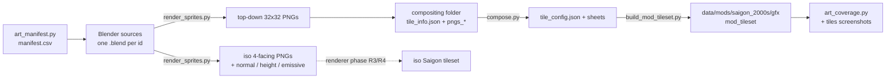

# Saigon art pipeline



## Steps
1. **Manifest.** `python3 tools/saigon/art_manifest.py` writes `doc/saigon/art/manifest.csv`. Re-run it after every content change; new ids appear automatically.
2. **Model.** In the art repository, create one `.blend` per id, following `STYLE_GUIDE.md` §1 (1 unit = 1 tile, pivot at the floor centre). Put the asset in a collection named exactly after the game id.
3. **Render.** Run the scripted render:
   ```bash
   blender -b assets/sgn_non_la.blend -P tools/saigon/art/render_sprites.py -- --id sgn_non_la --out art_build
   ```
   It writes `art_build/topdown/<id>.png`, plus `art_build/iso/<id>_f{0..3}.png` with `_normal`, `_height` and `_emissive` passes.
4. **Pack.** `python3 tools/saigon/art/build_sprites.py` packs every PNG under `art/saigon/tiles/` (hand-drawn, any UltimateCataclysm sprite size), `art/saigon/generated/` (code-drawn by `draw_sprites.py` from `art/saigon/drawn/`) and `art/saigon/overmap16/` into one sheet per size plus `data/mods/saigon_2000s/gfx/mod_tileset.json` and `mod_overmap_tileset.json`, with `compatibility` set to `UltimateCataclysm` / `Larwick Overmap` (ids verified). It needs no dependencies: the PNG reader and writer are pure Python (`pngio.py`). The upstream `compose.py` route (`build_mod_tileset.py`, needs `pyvips`) is only kept for a future full Saigon tileset. Hands-on guide: [`UPDATING_SPRITES.md`](UPDATING_SPRITES.md).
5. **Verify.**
   - `python3 tools/saigon/art_coverage.py` lists T1 and T2 ids that have neither a sprite nor a deliberate fallback. CI target: 0 T1 misses.
   - In the SDL3 tiles build: `CATA_DISABLE_SPRITE_SHADERS=1 ./cataclysm-tiles`, start the Saigon scenario, and screenshot the district.
6. **Isometric (later).** When renderer phase R3 lands, the same sources render the iso set. That needs a full iso tileset rather than a mod tileset, because a mod tileset only applies on top of a base tileset with the same projection.

## Tools and dependencies
| Tool | Status here | Needed for |
|---|---|---|
| `tools/saigon/art_manifest.py` | Works | Step 1 |
| `tools/saigon/art_coverage.py` | Works; gives the current baseline | Step 5 |
| `tools/saigon/art/render_sprites.py` | Written, **untested**: Blender is not installed | Step 3 |
| `tools/saigon/art/build_sprites.py` + `pngio.py` | **Works**: packs hand-drawn and code-drawn sprites of every size (71 sprites as of G17) | Step 4 |
| `tools/saigon/art/draw.py` + `draw_sprites.py` | **Works**: code-drawn sprites from `art/saigon/drawn/` | Step 3 (no Blender) |
| `tools/saigon/art/derive_sprites.py` | **Works**: recolour and flatten recipes on original art | Step 3 (no Blender) |
| `tools/saigon/art/validate_tileset.py` | **Works**: index, capacity, compatibility and declaring-sheet geometry checks | Step 5 |
| `tools/saigon/art/render_scene.py` + `tests/saigon_scene_dump_test.cpp` | **Works**: renders a generated Saigon block with the engine's lookup rules | Step 5 |
| `tools/saigon/art/build_mod_tileset.py` | Written, untested; only for a future full tileset (needs `pyvips`) | Full tileset |
| Blender 4.x | Not installed (~300 MB download; needs approval) | Step 3 |
| `pyvips` + libvips | Not needed for the mod tileset | Full tileset only |
| SDL3 tiles build | In progress (S0.3c) | Step 5 screenshots |

## Base tileset
- A mod tileset only draws on top of a base tileset whose id appears in `compatibility`.
- Pass 1 targets `UltimateCataclysm` (32×32 top-down) and `Larwick Overmap`. Both ids are verified from their `tileset.txt` in I-am-Erk/CDDA-Tilesets. `Ultica_iso` is the matching isometric set for R3.
- Sprites must match that tileset's tile size and perspective.
