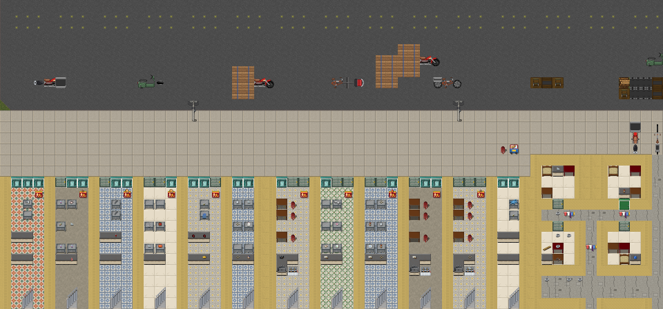

# Saigon sprite revision summary

This lists the graphics that need Saigon art: what is done, what keeps the original art, and what is left.
Status as of 2026-10-04, after units G9–G29, the canal (B8f) and the landmarks (B8h) (see `doc/saigon/PROGRESS.md`). The per-id list is [`sprite_revision_list.csv`](sprite_revision_list.csv), regenerated by `python3 tools/saigon/art/revision_list.py`.

## Tilesets in use

| Role | Tileset | Local folder | Source / download |
|---|---|---|---|
| **Main tiles** (32×32, top-down) | UltimateCataclysm | [`gfx/UltimateCataclysm/`](../../../gfx/UltimateCataclysm/) (installed locally, not in git) | [Release 2026-09-27](https://github.com/I-am-Erk/CDDA-Tilesets/releases/tag/2026-09-27) · [source folder](https://github.com/I-am-Erk/CDDA-Tilesets/tree/master/gfx/UltimateCataclysm) |
| **Map icons** (16×16) | Larwick Overmap | [`gfx/Larwick_Overmap/`](../../../gfx/Larwick_Overmap/) (ships with the game) | [source folder](https://github.com/I-am-Erk/CDDA-Tilesets/tree/master/gfx/Larwick_Overmap) |
| **Saigon layer** (on top of both) | `saigon_2000s` mod tilesets | [`data/mods/saigon_2000s/gfx/`](../../../data/mods/saigon_2000s/gfx/) | Generated by the tools below |
| Future isometric | Ultica_iso | not installed | [source folder](https://github.com/I-am-Erk/CDDA-Tilesets/tree/master/gfx/Ultica_iso) |

## Status

**Keep original** means a deliberate choice, not a gap: the UltimateCataclysm art is universal. Examples are dirt, water, stairs, pavement, fridges, counters, tools, generic clothing, wheels and frames. Vietnam's "Dừng lại" sign is the same red STOP octagon. The decisions live in [`art/saigon/art_triage.json`](../../../art/saigon/art_triage.json).

| Priority | Category | Tile ids | Saigon art: drawn | Saigon art: derived | Keep original | **To do** |
|---|---|---:|---:|---:|---:|---:|
| **T1** on screen everywhere | Terrain (walls, floors, paving, gates, canal, roofs, trees, shrubs) | 67 | 27 | 8 | 32 | 0 |
| **T1** | Furniture (street kit, shrines, jars, businesses, landmarks…) | 40 | 21 | 7 | 12 | 0 |
| **T1** | Items (starting kit, common tools) | 60 | 9 | 2 | 49 | 0 |
| **T1** | Monsters and animals | 17 | 0 | 7 | 10 | 0 |
| **T1** | Vehicle parts | 38 | 7 | 0 | 31 | 0 |
| **T1** | Map icons | 32 | 0 | 32 | 0 | 0 |
| **T1 total** | | **254** | **64** | **56** | **134** | **0** |
| **T2** | Saigon food, drinks, books, gear, kitchen, household, clothing, business loot | 124 | 78 | 13 | 33 | 0 |
| T3 | Deep dda loot | 2352 | 3 | 1 | 2003 | 0 (345 are a base tileset gap, below) |
| Not in the manifest | Worn clothing on the character (20 Saigon garments and gear × male/female) | 40 | 6 | 34 | – | 0 |
| Not in the manifest | Tropical seasons: winter/autumn variants use summer art | 263 | 0 | 263 | – | 0 |

**Base tileset gap:** 345 deep-loot (T3) dda items have no sprite anywhere in UltimateCataclysm, not even along their `looks_like` chain, so the vanilla game shows their ASCII glyph too. G16 found the Saigon-visible ones this way (incense on every altar, the cleaver, a tape measure, rice) and drew them. The rest are listed in the CSV as `base tileset gap`.

### Scene preview (G16)
The render below is a real generated Saigon block, not a mock-up. The hidden test `tests/saigon_scene_dump_test.cpp` runs the game's own mapgen for a road, nhà ống, a hẻm block, a chung cư, a pagoda, a chợ and green space, then parks every Saigon vehicle on the road. `tools/saigon/art/render_scene.py` then draws the result with the installed tilesets and the engine's lookup and connection rules:



Full block: [`scene_preview.png`](scene_preview.png); canal: [`scene_preview_canal.png`](scene_preview_canal.png). To re-run:
```
SAIGON_SCENE_OUT=/tmp/scene.json tests/cata_test --mods=dda,saigon_2000s "[saigon_scene]"
python3 tools/saigon/art/render_scene.py /tmp/scene.json OUT.png --scale 0.5
```
Not modelled: lighting, fields, monsters and floors above ground.

### What is left
No T1 or T2 sprite is left to do. The work after G15 is quality, not coverage. These work today, but a hand-drawn version would read better:
- **Saigon zombies** (xe ôm, vendor, công an, sốt) and the common zombies are recolours of dda zombies, with black hair since G14. Hand-drawn Saigon clothes (short sleeves, dép, conical hats) would read better. Character art is where code drawing is weakest.
- **Motorbikes** are built from generic frame, wheel and saddle parts, with Saigon engine, pillion and tank sprites since G12.
- **Isometric set:** a future renderer phase, out of scope here.

## What was made (G6–G28)
| Route | Sprites | Where |
|---|---:|---|
| Code-drawn | 141 | `art/saigon/drawn/*.py` → `art/saigon/generated/` (15 programs). Covers: food, drinks, books and papers; kitchen, household, medicine, work and trade goods; clothing; the street kit (power poles, loudspeakers, tables, carts, umbrellas, signs); hẻm terrain (gates, paving, breeze blocks, laundry); shophouse interiors (gạch bông, glazed tile, shrines, water jars, TVs, hammocks, plants); the canal (embankment, tin roofs); 8 trees and wild plants; vehicle parts; worn nón lá and quang gánh |
| Derived (recolour, flatten) | 330+ entries | `art/saigon/derive_recipes.json` and `derive_overmap_recipes.json`. Covers: stucco and cream walls, shutters, doors, floors, furniture, zombies (Saigon variants, black hair), street dog and yard chicken, drinks and condensed milk, canal water, 34 worn garments, 26 map icons, 263 tropical seasons |
| Hand-drawn | 0 | `art/saigon/tiles/` holds any PNG you add, and it wins over both routes above |

Previews:
- code-drawn: [`drawn_preview_small.png`](drawn_preview_small.png) (icons), [`drawn_preview_world.png`](drawn_preview_world.png) (terrain and furniture), [`drawn_preview_trees.png`](drawn_preview_trees.png);
- derived: [`derived_preview.png`](derived_preview.png), [`derived_overmap_preview.png`](derived_overmap_preview.png);
- a real generated block: [`scene_preview.png`](scene_preview.png), [`scene_preview_street.png`](scene_preview_street.png), [`scene_preview_canal.png`](scene_preview_canal.png), [`scene_preview_landmarks.png`](scene_preview_landmarks.png), [`scene_preview_flood.png`](scene_preview_flood.png) (the same street in a wet-season flood).

## Format rules

| Rule | Detail |
|---|---|
| File type | PNG, RGBA, transparent background, **not interlaced** |
| Size | Exactly the size in the table, matching the original sprite it replaces |
| File name | The tile id, for example `t_brick_wall.png` or `sgn_non_la.png` |
| Vehicle parts | `vp_<part id>.png`, for example `vp_wheel_motorbike.png` |
| Clothing worn on the character | Two images: `overlay_male_worn_<id>.png` and `overlay_female_worn_<id>.png` |
| Seasonal art | `<id>_season_winter.png` and so on. Saigon uses summer art all year. |
| Connecting terrain (walls, sidewalk, road) | All pieces: `center`, `corner`, `edge`, `t_connection`, `end_piece`, `unconnected` (+ `broken`), described in a sidecar `<id>.json` ([`doc/TILESET.md`](../../TILESET.md)) |
| Rotating furniture (fridge, oven, dresser) | 4 facings |
| Licence | CC-BY-SA 3.0. Record the author and source for every sprite ([`STYLE_GUIDE.md`](STYLE_GUIDE.md) §7) |
| Isometric (later) | 64×32 floor diamond, 4 facings, plus normal, height and emissive maps ([`STYLE_GUIDE.md`](STYLE_GUIDE.md) §1). Not needed now. |

The packer (`tools/saigon/art/build_sprites.py`) accepts every UltimateCataclysm size: 20×20, 32×32, 32×36, 32×48, 32×64, 64×64, 64×96 and 96×96. Map icons are 16×16 under `art/saigon/overmap16/`.

## Detail documents

| Document | What it covers |
|---|---|
| [`SPRITE_PLAN.md`](SPRITE_PLAN.md) | **What to make next:** new usable items, environment, creatures, vehicles, effects, map icons, scheduled as G18–G29 + H1 |
| [`../review/G_art_review.md`](../review/G_art_review.md) | Peer review of the graphics track (G17) and its fixes |
| [`sprite_revision_list.csv`](sprite_revision_list.csv) | **Every id** from the table above, with tier, category, size, image count, status and current fallback |
| [`../../../art/saigon/README.md`](../../../art/saigon/README.md) | The three art routes (hand-drawn, code-drawn, derived) and their folders |
| [`UPDATING_SPRITES.md`](UPDATING_SPRITES.md) | How the game picks sprites, and a step-by-step guide to adding or replacing one |
| [`STYLE_GUIDE.md`](STYLE_GUIDE.md) | Saigon look: palette, period rules, readability, projections, licence |
| [`PIPELINE.md`](PIPELINE.md) | The full art pipeline: manifest, models, render, pack, verify |
| [`manifest.csv`](manifest.csv) | Every sprite a Saigon world can show (generated) |
| [`../../../art/saigon/SOURCES_DERIVED.md`](../../../art/saigon/SOURCES_DERIVED.md) | Attribution for every derived sprite |
| [`../TDD.md`](../TDD.md) §10 | The architecture decision for graphics, and its risks |

## Commands (run from the repo root)

| Task | Command |
|---|---|
| Regenerate the per-id status list | `python3 tools/saigon/art/revision_list.py` |
| Render a generated Saigon block | see *Scene preview* above |
| Run the code-drawn sprite programs | `python3 tools/saigon/art/draw_sprites.py` |
| Compare original and Saigon sprites | `python3 tools/saigon/art/contact_sheet.py OUT.png <id> ...` |
| Pack hand-drawn and code-drawn PNGs | `python3 tools/saigon/art/build_sprites.py` |
| Re-run the recolour recipes | `python3 tools/saigon/art/derive_sprites.py` |
| Check the packed tilesets | `python3 tools/saigon/art/validate_tileset.py` |
| Regenerate the full list and manifest | `python3 tools/saigon/art_manifest.py` |
| Play (graphics, Saigon preselected) | `./play_saigon.sh`, then create a **new world** |
